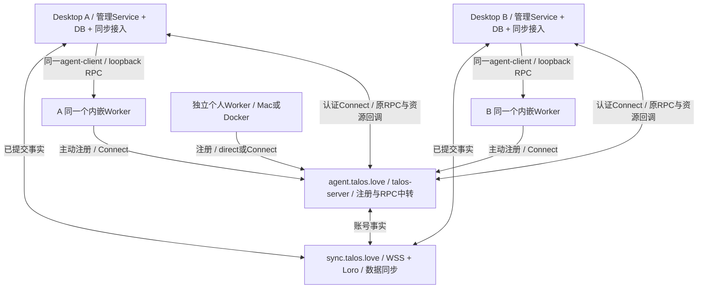

# Talos 多端同步接入

Status: Implemented. Talos owns product integration; the [independent Sync contract](https://github.com/apilots/talos-sync/blob/8e60e2b612ba895c8f4bcb4e0d78c9ae86227502/spec/feat-001-talos-sync/design.md) owns the service protocol. Current acceptance evidence belongs in the integration PR and ignored output reports.

Management hosts keep independent product databases. Sync replicates account-owned Project, Session, complete Timeline and required execution metadata. Talos Server owns the Computer directory and registration state; clients refresh that directory independently of Sync. Sessions retain their original Computer/Worker/Workspace binding. An authorized manager may coordinate the next idle Turn on the same Worker; a running Turn has one coordinator. Replication never migrates Workers or starts execution.

| Owner | 职责 |
| --- | --- |
| 当前协调者原Service/Store | 授权、Turn准入、结果/Timeline落库、发布实时进展。结果先本端commit，再异步共享。 |
| Worker / Harness | 模型/工具、所有Workspace文件/配置、最终排他及最小历史游标恢复标记。没有产品Session DB。 |
| agent-client / 中心G | 屏蔽loopback/direct/Connect；注册/租约只在G；RPC与资源返回当前协调者，不代执行、不代写其Session。 |
| Talos同步集成lib/Store adapter | 从本地事实补采到现有 outbox。将同步信封解码为 Talos 原生类型后分批导入原 Store，维护 event-map、水位和共享确认。 |
| 独立Sync SDK/types/server | 唯一WSS+Loro同步协议、账号隔离、持久Ack/增量恢复；不处理执行RPC。 |
| 原SDK/UI | 原Computer/Project/Session/API；独立Computer管理组件、相对当前宿主的本机标识、真实在线状态。 |

## 两级同步开关

- 部署`sync.enabled=false`完全禁止当前管理服务的所有账号连接Sync，优先级最高；页面enable不能覆盖。未配置或true仍须真实登录账号。
- 部署允许时，页面开关只控制当前管理宿主、当前登录账号；写本端`sync_account_preferences`，不改YAML、不传播到其他端。首次H失败而无binding时也能关闭。
- 登录/status/重启均读取该选择；账号关闭后H恢复不自动开启。已有binding继续记录outbox；显式enable恢复原增量流程。
- 关闭同步保留本机执行、Worker云注册/G RPC和源FileService。匿名本地工作不要求G/H在线；认领匿名历史使用现有显式授权流程。

## 持久化与可执行边界

Capture starts at a durable cut of committed Store facts. Inbound history is
staged across bounded transactions that release the local writer between
batches. Publication commits the document checkpoint, Store facts and event
map together. The runner saves the account feed cursor after applying its
contiguous prefix of documents.

The [Talos Sync parser library](../../talos-rs/crates/orchestration/sync-parser/src/lib.rs)
owns typed business payloads, outbound field selection and inbound decoding.
The wire API carries opaque metadata fields and record bodies. When required
data cannot be decoded, the business Store keeps its committed projection
and feed cursor. The SDK validates a full snapshot before it reaches the same
materialization path used for incremental updates.

The protocol v2 cutover pairs the Talos parser with published
`talos-sync-types` and `talos-sync-sdk` 0.1.8. The lockfile consumes these published registry packages without local source patches.

导入不计费、不重发工具或反思。稳定事件键与原 reducer 重建展示，原活动锁、claim 和内存 queue 留在执行端。跨端 Input、Interrupt 和 queue 仅路由当前执行协调者。

Worker核对`SessionHistoryCursor`并排他准入：history_generation、completed_turn_id、completed_event_sequence（最后完成Turn内事件offset）。同一协调者连续执行不依赖H；其他协调者必须拥有完整已共享事实。未知清理或旧历史不能伪装idle；clear/delete与恢复使用原Gate/Commit路径。

Workspace正文在Worker；旧附件只经源FileService读取/改删，源离线明确不可用。模型/Web Search由该Computer owner配置，其他用户不能访问其私有Worker。纯Worker不连接H、不创建管理DB。

## 详细契约与验收

[接入接口](contracts.md)、[管理DB与流程](flows-and-storage.md)、[统一Worker RPC](worker-coordination.md)、[跨控制面/NAT/回调](rpc-routing.md)、[持久数据覆盖](persistence-inventory.md)。

真实联合验收由Talos的19_computer_sync八个场景负责：多节点/OS注册、同Computer续跑、首次关闭/重启/账号隔离、无云本机、资源交互、云故障、NAT及owner配置。独立Sync测试只证明协议/存储，不冒充产品E2E。实际范围为arm64 Mac与Linux Docker；不发布生产。

## Local authorization and remote revalidation

The existing CloudAuthService owns verified in-memory authorization contexts and
one refresh task per credential, using its existing pooled Cloud SDK client.
AuthService.local_identity is synchronous, side-effect free, and has no network
fallback. Desktop ordinary methods, HTTP data APIs and the Sync SDK credential
callback consume this capability. Desktop retains the verified subscription owner
per credential/backend and shares in-flight account restoration; session changes
reuse it, while backend replacement explicitly restores Auth before replay.
Account restoration (`user/current`, HTTP
`/v1/user`), successful device login and cached-login startup explicitly admit the
credential. Unknown credentials fail immediately. Account ownership checks still
belong to the business Service.

Device login keeps the one-time Cloud approval in the existing login owner until
account admission and optional local-cache persistence succeed. Concurrent status
requests serialize per login; retryable admission failures return Pending with
the original polling interval without consuming another Cloud grant. No token is
delivered or persisted before verification. Cancelled/expired logins and failed
commits invalidate any admitted but undelivered token, preventing an orphan Auth
refresh task. This uses the same AuthService and adds no background task.

Auth refresh runs at a fixed 60-second interval, with a 5-second remote timeout. A verified context lasts at most 120 seconds and never
past token expiry. Known rejection invalidates it immediately; transient errors
never extend its deadline. Failed refresh retries at a fixed 15-second interval;
No retry burst or query-triggered remote fallback is introduced. Logout/cache removal invalidates the current generation
before remote completion. Shutdown cancels and joins all Auth tasks through its
owned tracker; last-owner drop cancels maintenance.
Persisted cloud-session JSON remains only a login candidate and cannot authorize
local requests. This repair does not introduce a durable 15-day offline grant.

Transport keepalive/reconnect remain owned by the SDK and registered Worker.
Sync lifecycle reconciliation consumes existing handles and Auth contexts, rather
than running another auth timer or introspection inside a credential callback.
Initialization rejected by authentication/permissions, uncertain enrollment,
expired credentials or invalid configuration waits for credential/account changes
or successful explicit Worker recovery. Temporary service, timeout and rate
failures retry initialization every five seconds. The supervisor never repeats
healthy transport checks or replaces SDK reconnect ownership.
Cloud Auth classifies a remote HTTP500 as temporary service unavailability,
like502--504, so first admission can recover with the same credential even before
an Auth refresh task exists. Other internal errors remain terminal; the host does
not inspect Cloud response text or manage a separate authentication retry loop.
The Sync server's independent shared-authorization fix is owned by talos-sync;
updating the product alone cannot change a previously released service image.
Full selected-session History and running-Turn Live remain the existing local
Store/subscription model. Deletion retains known-active and bounded unconfirmed
remote-execution guards.

Local display reads also remain independent of Sync's database writer. Shared
Session metadata, History cursors, active-Turn display and account associations
use consistent deferred WAL read snapshots through the existing Storage owner;
they never acquire its write gate or begin an immediate write transaction.
Single-query Sync preferences use the existing pooled read. Write/capture/import
transactions retain their original serialization and atomicity. A read snapshot
cannot be upgraded through the transaction write API, and SQLx owns rollback on
drop/cancellation. This does not change History loading or Sync ownership.

## Shared parsing and recovery ownership

The independent Sync service owns the generic wire protocol. Talos uses one
`talos-sync-parser` library above the SDK. Its `header`, `metadata`, `records`
and `codec` modules are shared by capture and import: identity/relationship
headers, merge boundaries, stable Turn/event keys and typed error serialization
must not be reimplemented in business callers. Original event occurrence and
persistence timestamps remain native values; rebinding never restamps them.
The integration's shared checkpoint Store module owns snapshot/version reads,
durable ACK persistence and retained-scope copying.

### A surviving replica restoring a new Hub

A verified account may replace its old Hub association with a fresh scope.
First materialize pending old-scope outbox operations locally. At one guarded
write cut, retain the complete canonical replicas, original event mappings and
captured source positions; enqueue a full-baseline marker per document and
reset Hub ACK/cursor state. Activate the new binding only after that state is
durable. The original Loro operations, Node associations, Turn coordinators,
notice publishers, timestamps, generations and tombstones stay unchanged.
An original replica can subsequently return and merge its original checkpoint
and later deltas. Native Store scans skip retained replicas, avoiding a
reconstruction that would incorrectly identify B as A's historical source.

Snapshot chunks may be referenced by the archived old scope and the new active
scope. Retirement checks all checkpoint references before reclaiming chunks.
Published capture batches scope copied mappings, reusing their existing atomic
visibility and local-event identity constraints. The old pending queue is atomically replaced by baseline markers after its
operations are materialized; the new baseline requires its own durable Hub ACK.
The old canonical checkpoints remain available for the archived scope. Missing dependencies and incomplete
checkpoints do not become complete by changing a Hub identity.

### Server-owned Computer directory

Talos Server is authoritative for Computer registration, identity, name,
endpoint, enabled state, managed lifecycle phase, system information and live
availability. Desktop and TUI periodically fetch the signed-in account's full
paged directory through the existing Node SDK, even with Sync disabled or an
empty/unavailable Hub. Administrative clients also request owner-only pages.
The central Server reads its own registry. A trusted local embedded Worker
retains its actual local availability.

One account-owned task refreshes every five seconds. Pages contain at most 100
entries, each RPC has a five-second deadline, and a host-wide semaphore permits
four concurrent directory RPCs. All pages must validate before publication;
duplicate identities, foreign owners and repeated cursors fail the pull. The
existing local Store publishes the complete cache in one transaction: upsert
confirmed entries and remove absent cache-only rows before SQL filtering,
pagination or counting. Credentials, leases and managed Worker records are not
copied or pruned. Fresh Server results supersede legacy Sync-only deletion
markers for the same owner.

List/detail remain local reads and never await a directory or Sync request.
Failed pulls preserve the last complete directory; status older than fifteen
seconds becomes unavailable/unknown. Confirmed create/update/rename/status/delete
operations write through the same cache owner immediately. Confirmations,
including deletions, override older in-flight pulls. A Server-authorized connection
may seed first-access metadata through the same publication owner; a delayed
handshake cannot replace newer observations or resurrect removed entries.
Create/update/rename/status responses carry their local request-start instant through
that same publication owner. If a newer observation or complete-directory absence
was published during the request, local timestamps cannot order the remote commits.
Re-read the current NodeInfo from Server under the publication lock, with a
five-second deadline including connection setup, then validate and persist that
result. A confirmed `ResourceNotFound` records deletion and returns `ResourceExpired`.
An older directory snapshot cannot suppress a later successful create or rename;
a create retains its original one-time credential. Normal uncontended mutations
need no additional RPC. This conflict path can delay other cache publications for
up to five seconds; list/detail remain local reads and do not take this lock.
Publication time governs absence checks even when the paged pull started before
the management request. The Store and caller must never receive the superseded
response as current directory state.
The durable cache survives restart without network access. Its last-known identities
remain selectable for local history reads, but a restart has no fresh remote
availability observations. Remote execution still requires a reachable Talos Server;
cached metadata does not provide an offline command transport or queue.
Account cancellation clears
transient state; another account cannot consume its observations.

Fresh Sync capture does not scan or capture Computers. Retained Computer
checkpoints can still be converted and relayed to preserve historical causality,
but their imports and tombstones cannot change the directory or retire a
registration. Session/Project import has no Computer-document dependency;
original Node IDs remain native history bindings. Actual command/file access
still passes existing Server/Worker authorization and reachability checks.

Hub recovery and directory maintenance have independent account-owned tasks.
Slow discovery or snapshot conversion must not delay directory refresh. An
authenticated replacement Hub is rediscovered after an identity conflict; the
old retained state moves before the replacement runner starts. Migration/install
failures retry automatically. Same-scope reuse requires a running handle.

### Released replica upgrade

Published SDK 0.1.7 replicas use document schema v1; generic SDK 0.1.8 uses v2.
The existing `talos-upgrade` startup framework runs one versioned task across
all local retained account scopes, including dormant accounts and disabled Sync,
before assembling Services or transports. It needs no login, token or network.
The Talos Parser performs the one-time persisted conversion. It imports the official Loro JSON
operation history, maps Talos containers/fields to generic headers and records,
and preserves operation IDs, dependencies, counters, Lamport clocks, source IDs,
native timestamps, generations and tombstones. An independent generic Header operation uses a deterministic reserved writer
derived from Hub/account/resource identity. Its empty dependency set, counter,
Lamport clock and timestamp match the Hub conversion even when offline local
facts differ. A reserved-writer collision fails explicitly. Re-encoding native values as new historical operations would
lose causality and is prohibited. The production dependency remains SDK 0.1.8;
the released SDK is used only to regenerate committed test fixtures.

Conversion builds and stages snapshots outside the publication writer. A bounded
compare-and-swap checks the original document and ACK version using official
VersionVector semantics, then persists the checkpoint, projection and schema
marker atomically. Existing non-null materialization proofs are conservatively
promoted to the complete converted checkpoint; null proofs remain unmaterialized.
This prevents reset/delete or old metadata replay while preserving a pending
native tail. Raw v1 outbox payloads use the shared Parser encoder. An unchanged Hub keeps the original truthful ACK cut; an empty upload marker
ensures the new Header is acknowledged even if no user edits are pending. The
old download cursor is cleared for catalog recovery. A replacement Hub still
gets fresh ACK/feed state and a complete baseline; conversion is not a Hub ACK.
Malformed or racing retained data fails without retiring the old binding.

Sync settings serialize with current account initialization without aborting
in-flight Worker enrollment. Explicit logout retains its cancellation boundary.
Tests wait for published background identity and binding state; status queries
do not perform registration or turn a pending initialization into a false identity.

### Shared startup-upgrade deployment profile

The independent Hub upgrades its own database before opening its listener; it
retains the Hub identity and historical documents. SQL alone cannot rewrite the
Loro envelope. Its isolated historical-protocol adapter preserves the opaque
record body and original operations. Talos owns the declarative Header rules in
`conf/sync-v1-upgrade-mapping.json`, generated by
`just gen-sync-upgrade-mapping` from the Parser's normal Header field selection.
The Hub reads that application profile through `upgrade.v1_mapping_file`; its
Kernel has no Talos DTOs or business field paths. Supply the profile only for an
initialized v1 Hub upgrade. Fresh and current-schema Hub databases need none.

Local upgrade is registered as `202611220001_sync_replicas_v2` in the existing
product ledger. Each checkpoint/schema/projection and proof update commits
atomically; interruption retries unfinished documents. Success is verified
against persisted schema markers even if an unrelated completed ledger was
restored. Login only opens upgraded state. Archived checkpoints are converted
without creating fake account bindings or credentials. Opaque historical record
JSON is preserved without adding current DTO defaults; Parser decoding still
validates the native object and the protocol identity envelope.
