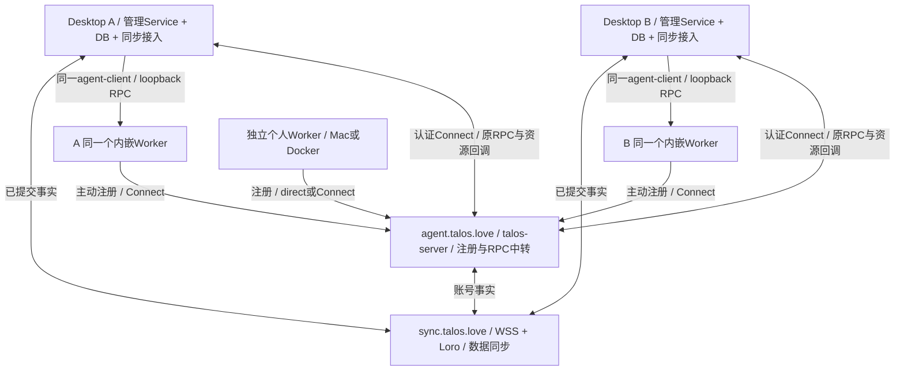

# Talos 多端同步接入

Status: Implemented；本轮账号选择修复、SDK registry接入及统一8/8验收通过，见[验收结论](verification.md)。独立服务方案在[talos-sync](https://github.com/apilots/talos-sync/blob/7230f9fdf294e7ae218bdb6d3cf1c4ef60203380/spec/feat-044-talos-sync/design.md)，本文件仅维护Talos产品责任。

同一账号在多个Desktop app-server/talos-server管理宿主拥有独立业务DB，双向同步Computer、Project、Session、完整Timeline及必要执行metadata。Session永久绑定一个Computer/Worker/Workspace，空闲可由任意授权管理端协调同Worker的下一Turn；执行中的Turn只有当前协调者。同步不迁移Worker、不触发执行。

| Owner | 职责 |
| --- | --- |
| 当前协调者原Service/Store | 授权、Turn准入、结果/Timeline落库、发布实时进展。结果先本端commit，再异步共享。 |
| Worker / Harness | 模型/工具、所有Workspace文件/配置、最终排他及最小历史游标恢复标记。没有产品Session DB。 |
| agent-client / 中心G | 屏蔽loopback/direct/Connect；注册/租约只在G；RPC与资源返回当前协调者，不代执行、不代写其Session。 |
| Talos同步集成lib/Store adapter | 原事务capture/outbox、导入原Store、event-map/稳定水位及共享确认；不调用Agent或复制活动锁。 |
| 独立Sync SDK/types/server | 唯一WSS+Loro同步协议、账号隔离、持久Ack/增量恢复；不处理执行RPC。 |
| 原SDK/UI | 原Computer/Project/Session/API；独立Computer管理组件、相对当前宿主的本机标识、真实在线状态。 |

## 两级同步开关

- 部署`sync.enabled=false`完全禁止当前管理服务的所有账号连接Sync，优先级最高；页面enable不能覆盖。未配置或true仍须真实登录账号。
- 部署允许时，页面开关只控制当前管理宿主、当前登录账号；写本端`sync_account_preferences`，不改YAML、不传播到其他端。首次H失败而无binding时也能关闭。
- 登录/status/重启均读取该选择；账号关闭后H恢复不自动开启。已有binding继续记录outbox；显式enable恢复原增量流程。
- 关闭同步保留本机执行、Worker云注册/G RPC和源FileService。匿名本地工作不要求G/H在线；认领匿名历史使用现有显式授权流程。

## 持久化与可执行边界

原Store事务与outbox共提交；文档、事实、event-map和下载cursor同事务导入；导入不计费、不重发工具或反思。稳定事件键与原reducer重建展示，原活动锁/claim/内存queue不复制。跨端Input/Interrupt/queue仅路由当前执行协调者。

Worker核对`SessionHistoryCursor`并排他准入：history_generation、completed_turn_id、completed_event_sequence（最后完成Turn内事件offset）。同一协调者连续执行不依赖H；其他协调者必须拥有完整已共享事实。未知清理或旧历史不能伪装idle；clear/delete与恢复使用原Gate/Commit路径。

Workspace正文在Worker；旧附件只经源FileService读取/改删，源离线明确不可用。模型/Web Search由该Computer owner配置，其他用户不能访问其私有Worker。纯Worker不连接H、不创建管理DB。

## 详细契约与验收

[接入接口](contracts.md)、[管理DB与流程](flows-and-storage.md)、[统一Worker RPC](worker-coordination.md)、[跨控制面/NAT/回调](rpc-routing.md)、[持久数据覆盖](persistence-inventory.md)。

真实联合验收由Talos的19_computer_sync八个场景负责：多节点/OS注册、同Computer续跑、首次关闭/重启/账号隔离、无云本机、资源交互、云故障、NAT及owner配置。独立Sync测试只证明协议/存储，不冒充产品E2E。实际范围为arm64 Mac与Linux Docker；不发布生产。

## Local authorization and remote revalidation

The existing CloudAuthService owns verified in-memory authorization contexts and
one refresh task per credential, using its existing pooled Cloud SDK client.
AuthService.local_identity is synchronous, side-effect free, and has no network
fallback. Desktop ordinary methods, HTTP data APIs and the Sync SDK credential
callback consume this capability. Desktop retains the verified subscription owner
per credential/backend and shares in-flight account restoration; session changes
reuse it, while backend replacement explicitly restores Auth before replay.
Account restoration (`user/current`, HTTP
`/v1/user`), successful device login and cached-login startup explicitly admit the
credential. Unknown credentials fail immediately. Account ownership checks still
belong to the business Service.

Device login keeps the one-time Cloud approval in the existing login owner until
account admission and optional local-cache persistence succeed. Concurrent status
requests serialize per login; retryable admission failures return Pending with
the original polling interval without consuming another Cloud grant. No token is
delivered or persisted before verification. Cancelled/expired logins and failed
commits invalidate any admitted but undelivered token, preventing an orphan Auth
refresh task. This uses the same AuthService and adds no background task.

Auth refresh runs every 60 seconds with stable +/-10% credential jitter, with a
5-second remote timeout. A verified context lasts at most 120 seconds and never
past token expiry. Known rejection invalidates it immediately; transient errors
never extend its deadline. Failed refresh retries within 15 seconds, capped to
leave the remaining verification window's request budget; no retry burst or
query-triggered remote fallback is introduced. Logout/cache removal invalidates the current generation
before remote completion. Shutdown cancels and joins all Auth tasks through its
owned tracker; last-owner drop cancels maintenance.
Persisted cloud-session JSON remains only a login candidate and cannot authorize
local requests. This repair does not introduce a durable 15-day offline grant.

Transport keepalive/reconnect remain owned by the SDK and registered Worker.
Sync lifecycle reconciliation consumes existing handles and Auth contexts, rather
than running another auth timer or introspection inside a credential callback.
Initialization rejected by authentication/permissions, uncertain enrollment,
expired credentials or invalid configuration waits for credential/account changes
or successful explicit Worker recovery. Temporary service, timeout and rate
failures retry initialization every five seconds. The supervisor never repeats
healthy transport checks or replaces SDK reconnect ownership.
The Sync server's independent shared-authorization fix is owned by talos-sync;
updating the product alone cannot change a previously released service image.
Full selected-session History and running-Turn Live remain the existing local
Store/subscription model. Deletion retains known-active and bounded unconfirmed
remote-execution guards.
