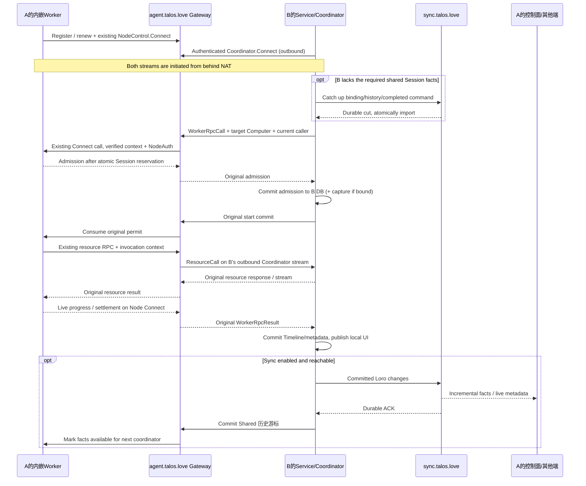

# RPC中转、NAT与当前协调者回调

Status: Implemented（阶段1–3）— 2026-10-12。统一载体、共享事实/历史游标/原业务导入已接线；Docker全拓扑/故障仍在阶段5验收。
[协议/Worker契约](worker-coordination.md)、[同步流程](https://github.com/apilots/talos-sync/blob/7230f9fdf294e7ae218bdb6d3cf1c4ef60203380/spec/feat-044-talos-sync/flows-and-storage.md)、[阶段1](plans/01-worker-rpc.md)。

## 1. 两个公网服务各司其职

| 入口 | 职责 / 不负责 |
| --- | --- |
| agent.talos.love | 复用Node注册/租约/主动Connect，接入控制面调用者，转发标准Worker RPC、结果与当前调用者资源回调。只保存既有Node metadata；不为代执行Turn做业务准入/落库。 |
| sync.talos.love | 管理节点已提交Computer/Project/Session/Timeline metadata的持久全量/增量同步。无Worker调用接口、任务pull API、RPC中转或命令队列。 |

两条连接独立认证、重连和报错；sync连接状态不是Worker路由可达性，RPC连接状态不是数据已同步证明。
当前执行链不等待sync持久ACK才向当前控制面反馈；ACK只影响最新事实能否安全交给另一协调者。

| 目标 | agent-client的执行路径 | 回调路径 |
| --- | --- | --- |
| 本机内嵌Worker | 本机Coordinator -> loopback AgentHarnessRpc/WorkerEnvironmentRpc | Worker -> 本机管理端资源RPC -> 当前Service/Store；不经过公网。 |
| 公网可达且已授权Worker | 当前Coordinator -> 目标Worker标准gRPC | 直达已验证当前资源端，或Worker -> agent Gateway -> 当前协调者主动连接。 |
| NAT后的个人电脑Worker | 当前Coordinator -> agent Gateway -> Worker主动Connect | 结果沿同一Connect反向返回；资源RPC经Gateway再转到当前协调者。 |

公网可达不等于免鉴权；direct只在原RPC授权、endpoint及当前调用者回调条件满足时使用，否则选择已授权Connect路径。
不为优化直连新建凭据交换/授权表/打洞系统；所有传输仍由agent-client/node client隐藏，业务只用AgentHarness。

## 2. A、B都在NAT后的完整链

A是目标Computer宿主，B是本次Turn协调者，G是agent.talos.love，H是sync.talos.love。
A的Worker listener只绑定loopback；A/B管理API都无需公网监听。

A的SessionService不参与B的准入；G自身的Coordinator也不替B执行。A只承载同一个Worker，B持有本次实际执行流。
G对结果只做认证、路由、流控和有界等待；B提交事实后才发布本端Timeline、异步同步给其他端。
另一控制面成为下一空闲Turn协调者时重新绑定调用上下文；Session Computer/Workspace及Worker进程不变。
纯Worker容器/Pod沿同一Node Connect链，完全不运行H客户端或Session DB。

## 3. 资源请求必须回当前调用者

复用现有AgentSessionDataClient到G的gRPC连接；改变的是每次invocation的可选caller PB对象与G的dispatch，不是另造资源业务协议。
资源请求NodeAuth由G验证；G核对当前调用者所属账号、Computer与已验证invocation路由，再通过B已认证主动连接交给B资源handler。
B仍核对本端真实invocation与原业务权限；不能接受随意自报coordinatorId或以导入NodeInfo代替凭据校验。
没有当前调用者路由、权限失败或B不可达就返回原错误，禁止回退到G或A的Store、用空history继续运行。
当G本身就是本次实际协调者时，按同一caller规则进入G原handler；它不是其他调用者失败后的兜底owner。

| 现有RPC/端口 | 本次执行的处理owner |
| --- | --- |
| ReadSessionHistory | B原History reader，读取B已提交/补齐的Session事实。 |
| ResolveAttachments | B原AttachmentReader/FileService；旧外置正文按原File位置及权限读取。 |
| Read/AdvanceMemoryProgress | B原progress Store；共享水位转换仍归同步adapter。 |
| SaveToolImage | B原ToolImageStore/FileService，结果fileId和metadata随后正常同步。 |
| Spawn/Send/Wait/Interrupt/FollowUp/ListSubagent | B原AgentControl/Coordinator，保持原树与权限。 |
| Dream模型请求/回应 | 原FormDreamMemory双向流经G回B，保留原模型/usage处理。 |

Node Connect继续承载现有WorkerRpcCall/Result；资源到G使用已有资源RPC，G到B的反向资源分支引用原PB对象。
Dream已在Worker RPC双向流内，不再增加重复resource方法。所有回调句柄按invocation绑定，不全局替换一个资源client endpoint。
G的临时关联使用账号、Computer、Gateway生成的connection UUID、调用者callId及原Session/Turn/project scope；Worker载体内部继续分配自己的callId。两套网络ID只在现有SDK关联，无DB请求账本。
CoordinatorCallContext附带原调用者callId；B SDK校验对应调用仍活跃且scope完全一致后才进入B原handler。连接结束撤销精确路由，旧frame不能送入新连接，断连不持久重放RPC。

旧外置附件使用独立于active invocation的既有FileService产品请求：B的FileService按storagePeerId经G认证管理连接请求源peer A的FileService。载体复用原FileReadRequest/FileContent有界字节流、FileUpdateRequest、FileDeleteRequest及原响应/ApiError，不暴露objectKey或任意磁盘路径。G核对双方当前登录账号、sourcePeer和请求关联；A按原actor/file scope授权，只有源FileService访问本端OpenDAL。可达公网源也由SDK隐藏传输，业务不绕过FileService。
读取采用原每文件/每Turn限额、取消、超时与背压；源不在线明确不可用，不回退B同名fileId。tags/metadata修改与正文删除在A原事务/lifecycle内完成，并capture原metadata/tombstone；B只物化远端位置和事实，不在import时删本地文件。阶段1接源端管理载体，阶段3接storagePeer位置选择，阶段5验证双NAT源在线/离线和源侧删除。

## 4. 单机独立与故障边界

| 条件 | 行为 |
| --- | --- |
| 从未登录云账号、未配置/启动sync | 现有本地身份/Service/Store+loopback Worker独立启动；create/Turn/input/cancel/Workspace/重启历史按原本地功能可用，不等待G/H注册或网络ready。 |
| H停止、G仍在线 | 当前协调者继续自己的本机或远端Worker任务并落库；已绑定变更积存在outbox。跨协调者只在已完整缓存的Shared 历史游标匹配Worker时可准入；缺事实明确等待补齐。 |
| G停止、H仍在线 | 可读同步历史；NAT远端执行不可达。仍可本机工作，不能借H传命令、改派Computer或改成pull队列。 |
| G/H均停止或不可达 | 本机执行与历史/目录不受Talos云服务依赖；已有本地恢复路径不要求获取云租约或sync快照。模型本身仍按原配置接入。 |
| 云Node租约撤销/Connect断连 | 撤销远程入口并按原契约清理该远程调用；不撤销本机凭据、不取消无关loopback任务、不关闭整个内嵌Worker。 |
| 当前B断连/退出 | 沿原执行流取消/确认清理；不把结果转写A或G的业务DB，不接管运行Turn；未知结果以原事实恢复。 |

Local 历史游标表示“当前协调者已持久化”，不表示物理本机；同一协调者连续执行不必每Turn在线访问H。
新协调者必须拥有Worker 历史游标对应的完整事实；已缓存满足时不用重复catch_up，缺失时才向H补齐。
本地启动/准入不读sync catalog、不等待云登录/renew；未绑定数据只在原业务DB，后续认领再backfill。
启停sync仅控制数据共享；本机RPC凭据、生命周期与远程Node lease分开，不能由一个云lease observer撤销全部准入。

## 5. 当前实现与待接入部分

已有[Worker主动Connect](../../talos-rs/crates/orchestration/agent-client/src/worker_connection.rs:38)、
[Gateway接入](../../talos-rs/crates/app/talos-base/src/agent_node_connect.rs:13)和[原资源client](../../talos-rs/crates/orchestration/agent-client/src/resources.rs:31)。
阶段1已实现单Worker/listener、本机私有NodeAuth与云租约隔离、认证Coordinator Connect、原Worker call/result双跳中转及当前invocation的反向资源载体。Worker资源端点仍可连接注册Gateway，但业务请求按caller返回B，不从G/A取替代数据。原Dream双向流完整保留。
源FileService读/改/删使用同管理连接上的闭合PB方法，独立于活跃Turn；真实受控TLS测试覆盖原FileService/SQLite/OpenDAL、跨账号拒绝、可选metadata/tag保真和源端离线错误。
跨控制面SDK、宿主发现/组装、storagePeer物化、完整Session事实/历史游标、执行中产品交互及共享续跑已按阶段3接线。产品自动登录、同步开关和UI按阶段4接入；当前验证范围见[阶段3证据](verification.md)，未将原生切片记为完整产品发布验收。
本机/注册端direct原业务链保留；跨控制面调用只有在验证当前回调路由成立时才允许direct，否则使用已实现Coordinator Connect，不通过固定注册端history兜底。
阶段1验证独立RPC/NAT载体；阶段3再验证共享Session与换协调者，阶段5做真实端口阻断/故障/E2E验收。实际结果见[验证证据](verification.md)。
