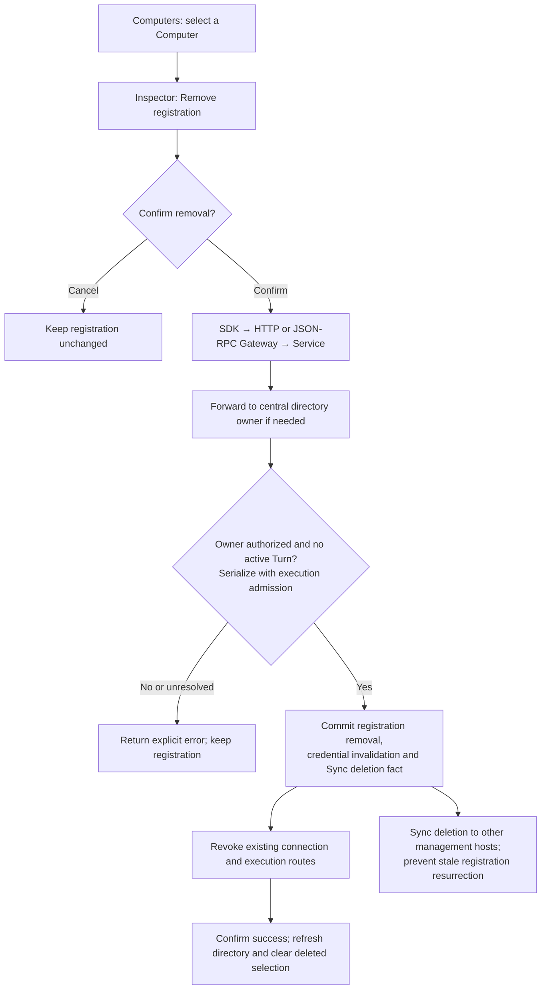

# Computer registration deletion

Status: implemented — ready for product review; multi-manager deployment acceptance remains a separate local procedure.

## Background and current behavior

[Issue #41](https://github.com/apilots/talos/issues/41): Computer inspection supports rename and remote-access status changes, but no registration deletion. Management replicas already forward mutations to the central directory owner. Sync already captures deletion facts; historical Project/Session imports currently require their Computer dependency.

## Goal and proposed flow

Owners can remove obsolete registrations, including offline Computers, while keeping the existing Connect entry point and temporary disable/enable behavior.

## Accepted decisions

- Page: place Disable/Enable and Remove registration side by side at the bottom of the existing inspector; confirmation explains credential revocation and data retention. Buttons, confirmation, pending and typed failure messages support English and Chinese.
- Ownership: Service owns policy and lifecycle; Gateways adapt transports. Extend the existing central management path, without a second registry.
- API: SDK `computers.delete({ nodeId })`, HTTP `DELETE /v1/computers/:node_id`, JSON-RPC `computer/delete`; keep Rust/embedded SDK parity.
- Active Turn: reject deletion, including waiting Turns; never interrupt implicitly. Offline status alone does not prove that execution is settled.
- History: retain Projects, Sessions, attachments and immutable Computer references. A deleted identity must satisfy historical Sync dependencies without becoming an executable registration.
- Current selection: clear it after success and require explicit reselection.
- Current Desktop: remove remote enrollment while preserving local runtime and files. Separate local identity from revoked registration aliases.
- Re-enrollment: require an explicit Connect action and issue a new identity/credential; preserve historical bindings.
- Success: authoritative removal and access revocation must be established before reporting success. Other hosts converge through durable Sync; do not claim that all hosts have already received the change.

## Non-goals and impacted areas

No uninstall, Workspace deletion, cascading history deletion, release or deployment. Affects the Computers inspector/selection state, SDKs and transports, Computer Service/Store, registration lifecycle and historical Sync dependency handling.

## API and lifecycle contract

`DeleteComputerRequest` and `DeleteComputerResponse` both contain `nodeId`.
HTTP `DELETE /v1/computers/:node_id` and App Server `computer/delete` adapt the
same Gateway method; Rust and embedded Rust expose `delete_computer`, while
TypeScript exposes `computers.delete`.
App Server protocol version is 0.5. Management replicas forward deletion through
the existing authenticated central Computer management connection.

The authenticated owner can delete a remote registration. Another user, including
an administrator, receives `resourceNotFound`; embedded identities are excluded.
An owner can retry an already removed UUID successfully. Active, reserved or
waiting Turns return `activeTurnRunning`. A live registration whose idle admission
cannot be verified fails explicitly. An expired unreachable publication may be
removed only after durable local execution checks pass.

Service serializes deletion with registration/renewal. A live Worker's existing
global admission gate first blocks remote admission while retaining host-local
authorization and rollback/acknowledgement control traffic. Store commits removal
and an owned tombstone in one captured transaction, excluding concurrent durable
admission. On commit failure Service restores admission; after commit it revokes
the publication and routes. Cancellation of the requesting transport does not
abort the admitted deletion operation.

Tombstones contain no executable credentials. They reject stale inserts and Sync
metadata resurrection, export as deletion facts even if Sync is enabled later,
and satisfy historical Computer dependencies on a new management host. Retained
Projects, Sessions, attachments and files are not cascaded. Computer inspection
reads directory metadata without attempting execution, including when offline.
Project and Session list filters also resolve only metadata aliases. Reading a
retained Project whose Worker registration is gone returns its original binding
with `nodeUnavailable` status. Execution/configuration paths retain their normal
authoritative connection and authorization checks.

Desktop persists removed enrollment independently of local Worker state. Login,
restart and automatic retry cannot recreate the old UUID. A successful own-Desktop
SDK deletion persists removal before acknowledging success; imported Sync deletion
also observes it without UI polling. The transaction observing removal snapshots
existing local Project/Session IDs. Alias retirement consumes only that snapshot,
preserving historical references while excluding subsequently created local work.
Explicit Connect creates a new UUID and credentials. New unregistered local records remain local
until fresh enrollment. Replacing the Sync capture alias retains the account,
source user and peer identity.

After success the inspector returns to the control-plane view and clears only
the removed execution selection. An explicit empty selection prevents automatic
fallback. Deletion observed from another host also clears that stale selection.

## Verification strategy

Use disposable registrations to cover owner/non-owner authorization, offline deletion, admission races, old credentials/connections, stale Sync updates, retained-history import on a new host, Desktop restart/re-enrollment and the supported Computers-page E2E gate.

The hosted `09_app_server/computer_deletion` case runs real Chrome, Talos HTTP
Gateway/Service/Store and node gRPC against a secretless upstream Auth contract
fixture. The same browser driver defaults to a real disposable Cloud Auth fixture
for local acceptance; contract Auth is selected explicitly and is never a silent
fallback. Neither mode uses a live account or production registration.

Worker admission, Desktop removal/new enrollment, and two-peer historical CRDT
imports have owning-package regressions. The multi-process
`19_computer_sync/09_registration_deletion` local procedure exercises real Auth,
independent management databases, WSS Sync, stale replica catch-up, old Worker
restart, management/hub restart and a fresh host's retained-history import. It
checks read-only database materialization before directory queries can reconcile
against the central owner. A Store/CRDT regression does not claim that this
deployment procedure has run.
