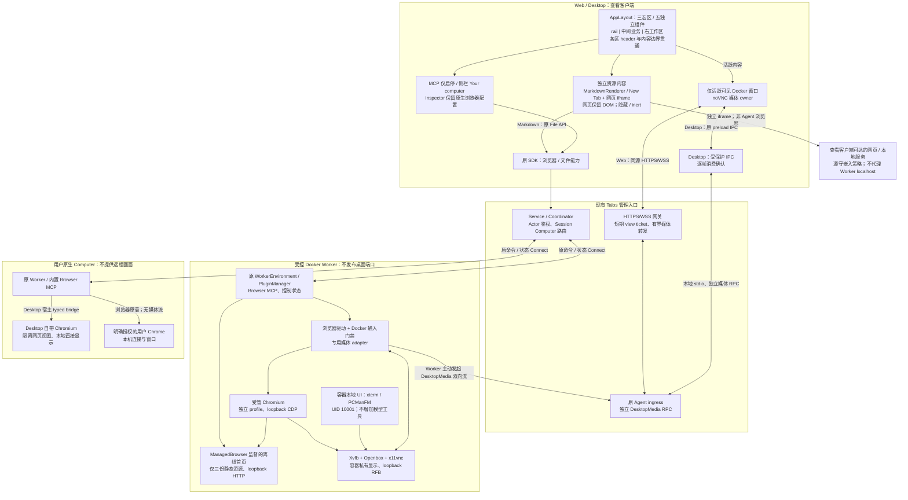
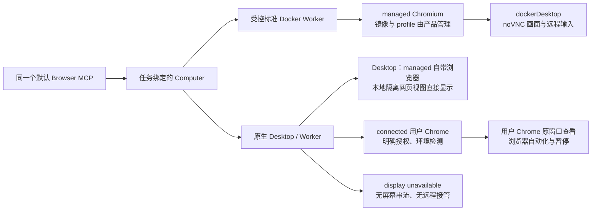
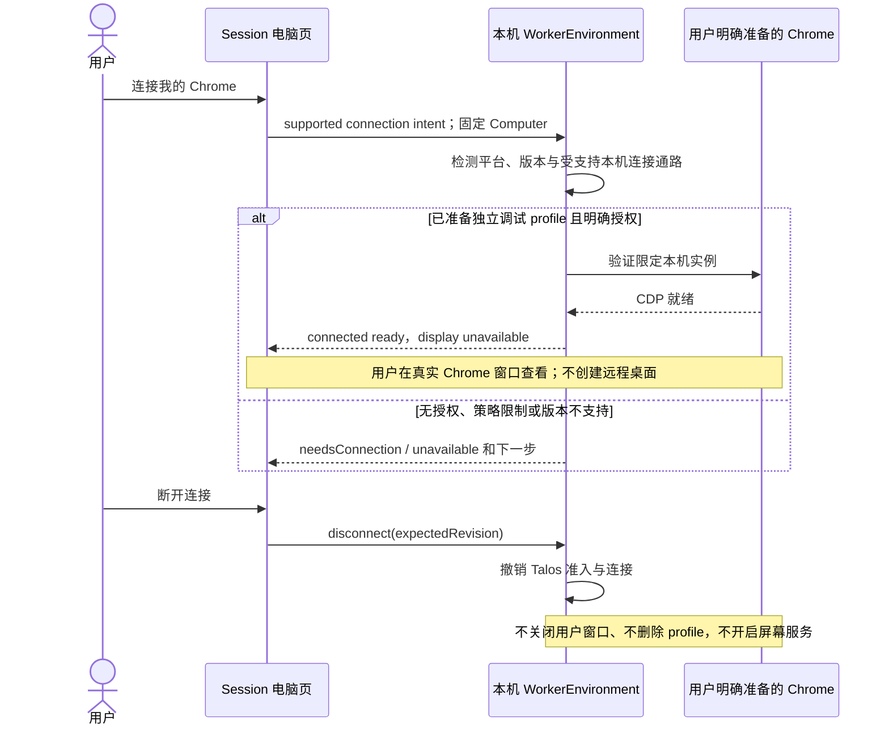
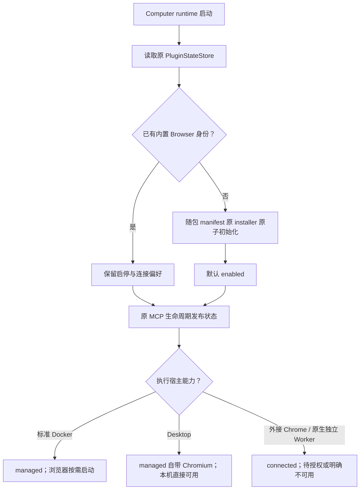
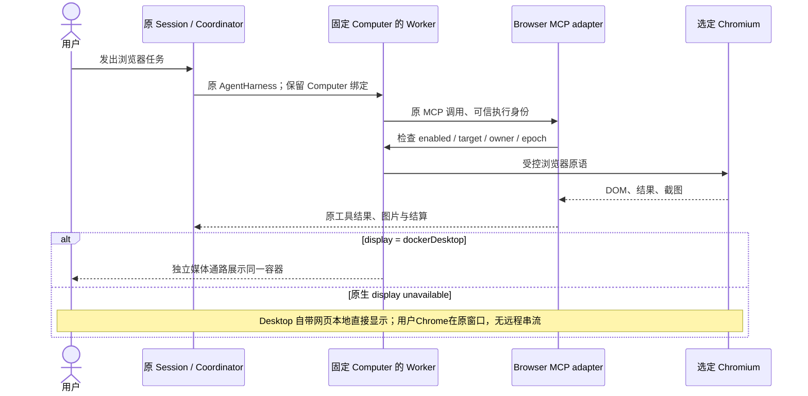
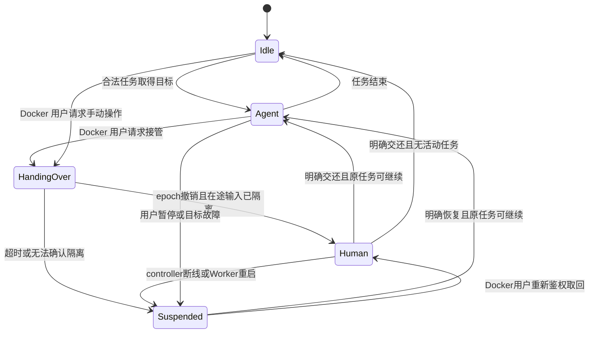
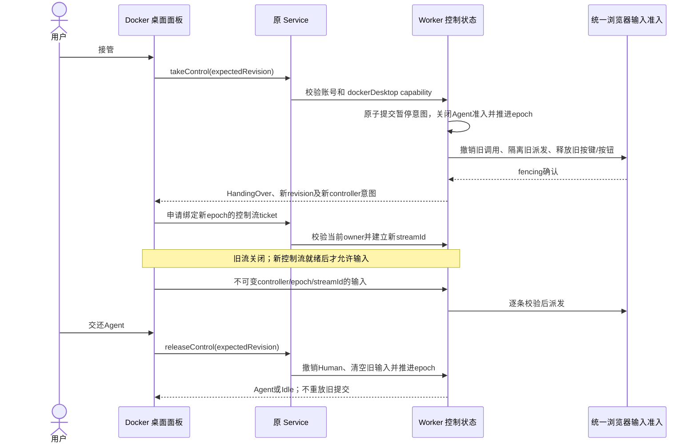
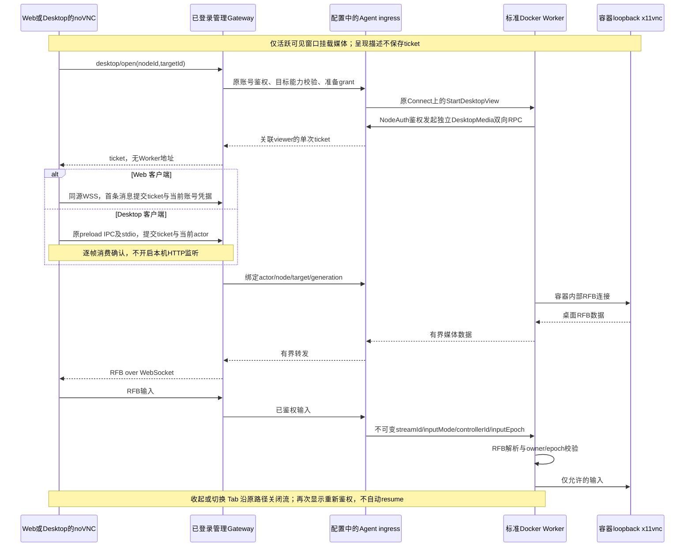

# 内置浏览器 MCP 与 Docker Worker 远程桌面

Status: active — 实施中的设计契约；未验收项不代表已有能力。

沿用 [Computer 与工作区](../feat-043-computer-workspace/design.md)、[分布式执行](../feat-042-distributed-agent-execution/design.md)、[客户端分层](../../docs/architecture/CLIENT_ARCHITECTURE.md)和[统一错误契约](../../docs/architecture/ERROR_MODEL.md)。执行计划在仓库根忽略的 `IMPLEMENTATION_PLAN.md`；实际验证与 Review 记录在忽略的 `output/`，临时原型在忽略的 `design/browser-mcp/`。

## 1. 产品范围与复杂度边界

设置 → MCP 默认集成一个可关闭的 Browser 插件。浏览器工具绑定任务实际执行的 Computer；**只有产品提供并管理的 Docker Worker 浏览器环境提供实时桌面与远程键鼠接管**。Desktop 直接复用自带的 Electron/Chromium 浏览器，在本地显示；Session 的独立电脑/浏览器页保留“Talos 自带浏览器 / 用户 Chrome”选择。原生 Desktop/Worker 不安装 VNC、屏幕采集或虚拟桌面服务，不广播用户电脑或浏览器页面。

Desktop 和 Web 均可作为 Docker 桌面的查看客户端；“Desktop 可以查看 Docker Worker”和“把 Desktop 所在用户电脑共享出去”是两种不同权限，前者属于本方案，后者不属于。

Docker 桌面提供 Browser、Terminal 和 File manager 三个真实的本地入口。Terminal 使用 xterm，File manager 使用 PCManFM，均以容器的 UID/GID 10001 运行，使用同一虚拟显示及已有媒体接管通路；它们不是新增 MCP 工具、远程终端协议或文件服务，也不把原生电脑或 Docker 宿主机纳入控制范围。

| 执行宿主 | 浏览器自动化 | 实时画面和远程接管 | 用户怎样查看/人工操作 |
| --- | --- | --- | --- |
| 标准 Docker Worker 镜像 | 内置 Chromium、驱动、独立持久 profile；默认受管目标 | 有；只分享该容器的虚拟桌面，不分享 Docker 宿主机 | Talos 会话内远程桌面；接管/交还 |
| Desktop | 默认使用自带浏览器；也可在 Session 电脑页选择并连接用户 Chrome | 无远程桌面或 browser viewport 串流 | 自带浏览器在本地内嵌网页视图直接显示；用户 Chrome 在自己的窗口显示 |
| 原生独立 Worker（无 Desktop 宿主） | 同一个 MCP；仅已交付并验证的本机 adapter 可连接 Chrome。首版无 Desktop 宿主时明确 unavailable，不假装自带 Electron 浏览器 | 无 | 在该 Computer 的 Chrome 窗口查看，暂停/继续 Talos 浏览器动作 |
| 普通 Talos Web 客户端 | 操作 Session 绑定的 Worker；不控制当前 Web 页所在浏览器 | 根据执行宿主能力显示 Docker 画面 | 不把 Web 客户端误当作已授权的用户浏览器 |
| Server 镜像内嵌 Worker | 本期不自动增加浏览器/桌面资源；已有其他任务保持原行为 | 无 | 如需本功能，连接标准独立 Docker Worker；不为此启动第二个内嵌 Worker |

**首版交付重点是 Docker 闭环。** Desktop 默认自带浏览器与已设计的目标选择保留，不再下载安装第二份 Chromium。其本地显示不是媒体串流；需要接通隔离网页视图与 MCP 的实际宿主适配。外接用户 Chrome 只在经验证的窄通路上变为 ready，未验证的平台/浏览器返回 unavailable。原生独立 Worker 不等同于 Desktop。Docker 不依赖实现跨平台远程显示。

### 目标

1. 一个默认内置、可关闭且关闭选择跨升级保留的 Browser MCP；无手动安装 Skill 或可选镜像流程。
2. Docker 中的自动化、显示和输入指向同一 Chromium/虚拟桌面，登录态可持久化；浏览器关闭后仍有可用的桌面和三个应用入口。
3. 不为每个 Worker 增加公网入站端口；复用管理入口和节点身份，新增专用有界媒体通道。
4. 统一插件、工具、路由、状态与错误；按能力提供 UI，不强求同一宿主部署或显示栈。
5. 保留现有插件提交锁：活动 Turn 期间禁用可返回冲突；要即时停止浏览器输入，使用独立的暂停/接管，不绕过全局插件状态锁。

### 非目标

- 远程控制用户原生电脑、任意原生应用、Docker 宿主桌面，或不可撤销地阻止用户自己敲键盘。
- 新装第二份原生 Chromium、浏览器 viewport 远程串流、WebRTC/P2P/STUN/TURN、多显示器、音频、录屏。
- Safari/Firefox、反检测保证、代解验证码、Browser Use Cloud、第二个推理 Agent。
- 自动接入用户默认 profile、复制其 Cookie、让模型指定调试地址或任意 Python/JS/CDP。
- 新建通用能力注册中心、任务系统、媒体业务数据库或跨宿主全量桌面抽象。
- 完整 Linux 桌面环境、登录管理器、桌面文件共享服务，或为容器终端/文件管理器新增模型工具与 API。

## 2. 当前事实与取舍

| 当前事实 | 拟定增量 |
| --- | --- |
| `TalosWorker` 已组装 PluginManager、MCP runtime、工具与凭据 | 同一 owner 增加 Browser adapter 和少量浏览器运行状态 |
| MCP 页面已有列表、详情、启停；PluginManager 的 commit_guard 与整段 Turn 读锁互斥 | 新增内置 Browser；enabled/readiness 独立，禁用在活动 Turn 冲突时不改变状态，先暂停或按原流程停止任务 |
| 当前通用 MCP 调用仅传工具参数和 cancellation，没有完整可信 ToolContext；Rust app-server 出站尚只有 Response/Error/Notification | 浏览器需要明确的调用上下文桥和 Desktop typed request/response 出站实现，不能当作已具备的能力 |
| 标准 Worker 基于 Ubuntu 24.04、非 root；Compose 无 `ports`；执行使用 outbound Connect | 仅该镜像增加浏览器/虚拟桌面依赖，继续零新增 Worker 入站 |
| 当前 Connect 是 typed RPC 与有限公平队列，不能直接承载 VNC | 短命令保持原路径；另加独立媒体流及网关 WSS 路由 |
| Desktop 已随 Electron 自带 Chromium；当前 main.ts 创建产品主 BrowserWindow，尚无独立网站控制 owner | 复用自带引擎和现有 Desktop 宿主/IPC，在隔离网页视图上接通浏览器工具；不把产品主 renderer 当浏览器目标，不另装 Chromium |
| 用户 Chrome 的授权、版本、策略、profile 不由产品完全控制 | 明确连接、能力检测和可操作的失败状态；不承诺默认已打开的 Chrome 可附着 |
| Browser Use 能连 CDP，上游 CLI MCP 有 Python 执行 | 复用底层 primitives；产品只暴露有类型、可撤销的工具 |

统一的是**能力发现和命令语义**，不是强制部署同一套桌面服务。`managed`/`connected` 仍是浏览器目标类型；首版 Docker 和 Desktop 自带浏览器使用 managed，用户 Chrome 使用 connected；无 Desktop 的原生 Worker 只提供 connected。Docker 身份也不等同于已获远程桌面能力，服务端以受信 Worker 上报并校验的具体能力为准。

## 3. 总体架构和端口

图中的 adapter 是现有 Worker/网关中的具体模块；媒体只维护短期连接、身份和队列，不拥有任务、profile 或新业务数据库。

### 3.1 到底需要开放哪些端口

**需要容器内部服务监听，不需要把这些端口开放到容器宿主或公网。** noVNC 是浏览器侧 RFB/WebSocket 客户端；它并不要求每个 Worker 拥有公网 VNC 地址。浏览器只访问已登录的 Talos 管理入口，Worker 主动连接受信 Agent ingress。

| 位置 / 路径 | 可达范围与部署要求 |
| --- | --- |
| CDP，例如 `127.0.0.1:9222` | 仅容器内部，实际端口由运行时分配/记录；无 Docker `ports`、host network 或公网调试地址 |
| Docker 离线首页 HTTP | 仅 `127.0.0.1` 的动态端口；由 ManagedBrowser 监督，固定提供首页三份静态资源，不提供目录、文件 API 或宿主端口映射 |
| x11vnc RFB，例如 `127.0.0.1:5900` | 仅同一容器内 Worker adapter 可连；原生端不启动 |
| Xvfb X 显示 | 容器内部 Unix socket，禁止 X TCP listen；不挂宿主 X11/Wayland socket |
| noVNC JS | 由原 Talos Web 静态资源分发；生产 Worker 不另开 6080 Web 页面，也不要求 websockify 服务 |
| Desktop 查看 Docker | 原 preload IPC 和 app-server stdio 传递有界 RFB 帧，逐帧等待当前产品 renderer 的消费确认；app-server 复用独立受信媒体 RPC，无本机监听端口，也不采集本机画面 |
| Web 用户 → Talos | 原 HTTPS 入口增加同源 `/v1/desktop/stream` WSS 路由，通常仍是公网 443；更新反代 Upgrade、Origin 和超时配置，无新增 Worker 域名 |
| Docker Worker → Agent ingress | 已配置受信 TLS ingress 上新增独立双向 `DesktopMedia` RPC，通常复用该 ingress 的 443；需代理支持 HTTP/2 长流。自建 ingress 使用其他端口时，以原部署地址为准 |
| 管理 Gateway → 独立 ingress | 复用部署配置的内部/受信 TLS 地址；需要服务端转发连通性，无浏览器直连 Worker |

默认 Compose 继续没有 `ports:`。若原 Worker 自选 direct RPC，本功能也不在该端口暴露 VNC；Docker 显示仍通过受信 ingress 的 outbound media。没有支持新媒体 RPC 的 ingress 时返回显示不可用，不降级为裸端口直连。私有 CA 沿原可信 CA 配置，禁止跳过 TLS 校验。

### 3.2 三条链路与可控复杂度

| 链路 | 复用 / 新增 | 不承担 |
| --- | --- | --- |
| Session/工具 | 原 Coordinator、AgentHarness、MCP、结果/图片/Timeline | 不用实时帧代替工具证据 |
| 浏览器环境 | 原 Service、WorkerEnvironment、插件状态；新增具体 target/control 字段 | 不迁移已有 Session，不保存第二份 enabled |
| Docker 媒体 | 新增一个有界 outbound RPC + 网关 WSS + noVNC adapter | 不走任务队列/Sync，不建 P2P，不覆盖原生显示 |

主要新增成本是媒体认证/路由/背压、Docker 进程生命周期和输入 fencing，不能把安装 noVNC 当作已完成。去掉原生 screencast、跨系统录屏权限与多个视频协议，首版只有 Docker RFB 一条远程显示通路；Desktop 在本地复用现有 Chromium，增加一个具体的本地宿主适配，不另做视频协议。容量上限和慢连接必须单独验收。

### 3.3 代码所有权

| Existing owner / path | Responsibility (normative) |
| --- | --- |
| `talos-rs/crates/app/talos-worker/src/runtime.rs` | Compose browser adapter; compose Docker display only when the shipped environment declares that capability. Own shutdown; no new business store. |
| `talos-rs/crates/orchestration/service/src/worker_environment.rs` | Verify Actor and Computer routing, expose concrete target/control/display capabilities; reject unsupported operations server-side. |
| `talos-rs/crates/action/plugin/src/` | Bundle repository-format manifest, idempotent provision, preserve explicit disable and built-in identity. |
| `talos-rs/crates/action/mcp/src/` and `talos-rs/crates/action/tools/src/mcp/` | Original lifecycle, typed tool admission/cancellation, image delivery. |
| `talos-rs/crates/orchestration/agent-protocol/src/environment.rs` and `agent-pb/proto/` | Canonical typed browser contract and Docker-only media messages; no generic JSON bus. |
| `talos-rs/crates/orchestration/agent-client/src/` | Original authenticated dispatch and cancellation; dedicated authenticated media client. |
| `talos-rs/crates/app/talos-base/src/` | Trusted ingress relay composition and bounded transient state; existing HTTP gateway owns WSS admission. Embedded/Server/stdio exits await BrowserRuntime shutdown and private IPC cleanup. |
| `talos-rs/crates/gateway/app-server/src/desktop_host.rs` | Own the existing JSONL generation, outgoing host queue, pending response correlation, timeouts and cancellation. Inject BrowserHostPort into the concrete native backend; media consumption ACK has independent semantics/capacity. |
| `talos-app/web/src/app/layouts/` and `shared/store/ui-slice.ts` | Compose application navigation and the right workspace. Own only ephemeral typed window descriptors, active selection, visibility and geometry; count actual descriptors; deduplicate Computer/Markdown by resource identity, and preserve independent webpage tabs by stable UI identity. Clear through the existing app-store connection-scope subscription. No media grants, Worker control state or new persisted registry. |
| `talos-app/web/src/features/settings/` and `features/computers/` | MCP settings remain enable/disable only. Computer content owns browser configuration and capability-gated view/actions; its active viewer owns media admission and cleanup, not application layout or a second window store. No authoritative client control state. |
| `talos-app/desktop/src/` | Reuse bundled Chromium in an isolated local website view, with typed host operations through the existing app-server controller/server-request boundary. Also render Docker viewer and user-Chrome selection; no VNC server, capture or product-renderer debugging. |
| `talos-app/shared/browser-home/` | Packaged offline home shared by managed Docker and native Desktop browsers; assets own static presentation only, without credentials or runtime authority. Existing builds own asset inclusion. ManagedBrowser supervises Docker's private loopback HTTP transport; native Desktop retains its packaged file URL. |
| `talos-app/ts-sdk/` | Reuse generated shared types; HTTP/RPC/embedded command parity. sdk-browser owns authenticated WebSocket admission; sdk-app-server owns protected preload media framing, backpressure, error and close semantics. Both expose desktop.connect(grant); Web owns noVNC and reconnect UX. |
| `build/worker/` and `deploy/docker/talos-worker/` | Standard Docker assets, restrained Talos wallpaper and compact Browser/Terminal/File manager launchers; all local applications use the existing managed display/process lifecycle. Persistent state, non-root execution and zero added inbound ports. Server image browser packaging is outside this increment. |

## 4. 目标与能力模型

| Type | Contract (English) |
| --- | --- |
| `BrowserTarget` | Stable targetId within the enclosing Computer/WorkerEnvironment scope, kind managed/connected, displayName and readiness. IDs are public strings, not paths or endpoints. |
| `BrowserReadiness` | stopped, starting, ready, needsConnection, unavailable with ApiError. Keep plugin enabled and Computer online separate. |
| `BrowserDisplayCapability` | dockerDesktop with its managed targetId, or unavailable with a closed reason enum (nativeHost, notBundled, hostPolicy, unsupportedVersion). No browserViewport variant in v1. |
| `BrowserLocalOpenCapability` | desktopOwned for a local Desktop-owned website target; externalUserWindow for connected Chrome; unavailable otherwise. Local opening is restricted to the matching Desktop/Computer, never a network video capability. |
| `BrowserControlState` | Runtime generation, monotonic revision, epoch and owner. Worker is authoritative; bounded per-call invocations remain private, not a second single current-invocation mirror. |
| `BrowserControlOwner` | idle, agent with Session/Turn, suspended with typed reason; operation failures return ApiError, and unconfirmed cleanup blocks Resume with that error; handingOver and human/controllerId are Docker-only variants. |
| `BrowserCommandContext` | Verified actor, node/target, Session/Turn/tool identity, generation and epoch derived from original dispatch; never model arguments. |
| `DesktopViewGrant` | Docker-only, single-use grant: actor, node, target, generation, viewer, streamId, inputMode and expiry. Control mode also fixes controllerId and inputEpoch; read-only grants have no input authority. Never carries NodeAuth/CDP address. |

Unavailability reasons are capability facts, not permission grants. Actual dependency/startup failure belongs in readiness with ApiError. A bundled Docker display capability remains stable when a supervised component exits or initialization fails; the existing viewer then reports the actual readiness/connection error rather than switching to native-host messaging. Determine Docker display support from bundled resources and trusted runtime configuration plus successful capability checks, never from OS name, browser CDP reachability or UI guesses. Native defaults remain unavailable even on Linux. Authorization is rechecked at Service and Worker for every view/control operation.

`nodeId` 决定执行位置，`targetId` 决定其浏览器；修改只影响后续准入，不迁移 Session 或在途动作。只读旁观其他 Computer 不改变任务绑定。 Native 宿主观察缓存同时绑定 managed/connected 类型；切换类型时清除当前标签与元素引用，不能把自带浏览器的标签 ID 发给用户 Chrome，反向切换亦然。同一类型且控制 epoch 未改变的新 Turn 可保留当前标签，但仍需获取新的元素引用；账号或控制 epoch 改变时，沿原撤销边界清除当前标签，避免插件关闭并重新启用后复用已关闭的宿主视图。

### 4.1 Desktop 自带浏览器与外接 Chrome

**Desktop 默认直接使用自带浏览器。** “自带”指复用已有 Electron/Chromium，无第二份浏览器安装。管理目标有独立持久 session partition、sandbox/contextIsolation、nodeIntegration=false，不加载 Talos preload，不能访问产品 IPC；禁止目标选到主产品 renderer、DevTools、文件系统或其他账户的 partition。

本机网页直接由 Electron WebContentsView（或已有同等宿主视图）呈现，不产生 noVNC/CDP screencast/媒体 grant。浏览器原语复用同一 MCP 面，但 Desktop 后端由原 app-server/Worker 的 typed host request → 现有 DesktopAppServerController server-request 边界 → 具体 website webContents 执行。WebsiteAccount 拥有独立的本地窗口、标签和 profile。一个单独、固定打包的 trusted chrome WebContentsView 提供标签、地址栏、历史/刷新及隐藏窗口；共享离线首页为首次打开提供有效内容。导航栏只注入窄 browser-navigation preload，接受 main-frame+WebContents+固定资源 URL 三重校验后的闭合动作；网站视图没有任何 preload/Node，导航栏不加入 BrowserHost targets、也不附着 debugger。关闭窗口隐藏并保留网站标签，Session 的“打开浏览器”重新显示同一窗口。用户 Chrome 不注入这层 UI，保留其原窗口与操作习惯。

Electron main 只接受有类型的导航/DOM/输入/截图/标签等已授权操作，持有 target 与 debugger 映射；不暴露任意 JS、CDP 方法或全局调试端口。截图沿原工具 image 通路，非持续串流。

外接 Chrome 的 CDP 下载源使用该账号下载目录下的私有 `.chrome-pending/`；只有收到完成事件并验证文件后，才无覆盖地生成最终文件。同名下载保留扩展名并分配序号，成功写入和清理源后才退役当前连接的 GUID 元数据。完成失败在领取时明确拒绝并允许重试，不静默遗漏；UUID 形状的合法最终文件名不被正则过滤。断连后的未完成源仍保持私有，但首版不承诺跨连接/进程恢复下载元数据，也不新增持久下载 registry。完成文件继续沿原 File API、大小/数量限制与 SHA-256 receipt 通路交付；自带浏览器与外接 Chrome 都验证 UUID 最终文件。

Browser Use primitives 用于 Docker 的受控 CDP；Desktop 用户 Chrome 复用封闭的原生宿主 CDP adapter；不把其完整 CDP transport 强塞进 Electron debugger API，也不为兼容它开放整个 Electron 进程的 remote-debugging-port。Desktop 使用 webContents.debugger 的受限页面原语，需要验证实际 Electron 版本的页面/标签/下载及 detach 生命周期。主进程是宿主执行 adapter，工具准入和 epoch 的权威仍在同一 Worker；目标绑定、host 生命周期 generation 和每步 fencing 必须经过可信桥，不接受网页或 model 自报身份。IPC/server-request 明确区分当前 Desktop 本机 Worker 与其他账号/Computer，宿主操作不由远端任意 Worker调用。

TypeScript controller 的 onServerRequest 是宿主接收边界；Rust `gateway/app-server/src/runtime.rs` 与 `app-protocol` 的既有 owner 负责封闭的 Desktop browser host request/result、出站请求队列和 requestId/pending-response 关联；限制每宿主一个 mutation、bounded pending/timeout/cancel，关联已初始化且标记 desktopHost 的 stdio client、当前 Worker 和 host generation。请求在普通 Web client、非绑定宿主或重启的旧连接上不可派发；关闭/重启拒绝全部未决响应并暂停旧调用，不重放输入。Reader、writer 与业务 dispatch 的并发必须在真实宿主回调中验证。下层 Worker 只依赖组装时注入的 browser-specific typed host port；gateway/app-protocol adapter 负责 JSON-RPC 映射，下层不引用 gateway 或 Electron 类型。

The Desktop last mile uses the existing protected preload and JSONL transport rather than opening an HTTP server or weakening WebSocket Origin checks. `desktop/streamOpen`, `desktop/streamSend` and `desktop/streamClose` are closed Desktop-host methods; ordinary app-server hosts reject them. Admission consumes the same single-use actor/node/generation/stream-bound grant as Web. `client/desktop/frame` forwards at most 64 KiB and waits at most two seconds for the opening product renderer to acknowledge consumption. Two active streams and bounded pending requests are permitted. Closing the renderer, account, stdio generation or ingress lease closes the stream; read-only reconnect never restores control.

The JSONL reader and typed host-request writer must progress independently of the serialized business dispatcher. Host response IDs are one-use, pending requests are bounded, and shutdown fails every pending result. Desktop queues at most 16 business frames and 68 MiB; excess requests receive Conflict without blocking host responses. Input cancellations use the same transport owner and are checked before every actual browser primitive. Browser files remain private host data until the original ToolContext File owner persists them; only successful file receipts clear completed browser downloads.

原生独立 Worker 若没有注入受支持的 Desktop 宿主 adapter，则 connected 目标明确 unavailable；不凭固定端口存在就宣称可执行。首版可信本地 MCP IPC 限于 Unix；BrowserRuntime 在能力快照和工具准入同时检查该通路，不支持的平台即使宿主 bridge 已连接、Chrome 可见也必须保持 unavailable，不能先获取任务控制权。连接/打开明确失败，断开和清理仍可执行；后续平台支持需补等价的私有 IPC 与真实产品验收。

**用户 Chrome 是另一个已设计目标。** 不改系统策略、不复制用户默认 profile、不默认打开调试或发布监听地址。首版只接受用户在本机明确准备并授权的、使用独立非默认 profile 的受支持 Chromium/Chrome 调试实例。Desktop 首版验证固定本机 `127.0.0.1:9222`、Chrome/Chromium 136+、`--enable-automation` 和独立非默认 `--user-data-dir`；连接失败不自动启动或安装 Chrome。连接向导验证本机允许的端点与版本，不提供任意远端 URL 输入给模型，不允许远程 Worker 接入用户笔记本 loopback。

默认已打开的用户 Chrome 并不必然可连接；这不影响 Desktop 自带浏览器的开箱使用。向导可以解释如何准备独立调试 profile，需独立登录；不能承诺复用默认 profile 的全部登录态。没有可验证授权/连接通路时保持 needsConnection/unavailable。原生连接及驱动分发是单独的平台兼容验收，不阻塞 Docker 桌面交付；不以模拟“授权成功”作为实际连接证据。

Chrome 连接候选必须在当前 operation/host generation 校验后才发布；reset/logout/cancel 后完成的候选立即断开，不改变后来的连接成员。固定同一 Chrome 的握手串行退役，避免旧候选清理覆盖新连接的全局下载行为。用户窗口始终保留。

### 4.2 持久化

| 内容 | Owner / persistence |
| --- | --- |
| 插件启停、内容版本、来源 | 原 PluginStateStore；幂等初始化/升级不覆盖关闭选择 |
| 默认 target / manualHold | Worker-private typed `browser/state.json`；由同一 BrowserRuntime 状态锁串行更新并复用 talos-fs 原子替换/fsync，不复制到全局 ConfigStore 或 Sync。它属于具体 Worker 的目标与安全暂停意图，不是账户配置；重启只恢复意图，不恢复调用/控制者。该 home 由一个 Worker 实例拥有，不保存 Cookie 副本 |
| Desktop 自带浏览器 profile | Electron 独立持久 session partition，由本机宿主拥有；不共用产品登录 session，不入 Sync；退出先停止自有网页目标，隔离凭据 |
| Docker profile、下载 | 受保护 Worker home 的 `browser/profile`、`browser/downloads`；不入镜像/Sync |
| Docker 本地工具工作目录 | 同一受保护 Worker home 的 `browser/workspace`，供 xterm/PCManFM 默认打开；普通容器文件，不是新 Store、同步或文件授权接口 |
| 原生 profile | 原浏览器/用户所有；Talos 保存有限连接描述，临时秘密沿原凭据管理 |
| generation / epoch / 在途调用 / media | Worker 运行态；重启新 generation，旧 grant 失效 |
| manualHold 暂停意图 | 原子保存；重启为 suspended，不恢复旧控制者、不自动恢复 Agent |
| Session/Turn、结果和截图附件 | 原 Store/Timeline/ToolImageStore，无新浏览器事件账本 |

## 5. 内置插件与工具

仓库维护 `talos-mcp.json` 与简短使用说明，随包提供，使用原 installer 的 manifest 激活、内容摘要和回滚事务；内置身份固定为 `builtin_browser`，不增加可编辑的外部 source，安装记录复用原 Manual 形态但拒绝替换内置身份；用户无需单独安装 Skill，首次调用不 pip install。成功关闭插件保留 profile；活动 Turn 导致 commit_guard 冲突时 enabled/连接/owner 均不改变，显示原 Conflict 错误并引导先暂停浏览器或按原操作停止当前任务后重试。暂停只关闭浏览器准入，不伪装插件已关闭；不自动取消其他工具/Turn，不修改通用插件锁语义。内置项不提供卸载，通用卸载 API 同样拒绝其内置身份，不能只隐藏按钮；不新增 tombstone 系统。

内置 manifest 通过当前宿主可执行文件的隐藏 `--browser-mcp` 入口启动薄 stdio adapter。仓库自有 Server、Worker、app-server 和 TUI/CLI 都在普通参数解析、账号认证与运行时初始化前分派该入口；握手无需账号、模型或有效业务配置。外部嵌入宿主须在自身 main 中遵守同一入口契约，SDK/composition rustdoc 明确该要求；不为 TUI 新增浏览器 backend 或本机远程桌面。

### 5.1 可信调用上下文与浏览器执行桥

当前 `action/tools/src/mcp/mod.rs` 的通用 MCP executor 不会把完整 ToolContext 传给 server；不能假定 stdio 天然带有可信 Session/Turn/epoch，也不能把身份字段加到 model 可填的工具参数中。

在该既有 executor 中，仅对核验过的内置 Browser 安装身份建立 **BrowserInvocationBridge**（Worker 内具体模块，不是通用 RPC bus）：

1. Worker 从真实 ToolContext 和固定 Computer/target 创建 per-call 记录：actor、session/turn/call、tool name、规范化参数摘要、generation、epoch、取消令牌、截止时间。生成不可猜的单次 invocation capability，不由模型生成。
2. executor 在 MCP `tools/call` 的私有 `_meta.talosBrowserInvocation` 注入 opaque capability；对同名模型参数/外部 metadata 不予信任。仅原受信内置 server 可使用此路径；普通第三方 MCP 保持原协议/行为。证据日志不记录 token。
3. 内置 Browser MCP 为薄 stdio adapter，通过 Worker-owned 私有本地 IPC 向该桥提交闭合 browser action 和 capability；首版支持的 Mac/Linux 采用权限受限的 Unix socket/私有目录，无公网监听。能力未就绪时失败，不退回通用无上下文 MCP 路径。初版不承诺未验证的平台 IPC。
4. 桥验证绑定的完整请求、tool/action 范围与生命周期，然后调用目标后端。所有真实 CDP/input 派发仍由 Worker 持有：Docker/外接 CDP 后端只在受信执行桥内使用 Browser Use primitives；Python 后端的每步发送必须经过关联此 invocation 的受控 transport，不能向薄 MCP server 提供裸 CDP endpoint 后让它直连。Desktop 后端派发 typed host request，同样绑定调用及 epoch。
5. 完成、取消、超时、Turn 结束、target/generation/epoch 变化即撤销 capability 和其待派发输入。迟到或重放的 IPC/_meta 请求被拒绝；无凭据/错调用/错目标一律失败，不推断“当前活跃任务”。

Browser Use 的每次操作从部分启动开始即由同一 `try/finally` 负责停止。启动/停止分别复用其连接预算 15 秒与 Worker 清理预算 5 秒，不扩大原工具 120 秒外层期限；阶段超时或停止失败明确失败，不伪装操作成功。Python 阶段取消依赖协作，不协作的依赖仍由原 Worker 进程组期限和取消 owner 兜底，不另建事件循环/驱动管理器，也不以阶段预算宣称根除了上游 watchdog 竞态。

该桥和 Browser Use 自定义每步 transport 是明确实施门槛：若无法在真实工具路径证明 fencing，就不发布接管承诺；不能用仅在工具入口检查一次或隐藏原始工具来替代。MCP image 结果仍沿原图片通路，不建立第二套结果协议。

### 5.2 工具面

拟定工具：browser_state、browser_navigate、browser_click、browser_fill、browser_key、browser_scroll、browser_tab、browser_screenshot、browser_download、browser_upload。参数限目标内元素引用/坐标/URL/已授权文件引用；引用绑定 target + document revision，导航后旧引用失效。model 不指定 node、调试地址、profile 路径、epoch。

- Browser Use / Harness 是 Docker 受控 CDP 的 primitives 依赖；Desktop 复用已有引擎的页面宿主适配，不额外依赖本机 Python。stdio MCP 握手和调用沿原 runtime。不直接暴露 browser_exec、任意 Python/JS 或裸 CDP。
- 每个真实 CDP/input 步骤在 Worker 核对 generation/epoch；不能只在长脚本入口检查。Driver 组装在原 Worker owner 中，不增加第二个 Agent。
- 截图作为标准 MCP image content 沿原附件/图片链路回传；截图不等于实时画面，也不会因此开启用户屏幕共享。
- 最终 Markdown 图片采用显式 `` 引用。MCP 工具图片结果保留原 typed image，并给模型该引用的简短文本；不把图片字节写入历史。客户端仅对完整合法的图片引用复用原 File API 授权读取和 FileImage 展示/释放，普通相对路径及裸 fileId 不隐式升级成文件授权；引用不是下载地址或权限凭证。拒绝访问必须可见，刷新重新鉴权，预览 dialog 挂载到顶层以保持有效 HTML 与焦点行为。
- 只对当前目标/任务授权的标签操作；上传仅接受当前 Turn 已由原附件 Reader 授权的 fileId，单文件上限 20 MiB；下载走原文件 API，每次最多 5 个文件、合计 20 MiB，成功保存并校验 receipt 后再清理浏览器下载副本。不把启用 MCP 当作全机文件授权。
- Desktop 退出账号会先撤销旧任务的 browser 调用、暂停输入并关闭产品自有网页视图；外接 Chrome 只清理 Talos 输入并断开连接，不关闭用户浏览器。旧任务不能在退出后用只读操作重新打开旧账号网页。
- Desktop 复用已有 Electron 包及宿主适配，不新装浏览器/Python；外接 CDP 驱动依赖只交付经验证平台。原生不包含 Xvfb/Openbox/x11vnc/noVNC 服务，不因依赖缺失运行时安装未知环境。

## 6. 任务与人工操作

一个目标同一时刻只有一个 Agent 任务；其他任务返回忙碌。截图/只读查看不抢占控制；任务结束释放 Agent 所有权。用户操作之前要暂停 Talos 浏览器动作，避免并行输入。

### 6.1 Docker 接管与交还

ACK 的承诺是之后不再派发旧控制者输入；已经提交的网站异步副作用可能继续完成，不伪装回滚。输入排队、按键/鼠标按下状态、driver 取消和新 owner 准入由同一个 Worker 控制状态协调；释放旧键/按钮必须先于新 owner 输入。无法在 5 秒内确认 fencing 时进入 suspended，不乐观授予控制。只读 viewer 断线不暂停 Agent；已接管 controller 断线才保存暂停。控制流握手有 5 秒超时；在新流 ready 前 UI 保持“接管中”且禁止输入，失败则 suspended。

不新增 Turn Paused 状态，不暂停所有非浏览器工具。原 Turn 已结束时显示“继续任务”，沿原输入 API 续接，不复活终态或重放提交。

### 6.2 原生人工操作

Desktop 自带网页由本机宿主呈现；用户可直接在该视图或自己的 Chrome 窗口操作。原生自动化协调使用 pauseAutomation/resumeAutomation：暂停设置 manualHold、推进 epoch、撤销 Talos 后续浏览器输入；用户在自带网页或本机 Chrome 手动操作，再明确继续。无远程输入 controller、无 Human grant、无实时播放器，不调用 desktop/open 或 takeControl。

这个暂停只能约束 Talos 的浏览器工具。用户、企业策略、扩展和其他 OS 进程仍可能操作同一 Chrome；不承诺独占用户电脑。每次恢复重新观察页面，不把上次 DOM 当作当前状态，不自动重试副作用。属于用户的外接 Chrome 窗口在禁用/断开/退出 Talos 后保持打开；Desktop 自带网页随其宿主生命周期关闭，持久 partition 保留。

### 6.3 Docker 本地应用与浏览器重开

1. 用户在 Session 侧栏或 ComputerInspector 的原能力入口查看同一容器桌面；只读画面可以观察应用，不接受键盘/鼠标。明确接管并完成原控制流握手后，才可点击 dock 的 Browser、Terminal 或 File manager。
2. Browser 首次显示打包的离线首页。Docker 由 ManagedBrowser 在原启动期限内监督一个 loopback HTTP 子进程，仅以 GET/HEAD 提供预载的 `home.html`、`home.js` 和 `talos-logo.svg`；首次窗口、`--homepage` 与 dock 重开使用同一受信 URL，不放宽 Browser Use 的文件安全策略。关闭最后一个浏览器窗口后，受监督 Chromium/CDP、桌面背景和 dock 保持可用；Browser 入口在同一 profile/进程中重新打开窗口，不静默重建浏览器实例或清空登录态。旧 target 的动作仍须拒绝，后续工具通过显式观察恢复。
3. Terminal 与 File manager 分别打开真实的 xterm 和 PCManFM 窗口，默认工作目录为 Worker home 下的 `browser/workspace`。PCManFM 使用 `--no-desktop`，不接管背景或启动另一套桌面；文本文件可通过既有 xterm 中的只读预览打开，不为此增加编辑器。它们继承同一容器用户、受保护显示环境及容器文件权限，不需要另一组凭据/监听端口，不运行宿主命令或挂载宿主显示。它们不成为 Browser targets，也不扩展 Browser MCP 的 DOM、截图或文件授权接口。
4. 手动命令和文件操作作用于该容器用户实际可达的文件；只有既有持久卷/工作区内的内容按原挂载语义保留，容器层内容不承诺跨替换保存。原 File API 的 Turn 附件授权仍适用于模型工具，不能用桌面入口给模型附加任意文件权限。
5. 交还、断线和关闭 viewer 继续遵守原控制权语义。交还撤销后续远程输入，不回滚已经执行的 shell 命令、文件操作或网站副作用；关闭 viewer 不关闭应用。Worker 退出回收该显示栈和自有进程，不留下独立桌面服务。

## 7. Docker 专用媒体与鉴权

Gateway 与 ingress 同宿主时省去中间跳。只接受已配置受信 ingress/origin；不接受 browser 传来的 relay URL。每个 viewer 使用独立 RFB 会话，最大两个，指向同一容器显示；允许一个 controller。首个浏览器动作/查看才启动受管显示栈；首版 x11vnc 与该栈一起准备并检查私有 listener，避免首次查看再引入一套独立 supervisor 状态。实际媒体连接仅按 viewer 建立，关闭最后 viewer 回收连接，不等于关闭浏览器或取消 Agent 任务。原 Worker 注册和普通非浏览器任务不依赖显示栈启动。

- Ticket 30 秒、单次消费，WSS 第一条 application message 同时提交 ticket 与当前账号 accessToken；Gateway 重新校验账号并与 grant.actor 比对，ingress 继续校验账号、节点与租约。二者均不放 URL/query。绑定 actor、node、target、generation、viewer、streamId 及 inputMode；控制票据额外绑定 immutable controllerId 和 inputEpoch。校验 Origin，日志不记录 ticket。
- **RFB 不携带 epoch。** 控制权每次变更先关闭原控制者的 WSS/Worker RFB 会话、撤销其 ticket/待发输入，再为当前 owner 建立新的 streamId 和单次控制 grant。不能在同一流中把迟到 KeyEvent/PointerEvent 标成“当前 epoch”；Worker 只使用建流时固定的 inputEpoch/controller，逐条与权威状态比对。只读流永远不能原地升级为控制流；需重新申请/握手。交还后可重建只读流，其他旁观者的只读流保持只读。旧流断开通知带 streamId，只能影响其对应 controller，不能暂停后续新流。
- Worker 数据流使用原 NodeAuth/租约/注册代次校验；注销、凭据失效、目标 generation 变化或账号权限撤销关闭对应连接和授权。浏览器不接触 NodeAuth、CDP/VNC 地址。
- 媒体 chunk ≤ 64 KiB、单连接待发队列 ≤ 4 MiB、每目标最多两个 viewer/一个 controller。标准 Docker 显示为 1440×900（16:10）；客户端只按比例缩放，不提供任意 X 分辨率调整。
- RFB 是连续协议，不能丢弃任意字节降帧。慢 viewer 关闭并重新握手，不占用任务队列锁、心跳或原 Connect 窗口；无第二套 JPEG/viewport 协议。
- 新 viewer 先预留有界候选，不销毁已有连接；同 viewer 最多两个 reservation（当前流及短时候选），候选有 30 秒 TTL。只有匹配 nonce/NodeAuth 的 Worker hello 证明权威 generation/controller/epoch admission 后才退役旧 reservation。迟到或被拒绝的 Control open 不得断开有效 Human 流，也不得改变暂停状态。
- Worker 完整解析固定支持的 RFB framing/长度；查看连接可发必要协商/更新请求，KeyEvent、PointerEvent、ClientCutText 逐条检查 controller/epoch。未知扩展显式拒绝；旧连接缓存输入在交还/断开时失效，不自动重放。
- 剪贴板默认不传输；将来显式粘贴必须有方向、大小上限与控制校验。本期不实现后台剪贴板同步或用户系统剪贴板读取。

## 8. 产品 API 与失败语义

以下是领域能力；Browser 控制统一使用闭合 `BrowserRequest.operation`，经 `browser/operate` JSON-RPC / `POST /v1/browser` 和同一 WorkerEnvironment Browser RPC 投影，不为每个操作复制一个 DTO。Rust 为唯一类型源，HTTP/RPC/SDK/PB 同语义，复用统一 TalosError/ApiError，不复制 DTO 到原型。IPC 将原错误投影为公开 ApiError 前由该 handling owner 报告原 cause 一次；代理任务也处理原 Result。后续 tool result/回放不重复报告，不把原异常内容暴露给模型。

| Capability | 范围与语义 |
| --- | --- |
| browser/read | 原 WorkerEnvironment：target、enabled、readiness、control、display capability；Actor 隐含 |
| browser/selectTarget | 目标需属于选定 Computer；无在途 mutation；expectedRevision；不迁移 Session |
| browser/openLocal | 仅匹配当前 Desktop 本机 Computer 的自带目标；原 Desktop IPC 负责聚焦/本地呈现，无网络流 grant；Web/其他 Desktop 返回不支持本地呈现 |
| browser/connect / disconnect | 用户 Chrome 的明确授权本机连接意图；自带浏览器无需此步骤；断开保留用户窗口 |
| browser/pauseAutomation / resumeAutomation | 明确暂停/继续 Talos 浏览器准入；native 无远程控制权；恢复先重新观察 |
| browser/takeControl / releaseControl | 仅 dockerDesktop；经过 Worker fencing 的权威结果 |
| desktop/open / close | 仅 dockerDesktop，单次有界 view grant/连接回收；无持久视频资源 |
| 原 plugin/enable / disable | 保持原提交锁和原子状态；活动 Turn 冲突时无副作用；成功关闭才撤销浏览器连接/显示授权；不新增 browserEnabled 副本 |

Browser 通过上述单一闭合控制接口；桌面使用 HTTP `/v1/desktop/*`；WSS `/v1/desktop/stream`；Agent ingress 新增独立 typed DesktopMedia RPC。SDK parity 指相同命令/错误语义，不代表各宿主必须有同一种显示能力。原生 desktop/open、takeControl 由 Service 和 Worker 两层拒绝，使用现有 `invalidRequest` 加拟新增 typed localization `browserCapabilityUnavailable { operation, reason }`（字段为封闭枚举）；当前 ErrorCode 没有通用 unsupportedOperation，不能虚构错误码或只隐藏按钮。

状态返回完整 snapshot，客户端用 generation/revision 拒绝旧回复；可见状态按现有查询模式 2 秒刷新，重连先读 snapshot。显示失败不切换 Computer，不自动开启裸端口。错误复用现有 ErrorCode 与 typed localization，具体新增定位类型在实施时按原统一错误契约生成，不用英语消息分支。

| 场景 | 行为 |
| --- | --- |
| 非所有者/错账号 | permissionDenied，不泄露目标或画面 |
| 原生不支持远程桌面/版本无媒体能力 | invalidRequest + browserCapabilityUnavailable 定位；readiness/capability 显示 unavailable，不创建流或监听 |
| revision/epoch 过期 | 原冲突语义；刷新，不自动重试 mutation |
| Computer/ingress 离线 | serviceUnavailable；冻结并标记最后画面，保持选择 |
| 用户浏览器未授权/版本受限 | needsConnection/unavailable，展示本机步骤；不退回受管目标 |
| 接管超时 | timeout + suspended，不宣告 Human |
| 插件关闭请求遇活动 Turn | commit_guard 返回 Conflict，不改变 enabled/owner/流；用户可先暂停浏览器，或按原流程停任务后重试关闭 |
| 插件关闭成功 | 停止新准入，关闭显示/输入授权，保留 profile 与 manualHold；不存在需绕过整段 Turn 锁的在途浏览器调用 |
| 执行结果未知 | 原工具错误/outcome；不自动重放提交 |

SDK 媒体能力包含 grant 申请和 `desktop.connect(grant)` 有界二进制通道；Web 不复制认证首帧、base64、protected bridge 生命周期或队列协议。Desktop transport 与浏览器 HTTP transport 暴露相同调用语义；没有相应媒体 adapter 的 stdio host 明确不可用。

Viewer 通过请求序号和当前 account/Computer/generation/display capability 退役旧 open/控制回复，禁用、窗口失活或关闭后不能重新安装旧 grant。电脑/浏览器页的配置、会话入口和 viewer 共享同一 account/Computer snapshot query/cache，不另存控制状态。应用窗口描述只保存呈现身份，不携带 ticket、controller、epoch 或 RFB 连接；保留描述不代表保留媒体授权。

## 9. 产品 UI

### 9.1 应用外壳与右工作区

Web 与 Desktop 使用同一组三类资源 Tab。Computer Tab 按执行电脑的 canonical `BrowserSnapshot.host` / `display` 能力呈现，不能仅凭查看端 `isDesktop` 禁用远程桌面：本机原生电脑无远程桌面；Desktop 连接具备 `dockerDesktop` 能力的 Docker Worker 时仍可查看并经原鉴权接管。

应用外壳是三个全高同级宏区：全局 Computer rail｜中间业务区（会话/Project 侧栏 + 主页面）｜右工作区。内部导航、rail、侧栏、主页面和工作区内容仍各自独立组件化，由 AppLayout 最后组装；`AppBusinessRegion` 只组合本区 header 与 sidebar/main 内容行。沿用固定 56px rail 和默认 296px 的业务侧栏、原页面/会话内容与 Composer 和既有主题 token。各宏区的 header 与下方内容由同一垂直边界包围，右工作区的分界线从自身 header 贯通 Tab/内容区，不能以跨中右的一整条 header 或两张留白卡片代替这三个区域；通过同级区域结构对齐，不引入测量或新的 layout framework。 全局 rail 与各区顶导复用同一轻量 surface 底色，连续衔接；其下的侧栏、主内容与右内容各用小圆角和低对比细边界，贴合顶导，不新增厚重色块、阴影或外部留白。侧栏与外壳仅轻微底色差异，沿原主题 token 同时适配明暗色。

分栏状态中，中间 header 拥有可用时的 `PanelLeft`、前进/后退、新聊天和当前页面/Session 与 Project 上下文；`PanelLeft` 只控制中区侧栏，不控制全局 rail 或右工作区，顶导不提供“查看电脑”。页面内部移除重复公共导航，保留各自业务内容和动作。右工作区只有一行顶部资源条，将 Tabs、“＋”、整体放大/还原和收起/显示控件放在同一行，不再增加一整行“右工作区”文字 header；下方直接为所选内容（网页的地址栏与 body 等）。`PanelRight` 与 `PanelLeft` 对称。工作区收起或无 Tab 时，通用入口在中间 header 末尾，不保留重复的一套。窄屏/整体展开 modal 的右区同样只有资源与工作区控件；中区仍由原 owner 保留并进入 inert/aria-hidden，不把导航或 Session 上下文投影进右区。Worker 的暂停/继续、接管/交还和浏览器配置仍在具体 Computer 内容。

顶导不再提供独立 globe 网页快捷按钮。最右工作区主开关在无 Tab 时显示 Plus 且可点击，调用原 `createWorkspaceWebpage` 创建 empty Tab 并展开 New Tab；已有 Tab 时显示 PanelRight 和实际 Tab 数，展开/收起均显示数量，点击仅 toggle，不追加 Tab。

“你的电脑 / Your computer”属于中间侧栏：`SidebarComputerEntry` 经原 SidebarContainer/SidebarPrimaryNav 插槽放在“新会话”下，仅目标 snapshot 的 `host = docker` 且 `display.kind = dockerDesktop` 时显示，点击原 `computer/nodeId` Tab。Session 路由使用其已绑定的 `nodeId`，未加载前不借用 rail 选择；非 Session 页面才使用当前选中 Computer。Web/Desktop 都按执行端能力判断，Desktop 连接 Docker 仍可见，本机原生电脑不出现远程入口。ComputerInspector 原浏览器配置入口继续保留，Desktop bundled/My Chrome 的选择、连接与本地动作仍可达。

中间业务 header 内部再按 sidebar/main 分成左右两段：左段 AppNavigation 与侧栏同宽、边界相接，右段 AppSessionContext（Session/Project 上下文）与主页面对齐。AppBusinessRegion 的唯一 sidebar 宽度同时控制 header/body 两行，展开为原侧栏宽度、关闭为零；使用 200ms ease-out CSS 抽屉过渡：侧栏向左退场并由所属容器裁切，main/composer 同步扩展铺开；侧栏内部保持固定宽度，避免文字被挤压换行。`prefers-reduced-motion` 时禁用过渡。宽屏业务侧栏采用普通 aside，只有窄屏覆盖场景使用原 native modal dialog，不以宽屏非模态 dialog 维持抽屉。关闭动作立即将侧栏内容设为 inert/aria-hidden，并按原焦点规则返回可见开关，不等待动画；唯一 AppNavigation DOM 在收起期间保持可达，主内容 header 连续让位，不能把导航开关一起 inert。关闭后不留固定空列或重复入口。 右工作区展开/收起同样使用 200ms ease-out 抽屉过渡，中区随宽度接过空间；原生 dialog 的显示/overlay 过渡只负责视觉，隐藏立即 inert/aria-hidden、清理 Computer 媒体并恢复所需焦点，不能等动画结束才撤销输入。reduced-motion 和拖宽期间禁用抽屉动画，不增加计时器、动画状态机或权限 owner。动画只改变布局，不重新挂载保留的网页 DOM，不申请或恢复 Agent/远程输入权限。 初次渲染、刷新和被动宽度变化不因当前焦点在 body 而主动聚焦导航开关；只在真实关闭或移除持有焦点的区域时恢复到所属可见入口，不抢占已移到其他区域的焦点。保留键盘 focus-visible 提示，覆盖展开/收起初载与刷新、真实 Escape/关闭及模态切换回归。 宽屏 sidebarOpen 保留持久布局偏好；窄屏侧栏抽屉只由 AppLayout 的瞬时交互状态打开，初始关闭，不从宽屏偏好或被动 resize 自动推导为打开，离开窄屏或显示工作区时关闭。组件以明确回调执行所属关闭动作，不各自修改另一种布局的状态。工作区在模态/分栏之间切换时保留仍可见的地址栏焦点，不无条件移到 Tab；跨域 iframe 使用浏览器允许的 Window.focus 恢复所属浏览上下文，不读取子 DOM 或增加 host bridge。原生 showModal 会清除跨域子页面的内层输入焦点，进入窄屏 modal 后需用户重新点选输入；同一 iframe、草稿和滚动状态保留。退出 modal 回到分栏时保留子页面当前输入焦点。只有显式新开、选 Tab 或原聚焦内容被移除时才恢复到 Tab/入口。

仅 sidebar/main 与 middle/workspace 两条竖向边界可拖宽，固定 56px rail 不参与 resize。原 UiSlice 的 `sidebarWidth`、`workspaceWidth`、`resizingPane` 是唯一临时展示宽度 owner，与窗口描述一起按账号/连接 scope 清空且不持久化；计算后的有效宽度共享给 header/body 和侧栏内部。min/max 同时考虑视口和中区剩余空间，不能将主业务挤没。两处复用具体的 `AppResizeHandle` 键盘 separator（左右方向键、Home/End、可见焦点）；pointer capture 拖动时实时改宽并暂禁抽屉过渡，松手/取消/失去 capture/卸载时释放 capture 并清理 resize 状态，恢复原 200ms/reduced-motion 策略。拖宽只改变几何，不重新挂载资源、不恢复 Agent 权限，不新增配置服务或布局框架。

主业务区缩至允许的 320px 时，共享 Composer 仍须可用。原运行控制在空间不足时整体换行，模型名称保持单行省略，完整模型名与推理强度保留在 accessible label、title 和原选择菜单；上下文用量和发送控件不得被挤出。菜单由原 Composer 的完整宽度约束，宽区保留双列，窄区堆叠原选择页，不得被主区边界裁切。由 Composer 自己负责响应式呈现，不能通过提高主区准入宽度或收起工作区来回避长模型名，不新增浮层定位或布局框架。Web 与 Desktop 均验证真实 Session 与右资源区并排的组合及完整可操作菜单。

右工作区属于应用呈现层，Computer 是其中一种具体窗口；它不是 Worker 的控制状态，也不是 Session 文件 Workspace。现有 `shared/store/ui-slice.ts` 是唯一临时窗口 owner，保存闭合的窗口类型与真实资源身份，以及当前窗口、收起/显示和整体展开状态；不持久化、不建立新的 backend/protocol/manager。Computer 窗口绑定明确的 `nodeId`；窗口集合可承载真实 Markdown 展示及网页/本地服务预览，Computer/Markdown 按类型和资源身份去重，网页 Tab 使用 UI owner 生成的独立稳定身份；不能以未实现的占位窗口、任意字符串或插件注册框架冒充已支持的内容。带真实地址栏的 New Tab 空态属于网页内容，不属于伪提供者。各内容仍遵守原能力所有者的授权和生命周期，不因进入工作区获得 Worker 控制权。

窗口描述使用 `shared/store/workspace-window.ts` 的单一闭合 `WorkspaceWindow`，当前选择只保存 UI key：Computer/Markdown 的 key 由类型和资源身份派生，网页 key 由其独立稳定 Tab 身份派生：

| kind | 真实身份 | 内容与授权 owner |
| --- | --- | --- |
| `computer` | `nodeId` | 既有 Computer/Browser snapshot；仅 Docker 能力建立媒体和控制流 |
| `markdown` | `fileId` | 原 File API 元数据与内容读取，复用 MarkdownRenderer；没有本机路径或任意 URL 读取 |
| `webpage` | UI owner 生成的稳定 `id`，key 为 `kind + id` | New Tab 空态和独立网页预览；地址不是 Tab 身份，访问只接受无内嵌用户名/密码的 HTTP/HTTPS URL，不携带 Agent 浏览器授权 |

同一 Computer/Markdown 资源重复打开选中已有项。每次新建网页 Tab 都生成新的稳定 UI 身份，同 URL 的多个网页 Tab 可独立共存；地址变更不更换该 Tab 身份，不按 URL 合并。标题、地址、票据或正在加载的网络请求不成为网页 Tab 身份。`createWorkspaceWebpage` 在原 UI slice 中生成新 `id` 和空 `url`；导航只更新同一描述的 `url`，不接受调用者另建一套网页身份 owner。

三类真实描述在右工作区以浏览器式多个 Tab 共存，一项描述对应一个 Tab；不是把 Agent 浏览器内部标签搬到外壳，也不要求所有内容后台活跃。Tab 条末尾的“＋”立即创建并选中新的真实空网页 Tab，计入已开 Tab 数；页内地址栏接受输入，未导航时呈现可操作的 New Tab 空态，不先弹 URL dialog，也不把空态当作地址错误。空地址不创建 iframe，不声称已访问网站；刷新/外部打开在未导航时不可用，“输入地址”只聚焦页内地址栏。尚无 Tab 时，中间 header 末尾的 Plus 创建新网页 Tab；已有 Tab 的收起态只提供 PanelRight 与数量，先展开再通过 Tab 条 Plus 新建，避免重复入口。Tab 条使用 `tablist` / `tab` / `tabpanel` 语义和明确关联，当前 Tab 为键盘入口，左右箭头及 Home/End 切换，关闭后焦点落在合适的相邻/当前 Tab；最后一项关闭后返回可见顶栏入口。同时只有选中的可见 panel 可交互；网页组件跨 Tab/收起保留 DOM，以 `hidden` + `inert` 隔离非活动 panel 并保留表单和滚动。Computer 仍只在 selected 且 visible 时挂载媒体内容，Markdown 只挂载当前项并复用查询缓存；原 Computer viewer cleanup、重新鉴权和 Human 暂停语义保持不变。

资源内容、外壳和授权各有原 owner：Markdown 展示复用原 File API 取内容及既有 MarkdownRenderer，从真实 Files 项进入，不建立第二套文件存储/读取服务。原 FileService 对 `.md` / `.markdown` 的完整上传内容验证有效 UTF-8 文本（除换行、回车、制表外不接受控制字符），以 `text/markdown` 识别，并继续交给 `storage.files.allowed_mime_types` 白名单与原文件大小/所有权规则；客户端扩展名或 Content-Type 不能绕过服务端准入，配置排除该类型时仍拒绝上传。网页或本地服务预览是独立 iframe 内容，独立于 Agent 使用的受管/用户浏览器，不共享其 profile、标签、CDP、控制权或浏览历史；不创建 Browser MCP 目标，不驱动 Desktop 浏览器宿主。预览服从页面自己的 CSP/X-Frame-Options 等嵌入限制，不绕过限制，也不增加转发 Worker localhost 的代理。预览可访问性由查看客户端原有网络环境决定，不能把其 localhost 解释为远端 Computer 的 localhost。外壳负责真实窗口身份和可见性；各内容组件负责加载、渲染和释放，既有文件/浏览器/媒体能力继续负责鉴权。

真实入口与内容组件分离：Files 详情中的 Markdown 预览按钮创建 `markdown/fileId` 窗口；Tab 条“＋”或工作区为空时中间 header 末尾的 Plus 入口立即创建独立网页 Tab，地址在页内输入；不复制参考图中未实现的 Tools、recents 或 Terminal 占位功能。MarkdownFilePreview 先读取原共享元数据，确认类型后读取原内容，按 account/connection/file 身份缓存；提供加载、空内容、无权限/加载失败和明确重试，沿既有 MarkdownRenderer 渲染，不执行原始 HTML。Markdown 中合规的绝对 HTTP/HTTPS 链接经原外部打开路径处理，不导航产品主窗。WebPagePreview 提供 New Tab 空态、页内地址、刷新和外部打开；地址变化交回 UI owner 更新同一稳定 Tab 的描述，刷新或显式重新提交同地址只重建自己的 iframe，不新建或合并 Tab。地址栏反映本 UI 显式提交的目标地址，不能观察或宣称同步跨域 iframe 内部的跳转和浏览历史。iframe 固定 `sandbox="allow-scripts allow-forms"`、`referrerPolicy="no-referrer"`，不授予 same-origin、popup 或 top-navigation，不注入 Talos token、preload 或宿主 bridge。页面始终提示嵌入/本地地址限制；iframe 的 load/error 事件不能可靠判定加载成功、网络失败或拒绝嵌入，产品不据此宣告结果；由浏览器呈现实际策略/加载画面，用户可刷新、修改地址或外部打开。

同一 Computer 再次打开时选中已有窗口并显示工作区，不重复计数。多个 Computer 可分别打开、选择和关闭；关闭当前项后选择相邻项，关闭最后一项后工作区为空。窗口数来自实际保留的描述集合，包含收起后的窗口，不取在线数、媒体流数或浏览器内部标签数。打开/选择呈现窗口不修改 rail 的 Computer 选择，也不迁移 Session 已绑定的执行 Computer。账号或管理端连接 scope 变化通过原 app-store 订阅清空整个窗口集合、选择和布局状态；单纯刷新凭据不产生另一组窗口。

| 用户动作 | 呈现状态 | 媒体与执行语义 |
| --- | --- | --- |
| 打开真实资源 | Computer/Markdown 按资源身份创建或选中；新网页 Tab 按独立 UI 身份创建，显示工作区 | Markdown 复用原文件读取授权；网页独立嵌入，均不隐含 Agent 浏览器或远端控制授权 |
| 打开已有 Computer | 选中去重后的同一描述，显示工作区 | 当前内容按既有能力/身份准入，不隐含接管或继续 Agent |
| 切换窗口 | 保留描述和真实计数，只显示选中项 | 旧 Computer 内容卸载并清理 viewer，新 Computer 重新鉴权；网页 DOM 保留但 hidden/inert，Markdown 复用原查询缓存 |
| 收起工作区 | 保留描述、计数和当前选择，退出整体展开 | Computer 内容失活并结束 RFB/SDK 连接、拒绝迟到回复；网页 DOM 保留但 hidden/inert，无不可见键盘焦点 |
| 重新显示 | 恢复选中描述的内容 | 重新读取并鉴权；不复用旧 ticket，不自动 `resume` |
| 关闭窗口 | 移除描述；当前项关闭后选相邻项 | 真正卸载对应 iframe/内容并沿原 viewer cleanup；不关闭 Worker 或容器内应用，不取消其 Session Turn |
| 账号/连接 scope 变化 | 清空所有临时窗口及几何状态 | 撤销旧内容、请求和输入生命周期，旧账号回复不能重新安装 viewer |

工作区独立于主页面路由：进入 Settings 仍可保留并显示已打开窗口，分区 header 中的工作区入口保持可操作；这不为 MCP 列表新增 Computer 入口。只挂载活跃且可见窗口的 Computer 内容；被收起或被其他窗口替代的 Computer 描述不持有后台媒体。网页 iframe 的 DOM 保留只用于维持该独立网页的表单/滚动，不保留或获得 Computer 媒体授权；关闭对应 Tab 或清空 scope 才真正销毁 iframe。只读 viewer 结束不暂停 Agent；Human 控制流结束沿现有 Worker 断线语义保留暂停意图，重新显示窗口不能自动交还或恢复。显式暂停、接管、交还和继续仍由 Computer 内容调用原业务接口；工作区通用控件只改变呈现状态。

窄屏和整体展开沿用 native dialog 的焦点隔离，阻止焦点进入被覆盖内容并支持 Escape 收起；关闭/收起先结束 dialog，再恢复可见触发入口。远程画面有键盘可达入口，明确接管成功后才聚焦远端输入；Control+Alt+Escape 返回工作区控件。几何变化不建立另一份媒体或控制 owner。

### 9.2 Computer 内容与原生浏览器

设置保留 SettingsPage 的 320px 桌面设置导航、标题、Servers 列表和开关。账户 Settings → MCP servers 的内置 Browser 行只显示插件状态与启停，无齿轮/详情入口、无卸载，不另设镜像/Skill/显示驱动安装选项。所有浏览器选择、Chrome 连接以及暂停/继续、打开、查看和接管统一在具体 Computer 的浏览器内容；侧栏 Docker 入口与 ComputerInspector 打开原 Computer Tab，原生 bundled/My Chrome 配置由 Inspector 入口保持可达。Docker 仅显示内置 managed 目标；Desktop 可选择 bundled/user Chrome，页面呈现本地配置与动作而不创建空视频区或原生远程流。

新增区块复用原图标、Badge、圆角、间距、配色与按钮层级；设置选择采用现有列表风格，viewer 明确区分查看/接管与连接反馈。标准 16:10 远程画面完整缩放，不拉伸或裁掉应用/dock；自然比例之外保留克制的留白。主要操作紧邻画面下方并居中排列，状态提示与操作层级清楚，窄栏按钮不逐词换行。整体展开与窄屏继续按比例显示，按可用视口高度限制画面尺寸，过小窗口保留滚动和返回路径；Computer 业务按钮不重复提供应用工作区的收起、关闭或整区放大控制。

Docker 桌面保留现有浅冷色背景，在中央以低对比玻璃质感 Talos 图形与细轨道线作克制点缀，不增加宣传文字，轻量 Openbox/tint2 dock 紧凑展示 Browser、Terminal、File manager 三个真实可点击入口；不摆放伪应用、Dashboard 卡片或大型品牌欢迎文字。首次查看有真实浏览器窗口与离线首页，关闭最后一个窗口仍可从 dock 重开。固定版本 Chrome for Testing 使用 keep-alive 保留同一个受监督进程和 CDP；崩溃仍显式不可用。首页是浏览器内的静态内容，只提供时钟、网址输入和固定官网/源码链接，不提供业务状态或浏览器授权；它与桌面装饰背景是不同层次。Docker 的私有 HTTP 首页只传输固定打包资源，不暴露任意本地文件、目录或写入能力；其进程复用 ManagedBrowser 的健康检查与清理，不新增 Dashboard 服务。Desktop 自带浏览器复用该首页与独立导航栏，仍从打包文件加载；用户 Chrome 保持原窗口 UI。远程画面始终来自真实应用/Xvfb；原型中的发布清单仍只是示例网页，不新增 Dashboard 业务。

| 执行宿主 / 视图 | 展示与操作 |
| --- | --- |
| Docker 电脑页配置 | 仅当前受管浏览器和 readiness；查看/暂停/继续/接管在同页，不提供连接用户笔记本 Chrome 的假入口 |
| Docker 会话/Computer 窗口 | 在线实时画面、Agent/接管中/Human/suspended 与当前 Computer 业务动作；外层工作区拥有窗口选择、收起/显示、整体展开/还原和关闭。结束只读 viewer 不暂停任务；Human 流结束保持暂停，不能当作交还 |
| Docker 桌面内 | 中性背景、紧凑 Browser/Terminal/File manager dock；只读可看，接管后可操作真实窗口；应用入口不新增模型工具 |
| Docker 断线 | 明确最后画面已停止更新，输入禁用，重新连接；已接管后断线保持暂停 |
| MCP 内置 Browser | 只有插件启停，无其他配置/业务入口 |
| Computer 浏览器内容 | Desktop 保留“Talos 自带浏览器 / 用户 Chrome”、本地打开/暂停/继续；Docker 只有受管目标和远程画面，可在同一页配置/查看/接管/暂停/继续 |
| 原生独立 Worker 配置 | 无自带 Desktop 引擎时明确说明，选择受支持的用户 Chrome 连接，不承诺内嵌显示 |
| 原生会话/Computer 详情 | Desktop 本机自带网页可直接显示；外接 Chrome 提示在原窗口查看；进度/截图沿原通路；无远程串流、远程接管/桌面按钮 |
| Web/Desktop 查看 Docker | 同一能力和鉴权；不因为查看客户端是 Desktop 而安装本机桌面服务 |

无能力时不展示误导性的空播放器或建议安装 VNC。Browser 截图保留原工具附件形态。原型须明确“模拟状态”；本机网页示意代表 Desktop 原生直接显示，不代表媒体 viewport；用户 Chrome 不显示伪造远程播放器。产品流程不显示 CDP、Python、端口或 seccomp 等实现细节。

## 10. 包装和生命周期

- 标准 Worker 镜像统一包含非 Snap Chromium、受控驱动与 MCP、Xvfb/Openbox/x11vnc、静态首页、中性背景/tint2 dock、xterm、PCManFM、字体和 supervisor；不安装完整桌面环境或登录管理器。noVNC 前端随 Web 资源发布，生产不需要独立 websockify/6080 服务。无可选浏览器镜像。
- 不扩大 Server 镜像或原生安装包为 VNC 桌面环境；Desktop 复用自带 Chromium 与轻量宿主桥。Server 嵌入 Worker 保持原资源。外接驱动有独立分发/签名/兼容检查，未验证就明确不可用。
- 非 root、Chromium sandbox 有效、独立 IPC/shm；不使用 privileged、host PID/network、宿主显示/输入设备或挂宿主浏览器 profile。固定平台依赖/许可证，运行时不拉 latest。
- Worker 先上线并发布插件/能力，浏览器按首次合法任务或查看惰性启动。Worker health、enabled、readiness、显示链路 ready 分离；媒体故障不让非浏览器任务或注册误判下线。
- Docker 启动顺序：配置/profile → 原 Worker → 首次浏览器需求启动 X display → 确认 Openbox ready 后准备背景/dock/Chromium/私有 RFB → 按 viewer 建立媒体连接。Terminal/File manager 按用户点击启动，复用同一受保护 display 与进程回收 owner；有超时和安全旧 X lock 处理。退出先撤销输入/显示，再停止自有进程、持久化 profile、回收子进程。所有 standalone/embedded/Server/stdio 退出路径均撤销 BrowserRuntime、等待私有 IPC task/socket 清理；原生退出停止自有网页与宿主桥，保留其 partition；对外接 Chrome 只断开连接。
- 容器替换保留 Worker 身份/profile/download，不允许两个活实例共享同一 profile。升级失败保留旧状态；不静默新建空 profile 假装登录态恢复。

## 11. 验证策略

本节定义验收要求；实际执行结果、限制与 Review 记录存根目录忽略的 output，不混入设计契约。

| 层面 | 验收要求 |
| --- | --- |
| 插件 | 幂等默认内置、关闭跨升级保存、卸载拒绝；活动 Turn 禁用返回 Conflict 且无副作用；独立暂停即时阻止后续浏览器输入 |
| 可信调用桥 | 真正 ToolContext 到 MCP私有meta/IPC、普通MCP不受影响；无凭据/错参数/错调用/重放/取消/超时/epoch变更拒绝；真实Browser Use每步transport fencing |
| 能力边界 | 标准 Docker 为 dockerDesktop；原生/Server 嵌入环境无远程显示；即便在线/能连 CDP 也不误报 |
| 端口 | 默认 Compose 无 ports；宿主无新增 5900/6080/9222，容器内部限定 loopback/X Unix；真实 NAT Worker 可通过新媒体流显示 |
| 任务 | Session 绑定不变；工具 DOM/键鼠/截图/上传下载真实有效；旧 DOM 引用失效、文件权限不扩大；完成后汇总遵循 Turn 终态，已恢复的单次工具错误保留记录和计数，不覆盖已完成状态 |
| Docker 接管 | 慢调用/取消失败/在途输入、按键释放、epoch、双控制者、controller 断线/重启/manualHold；ACK 后无旧派发 |
| Docker 桌面应用 | 浅冷色背景与中央克制 Talos 装饰，无宣传文字；Openbox ready、背景和 dock 可见；Browser/Terminal/File manager 经真实接管输入逐一打开正确窗口；应用 UID/GID 10001、同一私有 display 与 `browser/workspace`；终端创建测试文件，文件管理器显示并打开只读文本预览；关闭窗口/dock 重开、零浏览器窗口时同 CDP/profile/媒体连接；终端/文件管理不增加端口、MCP 或 Browser target |
| Desktop | 自带浏览器默认可用、真实网页与 MCP 同目标、host/Worker generation、桥身份/fencing、无产品 preload/renderer暴露、标签/下载/detach/退出；当前标签外部关闭后，旧 target 的动作明确拒绝，由显式 state/标签操作重新选择；本地显示无媒体连接 |
| 用户 Chrome | Session 电脑页两种目标切换不丢偏好；明确连接、版本/profile/策略失败、pause/resume、无屏幕服务、默认 profile 不修改/复制 |
| 媒体 | 同实例画面、两 viewer、匿名/错账号/过期票据/Origin拒绝、注销撤销、慢 viewer/断线不影响心跳和任务；同一 viewer 释放后重接管，延迟旧 RFB 字节不能进入新 owner；迟到旧 close 不暂停新流 |
| 分发 | Linux amd64/arm64 Docker 独立构建/运行；原生驱动仅承诺经验证平台；升级/资源/优雅退出 |
| 应用工作区 | 三全高宏区及其header/内容边界贯通、中区header/body共用侧栏宽度与分段边界/200ms过渡和reduced-motion/即时inert及焦点、五独立组件组装并保持原内容/布局tokens、页面导航去重、Settings与工作区并存；真实Markdown沿原文件授权/渲染、网页独立预览及嵌入限制、无Worker localhost代理；中区导航/PanelLeft、侧栏Your computer能力入口与右区单行Tabs/工作区控制/PanelRight责任边界；两处竖线拖宽/键盘separator/约束与取消清理；三类真实资源Tab共存、＋立即空网页Tab、同URL网页独立共存、移除顶导globe/最右0Tab Plus创建及已有Tab PanelRight仅toggle并常显计数、tablist键盘/关闭焦点；真实多 Computer 描述去重、选择、相邻关闭、收起保留计数、scope 清空；网页切Tab/收起保留表单滚动且hidden/inert、关闭/scope清空真正销毁iframe；仅当前可见Computer持有媒体，切换/收起清理且重新显示重新鉴权；Human 暂停不被外层布局自动恢复；窄屏抽屉仅显式用户打开、初载/刷新/被动变窄不自动打开、宽屏偏好独立保留；窄屏/展开的焦点隔离和入口恢复 |
| 客户端 | Web/Desktop 显示能力分支、正常 Settings 路径、窄屏与键盘；画面比例/留白、紧邻居中控制、可见 dock、接管/断线反馈；shared home/native 导航栏与用户 Chrome 原 UI 边界；SDK/HTTP/RPC错误语义和TUI状态 |

GitHub PR gate 使用受控网页覆盖 Docker 插件/工具图片、首次非导航操作与后台首页共存、桌面三入口及关闭重开、fencing、鉴权/背压与 native 无显示的代表用例。共享首页、logo 和 Desktop 导航栏属于实际构建输入，相关变更必须选择该 gate；普通无关 Web 静态资源保持原成本分流。真实 NAT、反代 HTTP/2/WSS、私有 CA、用户 Chrome 连接需额外本地验收，不以 mock 或单独组件 proof 冒充产品 E2E。

真实网站/模型任务与确定性回归分开记录：在本地功能检查、独立 Review 修复和最终视觉验收完成后，最后执行经用户授权的自然语言任务。从产品模型选择器选择 dev 配置中支持图片输入的 DeepSeek-v4-flash-vision-exp 和最低档 light，通过普通输入框提交阅读与滚动 `talos.love` 的任务，由模型自主决定浏览器调用，形成有真实工具证据、截图和来源链接的功能分析。推理强度应同时核对实际 Session 选择和 provider 请求映射；DeepSeek 的 light 对应 API low。管理端 `agent.inner_model` 独立负责标题等辅助工作，不随执行 Worker 的模型选择改变；真实验收必须分别记录两者并确保标题生成使用所选真实配置。确定性 fixture 区分标题文本与 memory reflection 的有限响应契约，未知辅助请求明确拒绝；完成后同时检查 Session 详情和列表标题。旧 fixture 污染会话保留为历史证据，不通过 UI 替换、猜测 JSON 或直接改库掩盖。不得以固定 fixture 输出或搜索/抓取替代浏览器，也不得在运行前写为通过；凭据、实际输出及未验收限制仅记入忽略的 output/计划。

轻量的托管产品资源工作区 E2E 与 Docker/native Browser 工具 gate 分工：前者必须挂载实际 AppLayout，使用受控本地网页与真实 File API 验证同 URL 多 Tab、切换/收起保留实例、关闭/账户 scope 清理、Markdown 授权及原生 dialog/键盘焦点；后者负责真实工具与媒体/失活清理。Web/Markdown owner 变更选择轻量产品场景，不能仅扩充 Docker job 路径白名单代替实际覆盖。

两种产品形态分别展示验收：Desktop 本地自带/准备好的用户 Chrome 展示实际本地窗口、自动化与结果；Docker Worker 展示实际远程电脑与浏览器结果。二者共享资源工作区，但本机不伪造远程桌面。Review HTML 在同一入口更新，明确区分本轮截图与历史证据。

## 12. Review 重点与风险

1. **复杂度取舍：** Docker 一种显示协议；无原生 screencast、跨 OS 录屏、P2P、多种媒体适配。Desktop 仅本地自带网页宿主适配；统一命令不等于统一用户电脑管理。
2. **网络依赖：** 不发布 Worker 入站仍需服务器新媒体 RPC/WSS 和反代配置；现有 Connect 不能免费变为媒体流，带宽/长连接容量须测量。
3. **原生范围：** 不保证默认个人 Chrome 可连或复用默认登录态；窄连接路径需专门验证，可独立于 Docker 交付。
4. **输入门禁：** 接管只约束产品驱动/远程输入，无法阻止已提交网站异步副作用或拥有 OS 权限的用户/第三方插件。
5. **资源成本：** 镜像、Chromium 进程、内存、profile 与更新成本集中在受控 Worker；桌面包不因远程显示增大为 Linux 桌面。
6. **Desktop 宿主接线：** 自带 Chromium 是现成依赖；独立网页目标、MCP typed host bridge 和输入准入必须一起验证。产品主 BrowserWindow 不得作为自动化目标。
7. **验收边界：** UI 原型不代表产品验收。实施计划分别记录真实工具、媒体、原生宿主和平台分发结果；未验证平台不能宣称可用。

## 13. 依据

- [noVNC](https://github.com/novnc/noVNC)：浏览器侧 RFB over WebSocket；可由已有管理入口接入，不要求 Worker 公网裸端口。
- [Chrome 调试端口与 profile 限制](https://developer.chrome.com/blog/remote-debugging-port)：调试默认 profile 的限制；不能承诺连接当前普通 Chrome。
- [Browser Use](https://github.com/browser-use/browser-use)、[Browser Harness](https://github.com/browser-use/browser-harness)：底层浏览器 primitives。
- [Playwright Docker](https://playwright.dev/docs/docker)：容器浏览器与运行环境参考，不作为额外产品驱动选择。

- [Electron WebContentsView](https://www.electronjs.org/docs/latest/api/web-contents-view)、[Debugger](https://www.electronjs.org/docs/latest/api/debugger)：本地网页视图和受限调试传输，不需要远程画面流。

### 标准 E2E 场景归属

本功能沉淀到现有编号顺序的 `20_browser_workspace` 组，由标准 `run_e2e.sh` 发现并执行。01 验证真实 Web AppLayout 的资源实例、焦点、账户清理和 File 授权；02 验证实际生产 Desktop 主进程/renderer 的公共预览与本地 Markdown；03 验证 Desktop 浏览器宿主和明确授权的本地 Chrome；04 验证 Desktop controller → embedded Worker → MCP → File 链路；05 验证 Docker Worker 工具、真实三入口桌面、私有媒体、接管和 profile 恢复。关联断言在同一旅程内细化，不按每个断言重复启动整套任务；单元测试保留原 owner。

轻量 Web 资源改动由普通 PR 场景选择 01；浏览器宿主、后端、镜像及其调用 owner 变更由专门 Browser job 运行整个 20 组，不在普通矩阵重复 01。测试前置条件、可观测结果与 provider-backed 验收边界以[组说明](../../talos-e2e/scenarios/20_browser_workspace/README.md)为准。真实网站分析仍从普通 Composer 提交配置中的视觉模型任务、使用最低推理强度，独立保留实际调用/恢复错误/图片展示证据；受控模型工具序列不等同于该验收。
