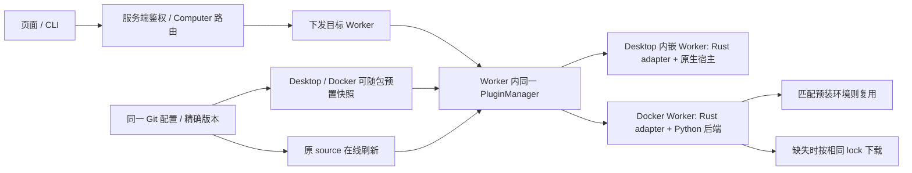

# 官方 MCP 插件的统一分发与生命周期

Status: implemented

发布前提：MCP 尚未正式上线；本次 browser-use 集成是 MCP 首次上线里程碑。直接收敛尚未发布的实现，不承担旧 MCP 配置、凭据或特殊 Browser 身份的升级兼容。已上线 Skills 的安装记录与行为保持。

## 1. 目标与边界

Desktop、Docker Worker 使用同一官方/第三方插件来源、manifest、安装身份与管理流程。区别仅是执行端能力，以及依赖是否已提前准备。Docker 预装 Browser 是同一官方插件的提前交付，不是另一套内置管理方式。

业务入口统一为：页面/CLI → 服务端鉴权与目标 Computer 路由 → 下发到目标 Worker → Worker 安装与加载。Desktop 使用内嵌 Worker，Docker 使用容器内 Worker；二者均由 Worker 持有安装目录、安装状态和运行依赖。Desktop 界面与服务端不代替目标 Worker 下载、安装或运行插件；管理远端 Computer 也不会安装到操作界面所在机器。

Skills 与 MCP 共用现有 source → scanner → installer → PluginInstall，安装后分别交给 Skills loader 与 MCP runtime。少量明确默认项自动安装，其余官方与第三方 MCP 均由用户按需安装；启停只由原 `PluginInstall.enabled` 管理。

本期复用现有规范和必要接入点，不增加第二个 manager、独立 `plugin.json`、全局 `mcp.yaml`、通用依赖安装协议、公共 runtime receipt 或新的启停存储。Skills 保持 `SKILL.md`，MCP 保持 `talos-mcp.json`；直接移除未发布的 `mcp.servers` 静态加载。保留 Rust MCP adapter、BrowserRuntime 和私有 IPC；Desktop 不增加 Python。仅支持 macOS/Linux。

## 2. 当前事实与复用点

- [scanner](../../talos-rs/crates/action/plugin/src/scanner.rs) 已从 Git/本地源发现 `SKILL.md` 与 `talos-mcp.json`；[installer](../../talos-rs/crates/action/plugin/src/installer.rs) 已有安装、更新、摘要、来源、回滚和卸载。
- [service](../../talos-rs/crates/orchestration/service/src/plugin/service.rs) 的 execution gate 与 [MCP 发布 hook](../../talos-rs/crates/action/plugin/src/manager/mcp.rs) 已负责修改准入和连接发布，不另建生命周期。
- [默认源](../../talos-rs/crates/infra/config/src/domains/plugins.rs) 包含 Skills 与 MCP 仓库；[官方 Browser](../../talos-rs/crates/action/plugin/src/manager/official.rs) 使用正常 Marketplace 身份和同一安装器，产品快照只提供来源内容。
- [Dockerfile](../../build/worker/Dockerfile) 从固定官方快照预装 browser-use；版本与完整依赖来自该快照的精确 hash lock，产品不重复维护另一份依赖锁。
- [Rust adapter](../../talos-rs/crates/action/browser/src/stdio.rs) 只转发 MCP/IPC。[ManagedBrowser](../../talos-rs/crates/action/browser/src/managed.rs) 构造时固定 Python 路径，[BrowserRuntime](../../talos-rs/crates/action/browser/src/runtime.rs) 只允许首次绑定后端。普通 MCP 更新不会自动切换这个执行环境。
- [手动 JSON 导入](../../talos-rs/crates/orchestration/service/src/plugin/mcp_import.rs) 转为 `ManualMcpServer`，调用同一安装服务；[CLI](../../talos-rs/apps/tui/src/cli/types.rs) 的六个插件管理命令调用同一 SDK/API。[Worker MCP 装配](../../talos-rs/crates/app/talos-worker/src/mcp.rs) 只加载 Plugin 发布的定义。
- [服务端路由](../../talos-rs/crates/orchestration/service/src/service/plugins.rs) 已按目标 node 调用 Worker environment；[environment client](../../talos-rs/crates/orchestration/agent-client/src/environment.rs) 已承载插件管理指令；[Worker runtime](../../talos-rs/crates/app/talos-worker/src/runtime.rs) 持有 PluginManagerService。复用这条下发链路，不新增 Desktop 安装器。

## 3. 一套仓库规范

产品默认登记 `https://github.com/apilots/mcps`，沿用 `plugins.sources` 的 Git source，`reference: main`、`sparse_paths: [mcp]`。Desktop、Docker 使用相同默认源；第三方添加 Git/本地源的流程不变。

两类官方源使用同一种默认配置，用户无需手写，页面添加来源仍由原 source store 管理：

```yaml
agent:
  kernel:
    plugins:
      sources:
        - source_type: official
          display_name: Apilots Skills
          kind: git
          url: https://github.com/apilots/skills
          reference: main
          sparse_paths: [skills]
        - source_type: official
          display_name: Apilots MCPs
          kind: git
          url: https://github.com/apilots/mcps
          reference: main
          sparse_paths: [mcp]
```

`talos.yaml` 的插件配置只负责来源、原有扫描根等全局设置，不列已安装 MCP、不存第二份启停状态。来源声明用于发现，不意味着自动安装或运行整个仓库。

```text
apilots/mcps/
├── README.md
└── mcp/
    ├── browser/
    │   ├── talos-mcp.json
    │   ├── requirements.lock
    │   └── README.md
    ├── playwright/
    │   └── talos-mcp.json
    └── context7/
        └── talos-mcp.json
```

| 文件 | 职责 |
| --- | --- |
| `talos-mcp.json` | 唯一必需的 MCP 定义；现有连接字段，加可选默认安装声明与 Browser 专属字段 |
| `requirements.lock` | 只有 Docker Browser 需要；上游 browser-use 及完整精确依赖、包哈希 |
| `README.md` | 用途、执行端前置条件和鉴权说明 |

第三方 MCP 仍只需原格式 `talos-mcp.json` 即可发现、安装，默认按需安装；不要求 Browser 协议或安装脚本。不另加 `plugin.json`、同义 `mcp.json`、根级 marketplace 索引或重复发布版本字段。安装版本沿用 Git commit + 内容摘要，上游软件包版本写在命令参数或 lock 中。

首版默认自动安装集合只有官方 Browser，其他官方条目默认 `false`。第三方的同名字段不能触发自动安装；默认来源不是授予私有 IPC 权限的用户可编辑标签。

Browser 的完整 `talos-mcp.json` 示例；`default_install`、`browser` 是单一 manifest 的可选字段：

```json
{
  "name": "talos_browser",
  "display_name": "Browser",
  "description": "Browser automation for this Computer.",
  "default_install": true,
  "browser": {
    "api_version": 1,
    "docker_requirements": "requirements.lock"
  },
  "credentials": null,
  "transport": {
    "type": "stdio",
    "command": "talos",
    "args": ["--browser-mcp"],
    "env": {},
    "cwd": null
  }
}
```

`default_install` 缺省为 false，只声明首次安装策略，不保存当前 enabled。`browser` 只由产品核验的官方 Browser 使用；API 版本和插件目录内的 lock 路径采用明确类型与校验，不形成通用依赖协议。scanner 与安装后读取共用同一 manifest 解析，拒绝无效新增字段和不支持的 Browser API；发布到 runtime 时只投影原连接定义。

Worker 核验官方 Browser 来源、内容与 API 后，将该宿主入口解析为当前 Talos 可执行文件。宿主绝对路径不写回连接入口，必要的凭据 patch 与 JSON 序列化仍沿原安装器处理；摘要采用原安装器规则，不要求源文件与安装文件字节相同。socket 和调用 capability 仅在运行时产生。Rust adapter 与产品驱动仍随 Talos 发布，browser-use 作为 Docker 后端库直接使用上游包，不运行其自带 MCP 替代 Talos 的授权桥。

普通 MCP 继续只需要原连接定义：HTTP 配 URL，npm/uvx 在 `command/args` 中填写上游精确包版本，由上游包管理器下载。执行端缺少 Node/uv 等命令时明确报告，不为所有 Desktop 自动安装 Python。

## 4. 分开三个概念，保持一个安装状态

| 概念 | 含义 | 不隐含的行为 |
| --- | --- | --- |
| 官方 / 第三方 | 插件来源与信任边界 | 官方来源不代表自动安装 |
| 默认安装 / 按需安装 | 首次取得插件的产品策略 | 默认安装不代表不可卸载或强制启用 |
| 预装 / 在线取得 | 同一插件内容到达执行端的时间 | 预装不产生独立身份、第二条列表或第二份 enabled |

Browser 保留既有可关闭、不可卸载的产品约束；不把该特例扩成所有默认插件的通用规则。本期不新增其他自动安装插件，也不引入删除后自动重装或 tombstone 机制。未来增加可卸载的默认项，须先沿既有配置 owner 定义一次性初始化语义，不能用每次启动扫描把用户卸载反转。

首装仅在没有安装记录时应用 Browser 默认值；已有关闭状态不变。发现普通官方/第三方插件只增加可安装项，不启动、不获取其服务程序。页面安装、启停、更新、卸载、凭据编辑继续调用原接口；受信 Browser 用原 installer 激活，移除旧固定 ID 的特殊拒绝，宿主权限校验继续保留。

## 5. 各端相同的交付与对齐流程



1. **统一输入**：构建与在线发现使用同一官方仓库。发布构建固定实际 commit，保留原 manifest 和 lock；运行时刷新 `main` 只发现候选，安装记录保存实际 commit。Desktop 和 Docker 均可携带这个官方快照，不再编译一份 Browser manifest 作为 Manual 插件。
2. **保留 Docker 预装**：Dockerfile 继续准备 Python、browser-use、Chromium 和桌面资源。browser-use 安装从构建输入中的官方 lock 读取，仍校验包哈希；保留镜像构建安装步骤，不再维护产品内另一份 browser-use lock/版本常量。Chromium与桌面资源的原交付方式不变。
3. **注册同一插件**：首次启动通过原 installer 登记官方 Marketplace 来源；预装快照只提供已取得的源内容，不直接覆盖用户持久化的安装记录。Docker volume 中已有用户状态时先读原记录，不能用镜像默认状态覆盖。Desktop 同样从预置快照或在线源登记同一插件。
4. **分别判断内容与环境**：插件身份沿现有 source + path；内容沿原摘要比较，来源 commit 用于追溯。Docker Browser 另外在自己的运行目录/原 `runtime.json` 记录 lock 摘要、平台/架构与 Python ABI、宿主 API、可执行文件位置，并验证实际环境可用。这些是 Browser 私有缓存元数据，不扩展公共 `PluginInstall`。
5. **相同就复用**：Browser lock、平台/ABI、API 和实际包环境一致时直接复用预装或已下载环境，不创建第二条插件记录、不复制虚拟环境、不重复 pip install。仓库其他插件、README 或 commit 改变，不单独触发 browser-use 重装。插件描述改变而依赖 lock 不变时，只更新必要配置。
6. **缺少才准备**：Desktop 检查已有原生宿主，Docker 在 Browser owner 内使用现有 Python 从 lock 下载到隔离、版本化目录；依赖缺失和损坏同样走这个步骤。仅支持固定包与哈希，不接受任意安装脚本。普通第三方仍用声明的上游包管理命令，鉴权仍归原 credential store。

镜像预装与在线准备必须遵守相同 lock 校验规则，不能只有一端信任包名/版本字符串。Docker 已有环境可作为只读资源复用，后续版本在 Worker 可写目录准备；不修改镜像环境，也不把虚拟环境移动后当作路径无关制品复制。

## 6. 下载、更新与 Browser 实际生效

- 官方源后台有界刷新；缓存和有效预装可离线使用。没有有效内容时沿原插件/Browser 状态显示下载失败或不可用，不阻塞整个 Worker，不退回未知版本。重启/重试可以恢复，普通启动不重复下载。
- **首次准备**：Browser owner 只有在依赖就绪后首次创建并绑定 ManagedBrowser；后台第一次下载完成后可走这次首次绑定，无需替换一个已绑定的后端。等待期间工具明确不可用。
- **版本更新**：页面仍调用原 update；候选内容与环境先准备，最终走原安装事务。下载或提交失败保留旧安装和环境。下面同时约束服务端与 Worker 的 gate，不另设公开安装阶段或新的管理服务。
- **生效边界**：仅依赖环境确实变化且后端已经绑定时，首版明确要求重启该 Worker；下载完成不宣称新环境已 ready。更新提交后 Browser 拒绝继续使用旧环境执行，按现有 unavailable/安全错误通路提示重启，撤销旧调用；其他 MCP 不受影响。重启读取已提交配置选择新环境，失败明确报错，不静默运行旧版本。仅描述变化且环境不变时无需因此重启。
- **安全边界**：继续复用可信 ToolContext、每次 capability、私有 IPC、epoch、取消、暂停/接管和文件授权。只有产品认定的官方 Browser 可以绑定私有 socket；第三方自报 `browser`、相同名称或 `official` 标签均不能授予权限。不要为环境更新另建通用 runtime 发布框架。

包版本来自官方 lock，例如当前 `browser-use==0.13.11`，不宣称它是最新版本。仅升级该库已验证兼容的版本可只改官方配置；API/驱动不兼容仍需要产品修改和验收。管理、分发统一不等于所有操作系统安装相同运行依赖。

### 准备与提交的最小边界

服务端 [install/update](../../talos-rs/crates/orchestration/service/src/service/plugins.rs) 与 Worker [install/update](../../talos-rs/crates/orchestration/service/src/plugin/service.rs) 使用准备和短提交两个阶段，分别保持各自的执行准入边界：

1. **准备**：服务端先鉴权并确定目标 Computer，沿原 WorkerEnvironment 增加内部候选准备调用；目标 Worker 在不持服务端 node gate、Worker execution gate 和插件文件提交锁时，取得不可变候选快照并准备所需 Browser 环境。候选放原 `.tmp` 下的独立目录，不能直接引用刷新时会被替换的 Git 工作目录；原来源元数据只在短文件锁内读取/校验，网络 I/O 在锁外。此步骤只写候选缓存，不写安装记录、不切换 runtime、不改变 enabled。普通第三方 MCP 不预启动其服务。先给出权限错误，不能未授权先下载。
2. **短提交**：准备结果只在同一次 install/update 请求内使用，包含 actor、目标、来源 commit、内容摘要和预期原安装修订等明确类型，不能接受客户端伪造的候选路径或跨 actor/目标复用。服务端重新核验目标权限并取得原 node gate，检查无非终态 Turn；经原 install/update 下发，由 Worker 取得原 execution gate 和插件文件锁，重验候选与原安装修订后执行原事务及发布。提交不重新拉 Git 或下载依赖；候选失效明确冲突，重新准备后重试。
3. **不新增状态系统**：内部准备复用原 source/cache 与 Browser owner，不暴露第二套页面状态、公共 receipt 或持久化任务队列。请求中断留下的候选只作为可清理缓存，不能在重启后自行安装。任何失败都不释放必要的执行准入检查，也不允许旧 capability 绕过更新边界。

准备后的服务端鉴权、准入或提交失败时，经同一 WorkerEnvironment 私有取消调用释放候选与准备名额；取消只能操作相同 actor 的候选，不取得安装提交锁。候选已消费时取消为空操作；服务端或连接丢失仍由原有过期清理兜底。Rust AppServer SDK 仅为 `plugin/install`、`plugin/update` 使用覆盖 Worker 准备和提交预算的 900 秒时限，其余请求保持 30 秒。

首次默认安装复用相同 Worker 准备/提交函数，启动未承载 Turn 时由 Worker 本地初始化；不要求服务端在线。source 刷新只更新可安装候选，不更改已安装修订；其既有策略不扩成新的安装生命周期。

## 7. 现有安装与页面

### 7.1 同一安装入口与本地加载

“手动安装”指用户主动发起 Plugin 安装，不是向目录复制文件后绕过登记。页面与 `talos plugin` CLI 使用同一服务端 Plugin API，共用目标 Computer 选择、鉴权和 Worker 下发；CLI 只映射参数并输出 JSON，不直接操作安装文件。来源管理和手动 MCP JSON 导入继续使用现有页面/API。

```bash
talos plugin list
talos plugin install <plugin-id> --node <computer-id> --commit <git-commit> --disabled
talos plugin enable <install-id> --node <computer-id>
talos plugin disable <install-id> --node <computer-id>
talos plugin update <install-id> --node <computer-id> --commit <git-commit>
talos plugin uninstall <install-id> --node <computer-id>
```

省略 `--node` 时由服务端选择本机内嵌 Worker。安装以 Plugin ID 为输入；更新、启停与卸载以安装 ID 为输入。默认拒绝安装冲突和覆盖本地修改；只有显式传入 `--replace` / `--replace-local-changes` 才使用原接口的覆盖策略。

| 输入 | 目标 Worker 内的处理 |
| --- | --- |
| Git 仓库 / 本地来源 | 原 source/scanner 发现候选 → 用户选择 → 原 installer 安装；本地路径指目标 Worker 可访问的路径 |
| 页面手填 / 导入第三方 MCP JSON | 原导入接口规范化为 ManualMcpServer → 原 installer 写 `talos-mcp.json` |
| 产品默认安装 | 目标 Worker 首次初始化时用同一 installer 登记核验后的官方 Browser；预装快照仅提供源内容 |

页面或 CLI 的用户管理操作都经服务端下发；Worker 启动时的既有安装加载与首次默认初始化不依赖用户再次点击安装。

两种 Worker 均沿用 [现有目录](../../talos-rs/crates/action/plugin/src/state.rs)，`TALOS_HOME` 为该 Worker 的运行数据根：

```text
<Worker TALOS_HOME>/plugins/
├── marketplace-sources.json
├── plugin-installs.json
├── skills/<name>/SKILL.md
└── mcp/<name>/talos-mcp.json
```

安装事务写目录与安装记录；启用后，Skills 提供已安装的 SkillRoot，MCP 发布已安装 manifest 的连接定义，由该 Worker 的 MCP runtime 启动进程或连接 HTTP 并发现工具。停用撤销相应加载；重启按原记录恢复。仅复制文件不构成受管安装，不另加“加载清单”。

普通 stdio MCP 的配置安装与上游包下载分开：Plugin 安装器取得定义，启用启动时 `npx`/`uvx` 等执行清单中的精确版本命令；HTTP MCP 只连接已有服务。禁用安装不启动服务程序。Worker 必须已有对应包管理运行环境；缺少则显示明确错误，不由 Desktop 客户端代装。固定入口包版本不等于完整锁定其所有传递依赖，要求完整复现的上游包须采用其已有锁定方式；Browser 仍使用专属 hash lock。

### 7.2 状态与页面操作

| 行为/状态 | 原 owner；本期约束 |
| --- | --- |
| 发现、安装、更新、卸载 | 原 source/scanner/installer/service；用户操作经服务端下发，目标 Worker 执行；默认初始化调用同一 installer |
| 启停 | 唯一权威仍是 `PluginInstall.enabled`，升级、预装和源刷新不覆盖 |
| 已安装版本 | 原来源 commit + 内容摘要；包版本来自命令参数/lock，不重复声明发布版本 |
| Docker 依赖是否可复用 | Browser 私有环境元数据与实际可用性检查；不成为另一份插件安装状态 |
| 官方、默认安装、预装标识 | 根据来源、元数据和本机资源派生，不按旧 `builtin_browser` ID 维护第二套 UI |
| 连接、鉴权、失败、重试 | 现有 MCP/Browser 状态与管理动作；下载成功不等于连接就绪 |
| 浏览器选择、暂停、接管 | 原 Computer 页面，不搬进 MCP 插件配置表单 |

Browser 首次即用正常 Marketplace 身份安装，删除未发布的 `builtin_browser`/Manual 预置分支，不写旧新 ID 转换、别名或历史凭据重绑定。正式上线后的普通更新沿原身份规则保持稳定；同名用户插件仍显式冲突，不能覆盖。

现有用户 sources 配置由配置 owner 仅补齐官方 MCP 源，保留显式空列表或自定义 Skills 来源的原有策略，不重写用户 YAML 的 sources。手动添加/可选插件流程保持，不把已经安装的插件再列入另一张加载清单。官方仓库维护实际 manifest 与精确 lock；构建输入在 `build/plugins/official-mcp.json` 固定来源 commit，在线更新仍沿原 source 流程。

### 7.3 首次上线直接移除静态通路

所有 MCP 从首次上线起只走 Plugin。直接删除 `agent.kernel.mcp.servers` 的类型、模板/示例、读写入口和 runtime 合并分支；其他非服务列表的 MCP 全局设置保持。配置校验拒绝该字段，不保留升级读取器或静默忽略路径。

- 删除 MCP definition/auth 管理中的 Config owner 变体及专用写回分支，凭据从创建开始就绑定 Plugin install owner。Token/OAuth 继续使用原私有 credential store；内联秘密经原导入接口抽离，不写官方仓库。
- 保持现有 Plugin manifest 语义：相对 cwd 基于插件安装目录；command/args/env 中的占位文本按现有 Plugin 规则处理，不额外承诺 YAML RuntimeEnv 插值能力。需要用户参数或秘密时沿页面导入/凭据配置，不模拟旧静态配置行为。
- 不实现旧 YAML→Plugin、Config→Plugin 凭据、旧 Browser ID 的迁移，也不建立共享 YAML 的跨 Worker 协调。开发环境中的未发布 MCP 测试配置与夹具按新格式显式更新；不自动清空 TALOS_HOME，不碰已有 Skills、会话、浏览器 profile 或其他用户数据。
- 页面安装、启停、删除、更新继续复用现有 Plugin 接口；只保留一份安装记录和一个加载来源。首次上线前同步更新 SDK、生成契约、配置 schema 与测试，保证静态入口确实删除。

## 8. 必要改动与验收

| 现有位置 | 改动 |
| --- | --- |
| config + plugin scanner/types | 默认 MCP source；现有 manifest 增可选字段，不新增 manifest；直接移除未发布的静态定义 |
| 服务端路由 + Worker plugin/service | 同一安装/事务 owner；两层 gate 拆准备与短提交；Worker 官方预装登记；CLI 仅补同一 API 客户端入口 |
| Browser + Docker/desktop packaging | 同源快照、保留 Docker 预装；Browser 私有环境复用/下载和明确重启生效；Rust adapter 不变语言 |
| MCP runtime/tools + 页面 | 只加载 Plugin 发布定义；凭据仅归 Plugin owner；受信安装绑定替代旧固定 ID 判断；页面保留原管理动作 |
| `apilots/mcps` | 独立提交官方 manifest、精确 lock 和配置检查；不与 Talos 合并跨仓历史 |

验收条件：

- macOS Desktop、Linux Docker 对同一官方插件得到相同来源、身份和生命周期；目录里其他官方与第三方 MCP 都按需安装。
- 页面/CLI 经服务端下发，分别在 Desktop 内嵌 Worker 和 Docker Worker 完成安装、启停、更新和卸载；操作远端 Computer 不写入客户端安装目录，权限和目标隔离沿用现有规则。
- 第三方 Git/本地源的 Skill 与 MCP、手动导入 MCP 均进入同一安装记录；MCP 真实连接/工具发现、禁用撤销、重启恢复及缺运行环境错误可验证；普通 MCP 不要求新增元数据。
- `mcp.servers` 配置被拒绝，配置 schema/模板与生成契约不再提供 Config owner；无静态写入口、合并加载、旧 Browser 预置或 MCP 升级兼容代码；已有 Skills 与非 MCP 数据不受影响。
- 慢下载时两层执行 gate 均未被占用；期间权限、来源或原安装变化在短提交时明确失败；并发 Turn 阻止提交，失败和中断不改变原安装/启停，也不留下自动激活任务。
- Docker 预装与在线获取同一 lock 后重启零重复下载；README/其他插件更新不重装依赖；volume 状态和已关闭 Browser 保留。
- 缺失/损坏环境可按精确 lock 恢复；无网络用有效预装/缓存；错误 lock、包哈希和 API 明确失败，不伪装 ready。
- 首次后台下载完成后真实 MCP 可执行；依赖更新按重启边界生效；更新失败、活动 Turn 冲突及旧 capability 不破坏原控制边界。
- Desktop 内嵌 Worker 的官方 Browser 不下载/执行 Python；现有 Browser 暂停、接管、文件和真实 Docker/macOS 任务仍通过代表性 E2E。
- 使用原 plugin/MCP/browser 相关 `just test -p <package>`、SDK/UI/生成契约与 `pnpm --dir talos-app check:repo`；实际预装/在线验收分别记录，不用 mock 宣称真实下载成功。

实施按根目录任务 Plan 的 I1–I4 推进：来源/manifest → Worker 分发与 Browser → 单一路径/CLI → 两类 Worker 验收。浏览器使用官方精确 lock、真实 MCP 任务在两种 Worker 上完成，并通过上述控制边界验收，才达到首次上线里程碑；仅成功下载或通过文档检查不算上线完成。

官方仓库的 manifest/lock 与可访问的固定 commit 是发布前置；单元验证可使用同格式的本地固定快照，双端交付验收使用实际远端固定 commit。远端仓库提交/发布与 Talos 产品改动分别 Review。

本规范仅替代 [feat-047](../feat-047-browser-computer-desktop/design.md) 的来源/分发、依赖版本和旧身份特设；原浏览器执行、媒体和平台边界保持。本规范与实现同步维护；首次上线验收须使用固定 commit 和当前源码构建的 Desktop/Worker。
