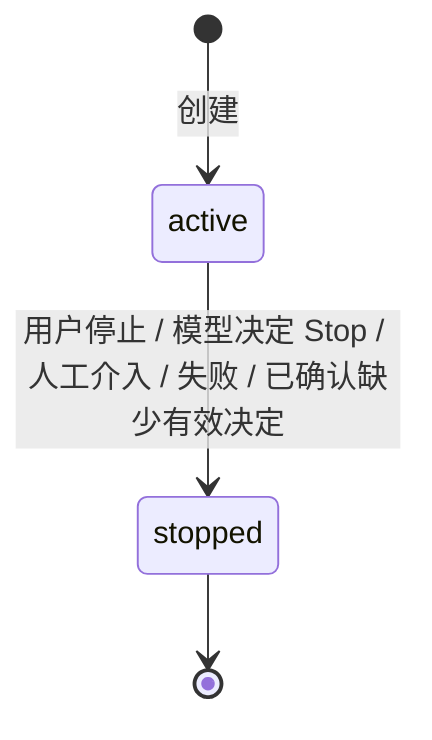
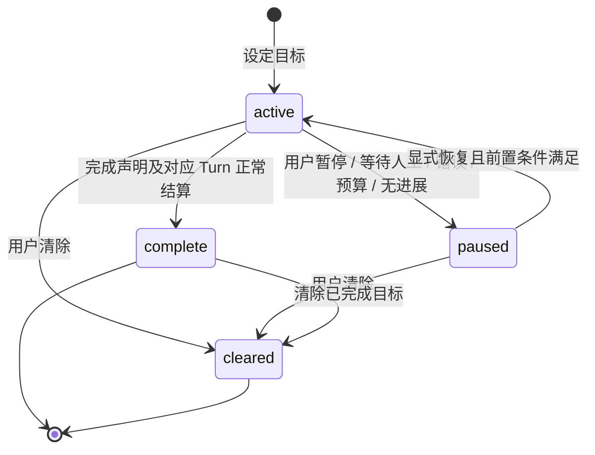
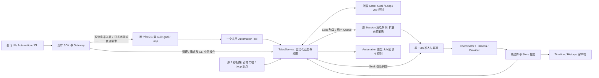

# Session Goal 与 Loop：一期最小方案

Status: accepted
Created: 2026-11-04
Related request: [Issue #120](https://github.com/apilots/talos/issues/120)
Implementation boundary: 按已确认 Plan 实现一期范围；复用现有执行、队列、调度和客户端基础设施，验证完成后交付 Review。

## 1. 要解决的问题

用户已经在一个 Session 中工作，却还需要不断提醒 Agent“再看看”和“继续做完”。这两个需求使用相同上下文，但推进时机不同：

| 场景 | 用户委托 | 一期能力 |
| --- | --- | --- |
| 固定频率跟进 PR、CI、部署进度 | “每 5 分钟检查，有变化告诉我” | 固定间隔 Loop 定时唤醒当前 Session |
| 按进展跟进 PR、CI、部署进度 | “帮我盯着，按进展决定何时再查” | Loop 定时唤醒当前 Session，模型决定下一次唤醒时间 |
| 修复测试、完成迁移、性能优化 | “持续推进，直到这些验收条件满足” | Goal 在需要时自动续跑 |
| 同时跟进多个 Session | “看看哪些还在运行、哪些需要我处理” | Automation 简单列表与管理 |
| 运维当前电脑的定时维护任务 | “查看任务何时运行，临时暂停，必要时执行一次” | 电脑 owner 在 Automation 管理所属执行实例的内置 Job |

Loop 回答“何时再执行”；Goal 回答“何时才完成”。一期都附着于当前主 Session；Home 首条消息经原准入建立 Session 后同样可登记，继续使用同一工作环境、Agent、权限和历史，不创建独立调度 Session 或新的任务执行系统。

Loop 既支持用户指定固定间隔，也支持模型根据本轮结果决定下一次唤醒；显式给出“每 5 分钟”时仍遵循用户指定间隔。同一 Session 只能启用 Loop 或 Goal 中的一种模式，暂停中的 Goal 仍占用目标模式。

“每 5 分钟检查 CI，直到通过”是 Loop；“持续修复 CI，直到通过”是 Goal。无需为了前者同时创建 Goal。

## 2. 一期范围

- Loop：固定间隔与模型决定间隔两种模式，后续间隔最小 1 分钟；显式模式的注册 Turn 只登记 / 回执；提示词驱动的普通 Turn 创建后同样交由自动首轮执行，最早在定义创建 10 秒后准入；查看、编辑 prompt / 间隔、停止、清除。
- Goal：每个 Session 最多一个未结束目标；注册与业务首轮分离，首轮同样等待创建后 10 秒；设定、查看、编辑、暂停、恢复、清除；目标与验收要求跨 Turn 保留；目标总耗时从创建算起，包含暂停，完成后定格；默认 24 小时上限在原准入 / 结算边界检查。
- 同 Session 的 Loop / Goal 互斥，包含原 User 队列中的显式待启用意图；多个 Loop 允许共存并串行执行。切换模式需要结束旧模式及其尚未完成的自动 Turn / 人工动作。
- 原执行链中的普通 Turn：串行准入、工具执行、用户交互、取消、恢复、历史与用量继续由现有能力负责；Loop 触发统一进入原 Session 消息队列，Goal 只在队列空后续跑。
- `goal`、`loop` 是两个独立内置轻量 Skill，用户通过命令、自然语言主动要求或 UI 显式调用；两者共用一个 `automation` 工具执行确定性业务操作，不形成两套产品入口。
- Web / Desktop：输入框 slash 与“添加 +”为两个等价入口，选择模式后发送；任务状态与原待发消息共用轻量展开列表。Automation 聚合 Goal / Loop 及当前电脑 owner 可管理的内置 Job。
- TUI 与 CLI：TUI 的 `/loop`、`/goal` 与 Web / Desktop 共享命令目录、参数及状态动作合同；非交互 CLI 通过 SDK 提供等价命名子命令。
- Loop / Goal 定义持久化；页面刷新、客户端重连或关闭不停止工作。消息队列仍全部在内存中，Server 重启不统一暂停 Goal / 停止 Loop；后续正常触发基于已有数据库记录继续，丢失的纯内存执行状态本期不恢复。
- 现有 `profile-usage-retention`、`dream-memory-maintenance` 保留原生回调与配置所有权，增加所属电脑 owner 的查询、持久暂停 / 恢复，以及按 Job 能力开放的“执行一次”；不新增管理员 / 普通用户分层。

一期不包含：用户 Loop 的日历 cron / cron 编辑器、Webhook / 平台事件、跨 Session 新建运行、独立 Goal evaluator、通用 Stop Hook、LoopRun 控制台、工作流编排、模板市场、每 Loop 独立凭据 / 权限体系、成本美元硬上限。内置维护 Job 既有 cron 继续使用并可只读查看。

Automation 扩展已有调度基础设施，并提供 Goal / Loop / BuiltinJob 的统一管理视图；不新增一份通用 Automation 持久业务对象，也不建设工作流引擎。本期不承诺跨独立 Server 的聚合或调度状态 Sync。

## 3. 产品入口与界面

### 3.1 会话入口

Web / Desktop 提供两个等价入口（TUI 仅 slash，不增加 Add 菜单）：输入框 slash 命令与“添加 +”模式选择。Web / Desktop 和 TUI 使用相同的 Goal / Loop 命令目录、参数及查看 / 编辑 / 暂停 / 恢复 / 停止 / 清除合同，不能各自解释时间；用户明确自然语言要求仍是第三种显式模型表达。创建时 slash / Add 只传选中模式和原始 prompt，不解析或剥离周期文本；模型按原要求判断固定 / 模型决定，再由共用工具与 Service 校验。CLI 的显式 `--every` / `--dynamic` 直接构造同一类型化 action，不拼接 slash 再解析。

TUI 支持直接输入 `/goal <目标提示词>` 或 `/loop <任务提示词>` 并提交，触发对应任务的登记与后续执行；只保留原 slash 入口，不增加 Alt+G / Alt+L 或 Add 入口。命令携带原始任务与受保护 System SkillSelection，空闲时沿原 SDK Start、忙时沿原 SDK Queue 提交，复用同一后端处理，不增加启用专用通道；裸 `/goal`、`/loop` 的查看行为保持下表约定。TUI 任务区仅保留 active / paused Goal 与 active Loop；结束对象仍可沿原查看 / 历史访问，移出任务区后释放任务焦点，普通输入继续进入原输入框；不要求复刻 Web 布局。

非交互 CLI 的 Start / Resume 使用原嵌入运行时并在前台观察精确对象。暂停 / 停止 / 清除只阻止后续工作；本对象已有 Running / Cancelling Turn 时，前台等待其结算后再沿原 shutdown 退出，避免把暂停隐式变成取消当前工作。等待人工输入时沿原可恢复边界处理，不新增后台守护进程、客户端调度或持久执行状态。

`goal`、`loop` 分别提供对话中的内置 Skill 入口。slash 建议项与 Add 选择收敛为相同的类型化 Skill 待发模式；完整命令带 prompt 发送则直接表达该次调用，裸命令按下表查看，不因出现 `/goal` 就创建目标。自然语言例如“使用 Goal 持续修复直到测试通过”“用 Loop 每 5 分钟检查 CI”同样可由模型根据用户请求调用，不要求命令前缀。两个 System Skill 提示模型区分任务委托与仅提及、讨论、引用；不因普通任务看似适合自动化就自行登记。信息明确时直接执行，缺少必要任务信息或要求一期不支持的周期才澄清，不增加强制确认。澄清复用原 AskUserQuestion，续接同一 logical Turn；显式选中的模式沿该次原输入保留，普通自然语言仍由模型结合用户请求判断，不伪造 SkillSelection。日历周期如“每天 9 点”一期不支持，不能静默变成每 1440 分钟；未指定周期通常直接采用 modelDecided。同名项目 Skill 不能覆盖保留命令。共享 `AutomationCommand::Activate` 仅含 `mode` 与原始 `prompt`，不含 schedule 或时间解析；裸命令和显式管理命令仍沿原合同分发。

产品入口与执行机制分三层：**两个 Skill** 写明 Goal 推进 / 完成和 Loop 唤醒规则；**一个 AutomationTool** 通过类型化参数和受限执行端口到达 Service，是对话模型路径；**Service / Store / 调度器** 拥有唯一业务校验、状态、计时和准入。UI 启用消息携带显式 Skill 选择，经 SDK 进入原会话执行；列表、暂停、停止、编辑等管理操作可经 SDK 直达同一 Service，不强制再调用模型。已启用的自动 Turn 注入对应 Skill 规则与当前状态，不重新创建能力。

两种创建路径共用同一个 AutomationTool 与 Service。slash / Add 的类型化 SkillSelection，或输入正文开头的完整 `/goal` / `/loop` 启用命令，确定本次选中模式；正文其他位置的命令文本不用于激活。已选模式是确定输入，不由模型重新猜测。普通自然语言不做关键词、调用动词或正则意图识别，也不补造 selection：原 Skill loader 向普通 User Turn 提供两个只读 System Skill 的指引，模型据用户请求决定是否通过同一工具 Create，并生成 Goal 目标或 Loop 调度参数。普通 Turn 保留原业务工具与 Queue / Steer 行为，不因注入 Skill 就变成 registration-only；Create 成功后由 Skill 要求回执并把任务交给后续自动 Turn。

后端只将原输入中的显式模式或已有自动执行绑定放入原 Runtime 请求上下文；普通自然语言不伪装为后端已确认的模式。上下文沿原预算与重建规则处理，不改写原始 prompt / 历史、不增加持久字段或传输通道。Service 校验真实 Session / Turn、模式互斥及对象版本；显式选择约束创建模式，已绑定自动 Turn 不得再创建任务。

当前 loader 只有文档加载 / 提示注入，本期使用只读 System root 的两个系统 Skill 和共用 `automation` 工具，复用已有工具参数校验、调用 / 结果和结算边界。显式选择与自动执行身份由原执行上下文绑定，不由模型传入参数自证；普通请求是否委托自动任务由模型依照两个 Skill 判断，不新增关键词授权门槛。不新增 Skill 私有结果通道、任意文本解析、通用 Skill 引擎或任意命令执行器。

Skill 覆盖完整类型化业务管理，不仅是创建提示。显式管理先读当前 Session 事实，以返回的精确 ID / revision 选择对象；多个同文案 Loop 不能凭 prompt 猜身份，目标不明确才追问。自动 Turn 只操作本次 `boundOrigin`，不能修改其他 Goal / Loop；固定自动轮不能自行调用管理 Stop，动态只能提交本对象的 Decide Stop。原权限、互斥、人工动作、结算与 revision 校验仍由同一 Service 执行，模型工具不管理内置 Job。

| Skill | 对应 typed action |
| --- | --- |
| Goal | Create / Read / Edit / Pause / Resume / Clear；真正业务轮对本次绑定版本的 Complete 声明在正常结算后生效，登记轮不能 Complete |
| Loop | Create / List / Edit / Stop / Clear；本次绑定版本的 Decide Continue（至少 1 分钟）或 Stop 在正常结算后生效 |

AutomationTool 的 target / action / schedule / decision 都是严格闭合对象，要求 discriminator 和各必填字段，不接受额外字段、把对象字符串化或缺省 / 修补参数。非法调用在进入控制端前失败，模型可在同一 Turn 根据真实错误纠正；被拒绝调用不能创建定义或排队。JSON / schema 继续由共享类型生成，不引入新的解析器或校验库。

| 入口 | 行为 |
| --- | --- |
| 选择 slash 的 Goal / Loop 建议项，或 Add 的对应项 | 进入相同待发 mode，原输入框写 prompt，发送才启用；选择本身不创建 |
| `/loop 5m <prompt>` | 选择 Loop Skill，原样传递 `5m <prompt>`；模型识别固定周期后调用同一工具创建 |
| `/loop <prompt>` | 选择 Loop Skill 并原样传递 prompt；未指定周期通常采用模型决定，无额外确认 |
| “用 Loop 每 5 分钟检查 CI” / “使用 Loop，时间由模型决定” | 用户明确指定能力与任务时，调用相同 Loop Skill；固定 / 动态规则一致 |
| `/loop`、`/loop list` | 列出当前 Session 的 Loop |
| `/loop stop <id>` | 停止后续触发；保留已有 Turn |
| `/loop edit <id>`、`clear <id>` | 编辑后续 prompt 与固定 / 动态间隔，或清除已停止项；清除 active 项先停止未来触发，保留 Turn 历史 |
| `/goal <objective>` | 创建目标并请求开始；未结束目标已存在或有 active Loop 时拒绝，提示管理原对象 |
| “使用 Goal 持续修复，直到测试通过” | 用户主动要求使用 Goal 时，调用相同 Goal Skill，不因只是普通长任务而自动创建 |
| `/goal` | 查看当前目标、状态、用量与最近关联执行 |
| `/goal edit`、`pause`、`resume`、`clear` | 编辑、暂停、恢复或清除当前目标 |

在现有 [ChatComposer](../../talos-app/web/src/features/chat/components/ChatComposer.tsx) 的“添加 +”菜单顶部提供 Goal / Loop。选择后，`Full access` 右侧以极淡竖线分隔，内嵌无独立边框 / 底色的 icon + Goal / Loop；悬停 / 聚焦显示清除提示与叉号，点击移除待发模式；用户仍在原输入框写 prompt 并发送，不打开创建表单或增加确认步骤。模式只是本地待发草稿，选中或清除 chip 不创建、停止任何任务；Home 与已有 / 尚未创建的 Session 使用同一命令目录及实际所选电脑上受保护的只读 System Skill，原始 prompt 与类型化 SkillSelection 一起贯穿首次导航和原消息发送。原准入 ACK 成功后消费一次待发模式，不等待整轮完成，也不等待首轮倒计时；准备或准入失败保留原草稿与模式，切换 Session / 电脑不沿用旧提交。后续普通输入仍按原消息处理，不重复创建。Goal 验收条件、可选 token 预算与 Loop 固定 / 动态间隔均在 prompt 中说明，创建不新增配置字段。权限选择保持原语义，新增模式入口不因模型不支持附件而被禁用。

slash 与 Add 的启用消息使用同一 Skill 选择、互斥、队列和准入规则；忙时仍可选择并进入原 User 队列，不能沿用现有所有会话命令仅空闲显示的限制，真正准入对应 Turn 后才允许创建。提交入队前检查已有定义与待启用意图的互斥；冲突直接拒绝并保留 draft / chip，不让 Goal / Loop 混排后再等待失败处理。Goal 或 Loop 正在运行时，用户仍可在原输入框输入消息：默认进入原 Queue，点击该消息的 Steer 则干预同一个正在运行的 Turn，不创建并行 Turn，也不切换任务模式。人工消息保留 [WaitingMessages](../../talos-app/web/src/features/chat/components/WaitingMessages.tsx) 的行级交互：忙时 Enter 先入队、主按钮 Stop，逐行 Steer；空闲时 Play，另有删除、编辑、上移 / 下移与原键盘 / 防重复请求规则。携带结构化 Skill 选择的消息不支持 Steer，普通 text / file 消息保持原限制；waiting 状态不允许 Play 绕过人工动作。

输入框上方只展示有效 Goal（active / paused）与 active Loop，包括正在运行、排队或等待下轮。Goal 完成、Loop 停止或任一项清除后自动移出；不要求用户手动清理、不读取或合并已结束列表。原 Timeline 与 Automation 已结束记录保留。输入区域上方的任务行与原 WaitingMessages 共用一个展开 / 收起容器，不增加独立 Goal / Loop 抽屉或重复状态区。任务行左侧仅显示图标与 Goal / Loop 类型，随后为摘要；不重复显示进行中、等待、暂停、已启用等状态文字，右侧保留时间与细线图标操作，精确复用设计稿的几何、大小与轻量布局，依次为暂停 / 继续（Loop 为停止）、删除、展开，参照紧凑单行列表；不增加卡片。Goal 显示从创建开始的目标总耗时，跨 Turn 不归零，暂停也继续计时；完成后在 Automation 保留定格耗时，移出输入框上方。Loop 仅当前确切 Loop 来源 Turn 才显示本轮运行耗时，等待时显示下次时间；已结束项移至 Automation 查看。普通 User Turn 不借用 Loop 的计时。提供 Goal 暂停 / 继续、Loop 停止，以及编辑 / 清除；Goal 编辑 modal 仅含 prompt，Loop 编辑另提供固定 / 模型决定选择及固定分钟数（至少 1 分钟），不增加创建表单或预算字段。同一 Loop 定义与已触发项共用一条任务行，不重复行或状态文字；原队列计数与 Automation 状态保留排队事实，来源、容量与派发不变，Loop 项仍只读、不能 Steer 或调序。显示秒数复用客户端原刷新机制，不运行业务调度，不新增持久计时字段。

定义登记成功后，任务行明确显示首轮秒级倒计时和“取消”，到点但仍被会话 / 人工队列阻塞时不伪装已执行。取消复用该对象 ID 的 Goal Clear / Loop Clear，阻止尚未准入的首轮并使该行移出；它不声称中断已准入 Turn，后者继续使用原中断入口。倒计时由已有创建时间 / 下次时间派生，仅为展示，不是客户端调度或延迟发送。

同一 Session 不同时展示为两种启用模式。编辑不扩大权限，不自动恢复已暂停 Goal 或已停止 Loop。原 Timeline 保持在容器上方正常流式展示；任务定义、等待触发与排队不生成虚构执行历史，只有实际准入的普通 Turn 才有执行过程。Loop 创建回执说明固定或模型决定的调度方式，不显示统一有效期。动态 Loop 只有在原 Turn / 队列事实可确认当前工作时才可提示“本轮结束后决定”；缺少下次时间依据时，模型决定模式只显示“模型决定”，固定模式显示“暂无下次时间”，不从 active 定义猜测正在运行。

History 中各来源使用相同的整体 Input 消息组件：上部内容区容纳原始文本 / 附件，随内容自然换行增高；下部为气泡之外、靠右的窄 metadata 底栏，不将来源文字塞进正文。确切自动来源或本条输入显式选择 Goal / Loop Skill 时，默认常显对应细线图标 + 简短“Sent as goal / loop”来源文案；鼠标悬停整个 Input 或键盘聚焦其内时，同一底栏再显示已有真实消息时间与复制按钮；普通 User 不显示来源图标 / 文案。触屏可直接访问底栏操作；展开不遮挡正文或改变上部内容高度，未知时间不补造。不为 Goal / Loop 添加历史大标题或卡片。实际执行绑定读取 `AutomationInputOrigin` 与其 `AutomationTurnOrigin`；此外，本条原始 UserInput 的类型化 `SkillSelection.name` 可投影为仅 UI 使用的 `activationMode`，注册前的首次气泡与历史刷新也立即显示“Sent as Goal / Loop”，不等待 Create 成功。展示优先真实 origin，再用本条 activationMode；按同一消息 ID 只补缺失来源字段，不覆盖正文、附件、时间或原执行身份，不重复气泡。activationMode 不伪造对象 ID、Turn origin 或计时依据。普通后续 Steer 没有自己的选择则不继承标签，不按 Session 模式或 prompt 文本传播。

### 3.2 Automation 列表与内置 Job

Web / Desktop 导航增加 Automation 入口：显示自己的 Session Goal / Loop，以及当前电脑 owner 可管理的“内置任务”，不提供管理员 / 普通用户切换。Goal / Loop 使用对齐的紧凑列表：主行仅以摘要为主，右侧仅保留操作；第二行弱化 metadata 汇总类型、一次状态（包括 Complete / Stopped）、耗时或周期 / 下次时间及必要原因，不把状态或时间另放右侧，不常驻 Token 裸数或技术 Session ID，不重复堆叠状态。打开会话使用带本地化提示的轻量入口，动态 Loop 可查看最近等待原因。

- Goal：进行中可暂停，暂停后可恢复；可编辑、清除；已完成不显示恢复按钮。
- Loop：active 时可编辑 prompt / 间隔、停止或清除；停止项只查看、清除或回原 Session 重新创建，不增加暂停 / 恢复语义。
- Automation 只做聚合查看、控制和回到会话，不提供“新建”或独立创建表单。创建在当前用户可访问的主 Session 中完成，包括 Home 首条消息沿原准入建立的 Session；一期不绑定 Subagent Session。
- 创建 / 恢复时检查会话模式；冲突时显示原对象与前往管理操作，不暗中停止、清除或切换。
- 默认展示未结束项；“已结束”查看仍保留的完成、停止记录，不建设独立运行报表。清除对象后退出管理列表，原 Turn / History 保留。
- 列表、会话面板、命令行读取同一后端状态。Automation 一期只展示定义的真实状态，active 表示“已启用”，不冒称“运行中”；Loop 显示固定周期或“模型决定”，有已知下次时间时再附加该时间，不为未知时间单列占位。执行过程回原 Session 查看，不为列表逐行查询 Turn / queue 派生运行监控。
- 内置 Job 显示名称、来源、所属电脑执行实例、原配置日程 / 时区、下次时间、最近已观察结果和可用操作；提供暂停 / 恢复，只有明确声明支持的 Job 显示“执行一次”。仅返回当前 owner 有权管理的实例，不因连接同一 Server 而获得其他电脑的控制权。
- 内置 Job 不可删除、改写为 prompt 或在本页编辑 cron。暂停只停止后续自动触发，不中断已运行回调；暂停与正在运行分开展示。

局部草图：[交互预览](../../design/goal-loop/index.html)、[设计说明](../../design/goal-loop/README.md)。`design/` 按仓库规则为本地 ignored 评审材料，不是随产品发布的页面；无关界面仅使用占位横线。

## 4. 业务流程

### 4.1 Loop：创建、等待、执行、结束

1. 用户在 Session 显式调用 Loop Skill；UI 选择 Loop 后直接发送 prompt。启用消息按原人工消息准入，Skill 调用工具创建 `active` Loop，有 active / paused Goal 或待启用 Goal 时拒绝。Loop 没有统一有效期或自动过期：固定间隔持续安排下一次，直到用户停止或原异常 / 人工边界终止；模型决定模式可根据本轮结果提交 Stop。
2. 显式选中 Loop 的 Turn 仅开放登记与原 AskUserQuestion；普通提示词驱动的 Turn 保留正常工具，模型 Create 成功后按 Skill 回执，不直接承担新 Loop 的业务首轮。保存 `next_due_at = created_at + 10 秒`；原 1 秒扫描到点后先用 Store 的原比较更新将该时间 claim 为已消费，再放入原内存队列，使同一数据库上的并发扫描只有一个胜者；真正执行仍等待当前 Turn、人工队列和原准入门槛。claim 后崩溃造成的内存项丢失不恢复、不承诺逐次 exactly-once。自动 Loop 永不调用 Steer，不向正在执行的 Turn 注入提示。
3. 固定模式按用户间隔唤醒；动态模式由同一执行模型提交本轮下一次决定，后续触发仍进入相同队列。每个 Loop 最多一个待执行 occurrence，本 Loop 正在运行时不再堆积；重复到点合并，不累计补跑。
4. 每次执行仍是普通 Turn，带可见的 Loop 来源，结果回到同一 Timeline。有变化或需决策时说明，无变化保持简短。
5. 用户停止，或模型决定模式的 Agent 根据原指令提交 Stop，均禁止下一次触发。执行失败 / 需要人工处理时停止该 Loop 并显示原因，不增加外层自动重试。

固定间隔从本轮正常结算后起算：等待用户指定的分钟数，再进入同一队列；执行和排队期间不重复触发，也不是严格墙钟日程。动态模式同样从结算后起算，仅等待分钟数由模型决定。首次触发不等待固定 / 动态分钟间隔，但必须满足创建后 10 秒的首轮门槛；后续不再加这段等待。Loop 没有截止时间字段或过期状态。固定模式的每次正常结算均安排下一次；停止仍撤回未准入项，已有 Turn 正常收尾。

动态模式经 `automation` 工具提交类型化 `Continue { delay_minutes, reason }` 或 `Stop { reason }`。`delay_minutes` 必须至少为 1；小于 1 的决定被拒绝，模型可在本轮内修正。Service 只暂存当前 Loop / Turn 的决定；正常终态提交后才生效：Continue 以结算时间加等待分钟数写入 `next_due_at`，Stop 结束 Loop。本轮仍在运行或等待人工时，不提前安排下一次执行。

决定提交仍核验当前 Loop 身份、状态、配置版本及本轮关联；停止、编辑或切换期间到达的旧决定作废，不能重新激活 Loop、结束新配置或覆盖其下一次安排。`missingDecision` 同样不能从旧配置 Turn 推导到新配置。

仅在原存活执行的正常结算中，能确认本轮没有提供有效决定时，才停止 Loop 并显示 `missingDecision`，不使用隐藏默认值或 fallback 唤醒。重启后仅缺少已保存决定，不能反推模型未提供决定。失败、取消与人工介入仍按原停止规则处理；不新增评估模型。

Loop 队列项显示明确来源，不能编辑或手动转为 Steer；“停止 Loop”移除尚未准入的队列项并取消后续触发。Loop 与人工消息共用容量；容量满时停止该 Loop 并显示 `queueFull`，不建立隐藏溢出队列。已经运行的 Turn 沿用原执行控制；用户中断由该 Loop 发起的 Turn 时同时停止 Loop，避免下次自动启动。

编辑 active Loop 可改 prompt 与间隔模式，固定分钟数至少为 1。真正首轮尚未准入时，编辑不重置创建时间、不提前入队，也不以新的分钟间隔替换原 `created_at + 10 秒` 门槛；任一变化递增同一配置版本，后续准入用新配置，当前 Turn 不重启、不 steer；停止项不能借编辑恢复。已有排队项保留且不重复创建，当前 Turn 的旧决定不能覆盖新配置。

首轮之后，只改 prompt 且已有下次时间时保留该时间。其余编辑后为固定间隔时，无本 Loop 排队 / 运行则从保存时间加新间隔安排；已有排队 / 运行则该轮正常结算后加新间隔。编辑后为模型决定时保留已知下次时间 / 排队项；没有后续依据则将本次显式保存作为一次正常 Loop 唤醒请求，本 Loop 正在运行时等它正常结束后进入原队列，新配置下一轮才必须提交下一次决定。请求沿原容量、合并和准入规则，不新增 evaluator、第二队列或持久待办。

清除移除管理列表中的定义，active 项先停止未来触发与排队项，既有 Turn / 人工动作及历史继续沿原机制处理。

### 4.2 Goal：推进、验收、暂停、恢复

1. 用户显式设定可验证目标与边界；UI 选择 Goal 后发送 prompt，忙时先进入原人工队列。消息准入后，Skill 调用工具，经 Service 校验模式与旧执行隔离创建 `active` Goal。显式模式的注册 Turn 仅登记 / 回执与必要澄清；普通自然语言 Turn 保留原工具，Create 后按 Skill 交给自动首轮。创建所在 Turn 均不是该 Goal 的业务首轮，`latest_turn_id` 保持空；即使保留注册输入的来源绑定，也不得将其结算为工作进展、无进展或完成。CLI 结构化创建同样不能插队，并遵守创建后 10 秒门槛。
2. `latest_turn_id` 为空时，用既有 `created_at + 10 秒` 限制首次真实工作；复用原 1 秒扫描请求原准入，仍须注册 Turn 已结束、人工队列为空、无 pending action / 取消阻断且 Worker 可用。真正自动 Turn 准入后才写入最近工作 Turn，Agent 根据文件、测试、运行结果等证据推进，结束前检查目标与验收要求。
3. 已提交的 Turn 终态或已确认的 Session 可用空闲事实驱动 active Goal 检查；目标未满足且仍能推进、原 Session 队列已空时，Service 请求续跑，后续输入带原目标、预算与完成审计要求。Goal 自动续跑不另行入队；首轮释放以外的后续推进仍由原终态 / 已确认空闲事实驱动，不新增周期 Goal 任务。
4. Agent 认为完成时，经 `automation` 工具提交绑定当前 Goal / 目标版本 / Turn 的完成声明与证据摘要。正常结算后仍须核验目标 active 且版本匹配，才置为 `complete`；暂停、清除后的迟到声明不能覆盖当前状态，失败或取消不能被声明掩盖。
5. 当前目标、版本及最近工作身份匹配的 Goal Turn 需要用户回答 / 审批或失败时，Goal 置为 `paused` 并说明原因；独立普通 User Turn 的失败或等待不改变 Goal 状态。预算耗尽或自动续跑无进展也沿原边界暂停。用户补充信息并恢复后继续。

Goal 总耗时按 `created_at` 到当前时间计算，暂停也计入，不做分段计时或记录暂停时长；定义保持 `complete` 时，复用正常结算稳定写入的 `updated_at`，固定为 `updated_at - created_at`，迟到用量或旧执行结果不能使其继续计时。目标编辑、续跑、跨 Turn 或重连均不重置起点；客户端仅在 `complete` 时使用稳定的 `updated_at`，未完成（包括 paused）始终显示当前时间减创建时间。清除后定义移出管理列表，`updated_at` 可记录清除操作时间，原 Turn / History 的完成事实保留，不额外保存清除对象的专用耗时字段。

Goal 默认有从 `created_at` 起算的 24 小时墙钟上限，包含暂停。与可选 token 预算共用原预算检查：下一次续跑准入或相应正常结算到达上限时，以 `BudgetExhausted` 暂停；不增加 watchdog、独立定时器或持久计时字段，不承诺强制截断正在运行的 Turn。Resume 不重置创建时间或上限；已耗尽的目标不能借恢复获得新一轮执行。

完成判断采用 Codex 式执行 Agent 自查，不单独调用评估模型。声明有证据要求，但不代表系统已独立重跑所有验收命令。

等待用户动作沿用现有 pending action：回答先恢复原逻辑 Turn，Goal 保持暂停，之后用户显式恢复自动续跑。普通暂停的 Goal 若本次关联 Turn 仍在运行，恢复只允许后续续跑，不启动并行 Turn；会话空闲且队列为空时才开始下一轮。暂停 / 清除只控制后续工作；中断仍用原执行控制，并使 Goal 暂停。当前 Turn 的可信 Goal Read 按 durable boundOrigin 返回精确绑定对象，包括已清除对象，以保留已准入工作与 Ask 回答后恢复的原权限；公共管理 snapshot 仍过滤 cleared。原 latest_turn_id 继续区分真正工作与登记，清除不会把登记 Turn 升格为业务执行。

编辑只修改目标 prompt，由后续 Turn 采用新版本，不重启或 steer 当前 Turn；首轮前编辑、暂停 / 恢复不重置 `created_at`，恢复仍先检查原 10 秒门槛，不能绕过或重新开始倒计时；原预算不变，不重新解析 prompt 中的预算要求，弹窗明确说明。完成声明与待续跑绑定目标版本，编辑后旧版本的声明不能把新目标标记为完成；暂停目标保持暂停。

### 4.3 模式互斥、切换与人工接管

- 一个 Session 可启用多个 Loop，或持有一个未结束 Goal，两种模式互斥；一个时刻只有一个 active Turn。`paused` Goal 仍未结束，必须完成或清除后才能创建 Loop。
- 原 User 队列的显式 Skill 启用意图同样参与检查：待启用 Goal 阻止 Loop 与第二个 Goal，待启用 Loop 阻止 Goal；多个 Loop 意图仍可排队。准入后至登记完成前，由当前 Turn 原输入继续识别该意图，避免出队后的检查空档；一条输入不能同时选择两种模式。未发送 chip 不占模式，取消 / 删除待启用消息即撤回意图，不新增持久占位或失败队列状态机。
- 创建 / 恢复 Goal 时任何 active Loop 或待启用 Loop 都构成冲突；需要先停止全部 active Loop 并撤回待启用 Loop。历史上的 stopped Loop 不占用模式。
- 切换时还必须等待旧模式的自动 Turn 及其 pending human action 完成。停止 Loop、清除 Goal 只取消未来意图，不能解除旧执行隔离或绕过尚未回答的审批 / 问题。
- Goal / Loop 运行时都不使会话只读：普通用户输入默认进入原 Queue，等当前 Turn 结束后按原派发规则处理；只有用户点击该人工消息行的 Steer，才于原 Turn 支持的安全边界干预同一个运行中的 Turn。发送普通消息不会自动 Steer，也不会自动完成、清除或改写 Goal / Loop 定义；不新增 Steer / Queue 模式开关。
- Steer 沿用原活动 Turn 输入机制，不等于取消并重启 Turn；硬停止仍使用已有“中断执行”。队列内 User 项先于 Loop 项；User 项默认 FIFO，用户可沿用上移 / 下移调整人工消息之间的顺序，不能跨到 Loop 项之后；Loop 项保持 FIFO。Goal 只在同一队列空后续跑。
- 系统生成的 Loop 队列项明确标记来源，不伪装成新的真人指令。多个到点 Loop 合并重复触发后串行派发，不引入第二套自动队列。
- 本期在原 Session 命令所有者内扩展统一业务检查，协调已启用定义、待启用输入及现有执行；提交入队、创建、恢复与自动准入都校验互斥，准入再复核。创建时排除本次调用自身，Store 保存业务状态；不假定现有内存队列锁已覆盖 Store 事务。各入口不能只依赖按钮禁用或建立第二份意图队列。
- 打开或关闭页面不创建、恢复或结束对象。运行位置属于关联 Session；执行端不可用时显示等待 / 暂停原因。

### 4.4 内置 Job：查看、暂停、恢复与执行一次

1. 电脑 owner 打开 Automation 的“内置任务”，看到所属执行实例维护 Job 的实际日程、控制状态和最近结果；不创建 Session 或调用 Agent。
2. 暂停经 Service 校验该电脑 / 执行实例归属后先持久保存，再停止未来自动准入；正在运行的回调可正常结算。恢复按原配置安排下一次，不补过去的触发。
3. “执行一次”仅对已声明支持的 Job 开放，仍用原回调及防重入边界；正在运行时拒绝重复开始。暂停期间允许显式执行一次，完成后仍保持暂停。
4. 重启先加载暂停控制再启动注册 Job，包括原来的启动即执行任务；最近结果仅展示已观察事实，无法恢复时显示未知，不伪造成功。

内置 Job 不属于 Session，不参与 Loop / Goal 模式互斥。Loop 到点扫描属于内部运行泵，不作为可暂停 / 手动执行的维护 Job 暴露，避免列表操作使用户 Loop 失效。

一期 Goal 编辑只改 prompt，累计用量与原预算保持不变。原预算用尽后不能通过恢复绕过；需要额外预算时清除并按新预算创建 Goal，继续使用原 Session 上下文。

### 4.5 注册与真正首轮的共用门槛

两种能力均从定义的服务端 `created_at` 起等待 10 秒；它不是发送延时、确认步骤或后续间隔。原 ACK 与 AskUserQuestion 机制不变。只有原输入明确选择模式的注册 Turn 由原工具边界限制为登记 / 查看与问题交互；普通自然语言 Turn 不加 registration-only 守卫，模型依照 Skill 在 Create 成功后回执，将新任务留待自动首轮。真实自动工作须结合持久 `boundOrigin`、对象 ID / 版本及 Goal 的 `latest_turn_id` 确认，不能把加载同名 Skill 的任意 Turn 当成自动工作。

Goal 注册后的 `latest_turn_id = null` 是首次工作门槛；Loop 登记时的 `next_due_at = created_at + 10 秒` 是首次到点依据。原 1 秒扫描只释放满足门槛的工作请求，不保证恰好在第 10 秒开始；注册尚未结束、队列 / 人工动作或 Worker 仍忙时继续服从原准入。真正首轮一旦准入，后续 Goal 续跑和 Loop 的至少 1 分钟间隔恢复原逻辑。首轮前编辑、暂停 / 恢复不重置创建时间或绕过门槛，清除复核与准入串行，不能在清除后再启动尚未准入工作。

不新增倒计时状态、counter、执行账本或持久队列。重启只协调已有持久事实；已丢失的纯内存 occurrence / reservation 不重建，也不把缺记录当成完成、失败或缺少决定。倒计时 UI 是现有时间字段的秒级展示；到点扫描与真正准入由原后端所有者负责。

## 5. 核心数据与状态

下列是业务结构，不是数据库表或完整 wire schema。Store record 保持私有；各客户端使用同一类型化 Service / SDK 模型。

| 业务结构 | 核心字段与含义 |
| --- | --- |
| `SessionLoop` | `id`、`session_id`、`created_at`（首轮门槛起点）、`prompt`、`schedule: FixedInterval { minutes }` 或 `ModelDecided`、二者共用的配置版本、`status`、`stop_reason`、可空 `next_due_at`（登记时为创建后 10 秒）、最近真实工作 `turn_id` 与等待理由；清除不新增执行状态 |
| `AutomationToolAction` | 一个工具的类型化 `target: Goal` 或 `Loop` 与对应 action / 参数；不是任意 JSON 或通用命令，执行上下文提供真实 Session / Turn 与启用意图 |
| `LoopWakeDecision` | `automation` 的类型化决定参数 / 结果：`Continue { delay_minutes, reason }` 或 `Stop { reason }`，绑定当前 Loop / Turn / 配置版本，正常结算后提交 |
| `SessionGoal` | `id`、`session_id`、`objective`、`objective_revision`、`status`、`pause_reason`、可空 `token_budget`、已观察 `tokens_used`、最近真实工作 `turn_id`（注册后为空，首次真实准入后写入）、完成证据摘要、创建与更新时间（完成后更新时间稳定，用于目标总耗时定格） |
| `GoalCompletionDeclaration` | `automation` 的类型化完成声明 / 结果，绑定当前 Goal / 目标版本 / Turn，携带证据摘要，正常结算后提交 |
| `AutomationTurnOrigin` | 类型化来源 `Loop { loop_id, occurrence_id, config_revision }` 或 `Goal { goal_id, objective_revision }`；按原准入 / 注册来源事实关联；注册绑定不能单独证明真实自动工作，须结合 Goal 最近工作 Turn 判断，不改写原用户输入，不另建执行账本 |
| `AutomationInputOrigin` | 原 Turn 来源对应的精确触发 `message_id`；同 Turn 后续普通 Steer 输入不继承来源标签 |
| `activationMode`（仅 UI 投影） | 只读取本条 UserInput 的类型化 Goal / Loop SkillSelection，供首次消息 / 历史来源显示；不持久化新业务字段，不充当 origin、授权或计时身份 |
| `AutomationControlResult` | `Applied` / `PendingSettlement`、当前 Session 事实、创建操作返回的精确 `created_object` 及可空 `bound_origin`；CLI 按创建回执、模型按真实绑定识别对象，不用 prompt 或快照差集区分同文案的多个 Loop |
| `QueuedMessage`（扩展既有对象） | 原 `id` / `input` 增加类型化 `source: User` 或 `Loop { loop_id, occurrence_id }`；User 输入可携带显式 Skill 选择，排队不提前创建；项、顺序与 reservation 仍 process-local，Loop 项只读且不能转 Steer |
| `BuiltinJobInfo` | 稳定 `id`、`name`、`source`、所属电脑执行实例、原配置 `schedule` / 时区、可空 `next_due_at` / `last_outcome`、`paused`、`running`、`available_actions` |
| `BuiltinJobControl` | 所属执行实例与稳定 Job ID 对应的持久暂停控制；由所属 automation Store 保存，不复制代码 / 配置中的 Job 定义 |
| `AutomationListEntry` | `Goal`、`Loop` 或 `BuiltinJob` 的类型化查询投影，携带对应 Session / 执行实例范围与可用操作；无独立写入身份或生命周期 |

Goal / Loop 与队列项沿所属 Session 的 user / workspace 关系授权；内置 Job 校验当前电脑 owner 与执行实例归属，不复制身份或扩展全局权限。管理操作绑定目标 ID，历史 Goal 清除不能影响新目标。原队列是运行期已触发待执行 occurrence 的唯一事实源，不保存第二份自动 pending 队列，也不持久化队列 / reservation。定义时间、ID 与私有并发版本沿用原约定。

### 5.1 Loop 状态

`active` 不等于此刻在执行。Composer 根据确切 Turn / 队列 / 调度事实展示计时、首轮等待或下次时间，任务行左侧始终只有 icon + Goal / Loop，不重复状态文字；真实错误原因仍可见。Automation 管理列表只摘要展示定义状态、调度和已保存原因，不逐行派生运行监控。排队和执行期间 `next_due_at` 可空；Composer 若无已知 Turn、队列项或下次依据，动态时间提示为“模型决定”（只表示模式，不保证已有唤醒），固定模式为“暂无下次时间”，不能据此推断执行、失败或缺少决定，也不补造时间。这些为展示投影，不新增业务状态；正常结算后固定模式计算下次时间，动态模式应用本轮决定。

### 5.2 Goal 状态

`pause_reason` 是类型化原因与用户可读补充，沿用统一错误合同；不通过解析错误文本判断。编辑未结束目标保留身份与累计用量，暂停状态保持暂停。完成或清除后可创建新 Goal，旧 Turn 历史保留原来源。

默认 24 小时上限由创建时间派生；token 预算沿原用量所有者按归属该 Goal 的真实 Turn 事实累计，包含已有可观察的失败 / 取消部分用量；登记来源绑定不把登记 Turn 变为业务首轮或触发完成 / 无进展判断；独立人工 Turn 和历史 Loop Turn 不自动计入。使用原 Turn 的 canonical metrics 按 Turn 身份幂等结算，同一逻辑 Turn 的等待 / 恢复累计值只计增量；不从会丢弃失败用量的 Profile 汇总反推。首版基于已观察用量在执行边界停止续跑，不承诺请求中精确截断、美元硬上限或独立子 Session 的完整费用。

### 5.3 内置 Job 控制

暂停 / 恢复改变持久 `paused` 控制；回调开始 / 结算改变运行时 `running` 与最近结果，两者独立。`paused && running` 表示已禁止下次触发、当前执行仍在完成。“执行一次”不改变暂停控制，不能制造第二个并行回调；未知结果不作为成功或自动重试依据。

## 6. 最小架构：扩展原所有者

| 现有基础 | 当前事实与本次扩展 |
| --- | --- |
| [Automation](../../talos-rs/crates/infra/automation/src/lib.rs)、[应用组合](../../talos-rs/crates/app/talos-base/src/application_automation.rs) | 两个维护任务目前是静态注册、六字段 cron、IANA 时区、原生回调和进程内防重入；扩展注册信息、查询 / 控制，不改写为 Agent 提示。应用层原不可管理的 1 秒扫描负责两种能力的首次 10 秒门槛及 Loop 后续到点；Goal 后续仍由已提交终态或已确认可用空闲事实驱动 |
| [System Skill 类型](../../talos-rs/crates/common/types/src/skills.rs)、[Skill 加载](../../talos-rs/crates/action/skills/src/loader.rs) / [提示注入](../../talos-rs/crates/action/skills/src/prompt.rs) | 保留文档加载与提示注入；只读 System root 提供独立 goal / loop Skill，Web 模式消息复用原 SkillSelection 与可信入口绑定，Skill 文档只负责使用规则 |
| [Web 命令建议](../../talos-app/web/src/features/chat/components/composer-input/composer-suggestions.ts)、[TUI 建议](../../talos-rs/apps/tui/src/types.rs) / [执行](../../talos-rs/apps/tui/src/commands.rs) | Goal / Loop 命令描述、管理语法与 Activate 的 mode / 原 prompt 共用 common/types 合同，经 SDK 供客户端使用；前端只适配建议与输入，不解析周期，模型按 prompt 选择调度后由 Tool / Service 校验类型化参数，不改造其他既有 slash 命令 |
| [ToolRegistry](../../talos-rs/crates/action/tools/src/registry.rs)、[ToolContext](../../talos-rs/crates/action/tools/src/context.rs) | 只保留一个共享 automation 工具，复用类型化调用 / 结果与 policy，沿现有 AgentControl 类似的组合方式新增受限 AutomationControl 端口到 Service，不让 action crate 直接依赖 orchestration Service，不新增 Skill 结果协议 |
| [TalosService](../../talos-rs/crates/orchestration/service/src/service/facade.rs)、[资源访问](../../talos-rs/crates/orchestration/service/src/access/service.rs) | 增加薄业务能力，拥有授权、目标操作、到点选择与续跑决策；不增加另一套 Agent manager |
| [Turn 准入](../../talos-rs/crates/orchestration/store/src/session/agent_execution/admission.rs) | 扩展类型化自动来源，复用持久准入、命令幂等与 Session 执行所有权；所有发起路径共用一个串行边界 |
| [消息队列](../../talos-rs/crates/orchestration/service/src/message_queue/service.rs)、[命令转发](../../talos-rs/crates/orchestration/service/src/service/message_queue.rs)、[空闲派发](../../talos-rs/crates/orchestration/service/src/turn/service/message_queue.rs) | 保留 process-local 生命周期与原 reserve / commit / release、转发和准入；仅新增类型化来源、User 优先、人工组内调序 / Loop 只读策略。User 与 Loop 共享唯一队列，不改造全量人工队列持久化 |
| [完成效果](../../talos-rs/crates/orchestration/service/src/turn/service/completion.rs) | 回调也会收到等待用户的 settlement；waiting 不触发新 Turn，已提交 terminal fact 可驱动 Goal 检查 / Loop 结算。Automation 结算出错沿原 warning 报告，不阻断原 Turn 后续用量清理与 User 队列派发。Goal 也在已确认 Session 可用空闲时检查；注册 Turn 不作为业务首轮结算或完成，已知同一执行身份的重复结果沿原准入防重 |
| [执行指标](../../talos-rs/crates/orchestration/agent-api/src/event.rs)、Timeline / History | 复用真实指标、过程、失败与取消；添加来源投影，不复制一份 transcript 或独立 Run 结果 |
| [Client architecture](../../docs/architecture/CLIENT_ARCHITECTURE.md) | HTTP / App RPC / Rust 与 TS SDK 使用同一业务类型；Web / Desktop 共享 UI，TUI / CLI 复用 SDK，不在客户端自行运行调度；时间展示复用客户端原刷新机制 |

Job 暂停控制由 `orchestration/store` 所属 automation 模块持久保存，Service 读取后交给 infra 调度器；infra 不直接依赖业务数据库。Job ID / 回调 / cron 仍来自原应用代码和配置，只新增暂停控制，不建 JobRun 历史表或通用注册中心。每个实际执行实例仍保留一个原生 Job owner，管理命令路由到该 owner，不实例化第二份回调或建设跨 Server 租约平台。

现有两个 Job 仍是应用实例全局回调，尚非按电脑隔离；本期以 [Computer 归属访问](../../talos-rs/crates/orchestration/service/src/agent_node/computers.rs) 与 [本机 owner 校验](../../talos-rs/crates/app/talos-base/src/application_sync_computers.rs) 为适配基础，按 owner 实际可管理的当前执行实例投影。本机独占实例可管理其原生 Job；共享 Server 回调若影响其他电脑 / 用户，须先收窄实际作用域或确认完整实例归属，不能只贴 node ID 就授予该电脑 owner 全局控制权。

Loop 与 Goal 分别拥有自己的业务状态，同一 Session 互斥使用；动态 Loop 的下一次决定复用原结算点提交，不增加独立 evaluator。不把 Goal 塞进 cron，也不把 Loop 定义为“无限 Goal”。共用现有准入和结算点，不建设通用事件总线、规则引擎或 Hook 平台。

### 6.1 实现分工与依赖

根目录任务 Plan 是唯一进度来源；本节只规定开发依赖，不记录实测结果或重复待办。

1. **先冻结共用合同。** 明确注册 / 业务 Turn 识别、10 秒门槛、清除与准入竞争、可见来源投影。共用 DTO、端口、RPC / SDK 生成和 host 绑定由同一集成 owner 串行处理；只复用已有字段，不增加计时或队列协议。
2. **合同冻结后按文件并行。** Store / Service 分支负责首轮到点、原扫描 / 准入 / 结算及清除；Skill / Tool 分支负责登记指令与原工具边界限制，消费已冻结真实绑定接口；Web 分支负责 Home / Add / slash 发送、Input 精确来源和 Composer 倒计时 / 管理列表；TUI / CLI 分支复用 SDK 与相同首轮合同。各分支独占叶子文件，同一 Store / Service facade、ToolRegistry、共用 UI 类型、Composer 或生成产物不能分给两个并行写入者。
3. **实际装配串行。** 先接真实 Store / Service，再装配工具 guard 与原扫描，最后刷新协议 / SDK 并接各端；共享文件改动由集成 owner 合并后再开放依赖分支。注册守卫依赖真正 boundOrigin / Goal 最近工作事实，不能为独立编译补生产 fake 默认值。
4. **按改动完成验收。** 后端验证显式注册限制、普通提示词保留原工具、创建不完成 Goal、首轮到点与取消竞争、编辑 / 暂停 / 恢复和原重启边界；客户端验证 Home 与已有 Session 的 slash / Add、Enter / Send、ACK 消费和失败保留、首气泡 / 历史精确来源、秒级倒计时取消及管理列表 en / zh / 窄屏。沿原 owning tests 与真实准入路径验证，不扩大为新调度平台或无关全量矩阵。

## 7. 准入、恢复与权限边界

- **同一队列、原准入边界。** Loop occurrence 只进入原 Session 队列，携带稳定来源身份；定义本身只保存日程、下次时间与决定。复用 Session 执行所有权与持久 Turn 准入，只有接受后才执行；在原准入边界按已有稳定身份防重，不承诺跨崩溃逐次触发 exactly-once。
- **状态变更优先于未执行意图。** 准入再次核验对象仍 active、Session 可访问、模式互斥；Loop 停止使排队项失效并移除，Goal 暂停 / 清除禁止后续续跑。每次自动准入也重新检查模式，已准入旧 Turn / 人工动作继续由原执行隔离状态负责。
- **尊重用户取消。** 取消门槛限制自动 tick / 续跑。用户显式新输入、Play、创建 Goal / Loop 或恢复 Goal，可沿原用户命令重新请求开始，仍须满足 active / pending 与首轮 10 秒门槛。公开结构化 Create / Resume 以及原有会产生新 wake 的 Loop Edit，在动作前捕获旧 canonical `Cancelled` 的精确 Turn identity / `event_seq`，成功后由原 Automation Service 保存针对该对象的短期内存 permit；它只允许该对象通过旧取消门槛，不恢复普通 User 队列。Skill 异步准备后，在原 admission gate 内再次核验；新 Cancel 使旧 permit 失效，真正准入后消费，暂停 / 停止 / 清除 / Session 删除时清理。显式 Play 按选中项沿原准入处理；空闲新输入直接执行本次内容，人工队列仍优先。Loop 创建首轮仍从同一队列派发，不增加 Loop 恢复按钮。
- **重启不改变业务状态。** Goal / Loop 保留已保存状态，后续按已有日程 / 下次时间和原准入继续；已有的暂停、停止、取消及人工动作仍有效，不因重启统一暂停、停止；旧取消覆盖所需的短期内存 permit 不在恢复范围内。首轮可依据已保存 `created_at` / `latest_turn_id` 或 Loop 的 `next_due_at`，在原扫描与准入边界检查；Goal 后续仍由原 Session 协调后的已提交终态 / 已确认可用空闲事实驱动，不扩展周期 Goal 任务、重放丢失回调或承诺启动时全量补跑。
- **有记录才按原机制协调。** 数据库中已有的 active / waiting Turn、已提交终态和调度决定沿现有所有者处理；旧执行仍占用 Session 时不能另起 Turn。明确记录的执行失败按普通失败规则处理。
- **纯内存状态不恢复。** 未准入队列项、reservation、短期 per-object permit 与未保存的触发 / 执行状态丢失后，本期不恢复、不补跑，也不推断成功、失败或缺少决定。定义持久化不代表 permit 持久化：重启后若最新 canonical 事实仍为旧 Cancelled，不承诺自动覆盖取消，可由用户显式 Resume / Play 重新请求准入。没有可用触发时间 / 续跑依据时不补造；不能仅因缺少记录改变业务状态，不新增逐次触发账本、可靠重放或持久队列。
- **权限不变化。** 命令 / UI 模式经原结构化选择确定启用，普通自然语言由模型依照 System Skill 判断用户委托并调用同一工具，不由后端关键词匹配决定。CLI 等价命令经 SDK；两条创建路径同由 Service 校验真实调用 Session / Turn 与模式互斥，显式选中模式不可被改为另一种，自动 Turn 不得创建更多任务。仅提及 / 引用与工具被发现不等于用户委托，这是 Skill 的判断规则。自动执行模型仅能操作当前 Session 的绑定对象，Loop 下一次决定和 Goal 完成分别绑定本次 Loop / 目标版本 / Turn，不接受任意 Session；不提升权限或增加发布授权。
- **删除沿用 Session 所有权。** Session 删除时终止调度并清理关联状态；会话无法访问时不能继续执行。Automation 不能因聚合查询泄露其他用户的数据。
- **内置 Job 按电脑归属鉴权。** 查询、暂停、恢复、执行一次均由 Service 校验当前电脑 owner 及目标执行实例归属，不能只隐藏 UI，不新增角色权限或授予共享 Server 全局控制权。Goal / Loop Skill 的共用工具仍不暴露内置 Job 管理操作，owner 通过 Automation / CLI 显式管理。实际回调影响实例内的全部相关数据；仅验证电脑归属不等于验证整实例归属，存在其他 owner 的受维护数据或无法证明范围时拒绝查询和控制，不以用户数或文件系统 namespace 替代权限证明。

Public contract: Goal and Loop are two independent built-in Skills sharing one typed AutomationTool. UI activation sends the normal message with an explicit Skill selection; management and CLI operations use the same Service through SDKs. Typed selections and leading activation commands deterministically select the mode; ordinary natural-language requests remain normal User Turns, with both built-in Skills guiding the model to use the same tool. No keyword-based activation or fabricated selection is introduced. Model actions bind to the authenticated Session, automation identity, applicable revision and Turn. Built-in Job controls remain explicit SDK / Service operations authorized by the current computer owner and execution-instance ownership; no shared-Server or cross-computer authority is granted.

沿用 `TalosError` / `ApiError` 与现有恢复 / 订阅路径表达失败和状态变化。只为当前客户端添加必要操作与失效通知；具体方法名、字段序列化和模块边界以共用类型、Service / SDK 与生成协议为准；本文保留业务与架构合同，不重复枚举实现细节。Web 创建 / 管理的本地校验失败沿已有结构化错误呈现路径，使用闭合的 `automationRequest` reason 保留 Conflict / InvalidRequest / ResourceNotFound 等真实 code，并在渲染时本地化；保留错误后切换语言也须更新文案，不按英文句子分支或另建错误框架。共用错误类型、Agent 协议与 SDK decoder 使用同一合同；既有未知异常仍沿原呈现逻辑。

## 8. 验收策略

以下是一期实现的验收要求；实际命令、结果和局限单独保存在任务 Plan 与本地验证证据中：

1. Web / Desktop slash 与 Add、TUI slash 使用同一 Goal / Loop 命令及业务合同；建议选择进入待发 mode，完整命令带 prompt 启用，裸命令查看，不各造时间 parser。选择 chip 不创建，清除 chip 不停止任务，无创建表单或额外确认。忙时启用消息先排 User 队列，入队前拒绝模式冲突并保留 draft / chip，准入再复核；多个 Loop 可排队，后续普通消息不重复启用。明确自然语言仍可调用同一 Skill；Automation 只聚合管理并回到会话创建。
2. 两种 Loop 模式均由同一 Session 队列触发，空闲派发、忙碌等待且绝不自动 Steer；显式模式注册 Turn 仅登记 / 回执并限制业务工具，普通提示词 Turn 不套用该工具限制、Create 后按 Skill 回执；真正首轮自定义 created_at 起 10 秒后经原扫描 / 队列准入，倒计时可通过该 Loop Clear 取消，未准入清除不得执行。每 Loop 至多一个待执行 occurrence，运行时不堆积，满队列以 `queueFull` 停止。动态决定至少 1 分钟、正常结算后才安排下一次，原存活正常结算能确认未提供有效决定时以 `missingDecision` 停止；固定间隔持续安排下一次而无统一截止时间，模型决定可正常提交 Stop；停止移除未执行项，不伪报当前 Turn 已结束。
3. Goal 创建与真实首轮分离；显式模式注册只登记，普通提示词 Turn 保留正常工具；创建所在 Turn 不能 Complete 或结算为 Goal 首轮进展；latest_turn_id 为空时首次 10 秒门槛不可被编辑 / 暂停 / 恢复绕过，倒计时可通过该 Goal Clear 取消。Goal 未完成可续跑、完成保留依据；暂停 / 清除后不续跑；token 预算或默认 24 小时到达、Goal 本次绑定工作等待审批 / 失败与无进展时暂停；独立 User 的失败 / 等待不暂停 Goal，恢复不重置创建时间或预算。
4. 同 Session 的 Loop / Goal 在各路径始终互斥，暂停 Goal 仍占用模式，切换等待旧 Turn / 人工动作。分别覆盖 Goal 与 Loop 运行场景：原输入框可用，普通输入默认进入原 Queue；未点 Steer 不影响当前 Turn，点击该消息行 Steer 后仅干预同一个 Turn，不另起执行。编辑、删除、调序与空闲手动启动沿用现状，既不取消重启 Turn，也不隐式清除或改写任务定义；同队列 User 先于 Loop，人工消息可组内调序，Goal 仅队列空后续跑。
5. 页面刷新 / 重连 / 关闭不停止工作；Server 重启不统一暂停 Goal / 停止 Loop，后续正常触发基于已保存状态走原准入。有旧 Turn 记录时先协调，不绕过人工动作；纯内存队列、短期 per-object permit 和未记录执行丢失时不补恢复，也不伪造终态或下一次决定；旧 Cancelled 仍有效，显式新建许可不冒充持久事实。没有可用下次依据时，动态显示“模型决定”，固定显示“暂无下次时间”；首轮门槛依据已有持久字段经原扫描检查，Goal 后续仍按已提交终态 / 已确认空闲事实检查，不引入周期续跑或启动全量补跑。不新增队列 / 逐次触发持久化。
6. History / Timeline 使用正常用户消息与执行展示，在确切自动 Input 或本条显式选择 Skill 的 Input 底栏，按真实 origin 优先、否则本条 activationMode 默认常显小 icon / 简短来源，整条 Input 悬停 / 聚焦时展开时间、复制；普通 User 无 badge，不单独创建 Goal / Loop 大标题或卡片，不解析 prompt 猜来源。保留原错误、取消与用量，同一目标不因重连或重复结算重复累计。
7. Web / Desktop 的待发模式位于 Full access 右侧，以淡竖线分隔并无框嵌入图标与文字，悬停 / 聚焦可清除；任务行与 WaitingMessages 共用一个展开容器，左侧仅 icon + Goal / Loop，随后摘要，不重复状态文字、抽屉或同 Loop 定义 / 排队行，不替换 Timeline。Goal 编辑仅 prompt 且保留预算；Loop 可编辑 prompt 与固定 / 动态间隔，固定至少 1 分钟，旧配置决定不覆盖新配置，不重启当前 Turn、重复对象或自动恢复。人工队列编辑 / Steer 保持原限制；历史 Goal 操作只影响目标 ID。覆盖窄屏 / 空态 / 错误态及 TUI / CLI。
8. Skill 通过共用工具、管理 / 编辑和 CLI 通过 SDK，均进入同一 Service；普通请求由模型依照两个 System Skill 判断，不伪造 selection 或用关键词限制创建，显式模式与自动绑定仍由后端确定。Home / Add / slash / 新旧 Session 均传真实 System SkillSelection 与原 prompt，原 ACK 消费一次、失败保留；Goal 注册不冒认人工 Turn 为真实首轮，不越过人工队列；后续自动 Turn 加载对应 Skill 规则。
9. 当前电脑 owner 能查看所属执行实例的两个现有内置 Job、暂停 / 恢复并按能力执行一次，不分管理员 / 普通用户，不因电脑归属获得其他电脑或未经归属授权的共享 Server 全局控制权。暂停覆盖启动即执行与定时执行、重启后保留，已运行回调不中断，手动执行不解除暂停且不并行；内部首轮 / Loop 扫描不可被列表操作关闭。

TUI 入口须单独完成本端验收：分别直接提交 `/goal <提示词>`、`/loop <提示词>`，确认发出的结构化选择、登记和实际执行结果，并保留可供 Review 的终端截图。源码接入、mock 回归、CLI 参数调用或 Web 截图均不能替代这项 TUI 验收；不因此额外要求与 Web 相同的布局设计。受维护的 E2E 必须区分“已登记并保存首轮期限”与“已到点进入原队列”，不得在 10 秒期限前断言已排队；取消与重启场景依据真实 definition / queue / Turn 事实验收，并保持原内存丢失边界，不为测试缩短生产门槛。TUI 与 E2E 的实际验收结果只进入本地证据和任务 Plan。

## 9. 已确认要求与一期约定

本次用户 Review 已确认：

- Loop 一期支持固定间隔与模型决定间隔，最小 1 分钟。
- 同一 Session 只启用 Loop 或 Goal，原 User 队列的待启用意图也互斥；暂停 Goal 仍占用模式，切换须等待旧自动执行 / 人工动作结束，多 Loop 仍可。
- Automation 扩展支持 Goal / Loop 与现有内置定时 Job 的统一查看和简单管理。
- slash 与添加 + 为等价入口，Web / Desktop 与 TUI 共享 Goal / Loop 命令目录、参数和动作合同。Web / Desktop 选择后在 Full access 右侧用极淡竖线分隔，嵌入无边框 / 无独立底色的 icon + mode；悬停 / 聚焦显示清除提示和叉号，点击移除待发模式，在原输入框发送才启用，无创建表单或额外确认；任务与 WaitingMessages 共用轻量展开容器，任务行左侧仅 icon + Goal / Loop，不重复状态文字，执行仍在原 Timeline 展示。
- Goal 编辑仅 prompt 且保留预算；Loop 编辑 prompt 与固定 / 动态间隔，固定最小 1 分钟，不重启当前 Turn；Goal 可暂停 / 继续，Loop 可停止，不新增 Loop 暂停态。Automation 只查看 / 控制，创建回到会话。
- 每台电脑一个 owner，可管理该电脑执行实例的内置任务，不再区分管理员 / 普通用户，不新增跨电脑或共享 Server 全局控制权。
- History 沿正常用户消息与执行展示，真实自动来源或本条显式 SkillSelection 在独立窄 metadata 底栏立即常显来源 icon / 简短文案，Input 悬停 / 聚焦时展开时间 / 复制；普通 User 无来源 badge，不新增独立历史卡片。
- Goal / Loop 运行中均保留原输入框；普通用户输入默认 Queue，显式点击该人工消息行的 Steer 才干预当前同一个 Turn，完全复用原产品操作。自动 Loop 触发进入唯一 Session 队列，不自动 Steer。
- goal / loop 是两个独立内置轻量 Skill，共用一个 automation 工具；命令、明确自然语言及 UI 模式消息主动启用，提及 / 讨论 / 引用和工具被发现本身不启用。
- 队列全部保持内存；重启后按已有数据库状态正常触发，有执行记录则沿原机制协调，只有内存状态的工作本期不恢复。不因重启统一暂停 Goal / 停止 Loop，也不为此新增逐次触发持久化。

- Goal / Loop 均先登记回执；显式模式注册 Turn 限制业务工具，普通自然语言 Turn 保持正常工具并按 Skill 在 Create 后回执，真正首轮自定义创建后 10 秒才可准入；倒计时可取消，编辑 / 暂停 / 恢复不重置起点，清除只阻止未准入工作。
- Automation 主行以摘要为主，Complete / Stopped 等一次状态与耗时 / 周期置于第二行 metadata，右侧仅操作。

其余一期约定：

- Loop 无统一到期限制；固定模式正常结算后持续安排下一次，动态模式可自主 Stop；动态模式在原存活正常结算能确认未提供有效决定时停止，不隐式安排 fallback，也不从重启后的缺少记录反推。停止后重新创建，不增加暂停 / 恢复或复杂配置。
- Goal 由执行 Agent 自查完成；默认 24 小时上限从创建计入暂停，在原边界检查，恢复不重置；prompt 可选描述 token 预算，仍只是观察到的执行用量边界，不增加预算表单、watchdog 或独立 evaluator。
- Automation 的内置任务通过管理 UI / CLI 显式操作，模型共用工具不暴露该能力。

完成判定和动态等待决定的可信度取决于执行模型与证据质量。

## 10. 交付证据边界

实现与验收分别记录。交付须包含第 8 节的受维护取消 / 重启 E2E，以及真实 TUI `/goal`、`/loop` 终端截图与执行结果；源码、单元测试或其他客户端截图不替代这些证据。实际命令、结果、未验证项与遗留问题保存在根目录任务 Plan 和本地 `output/` Review 产物，不写入本设计文档，也不把尚在验收的路径描述为已完成。
