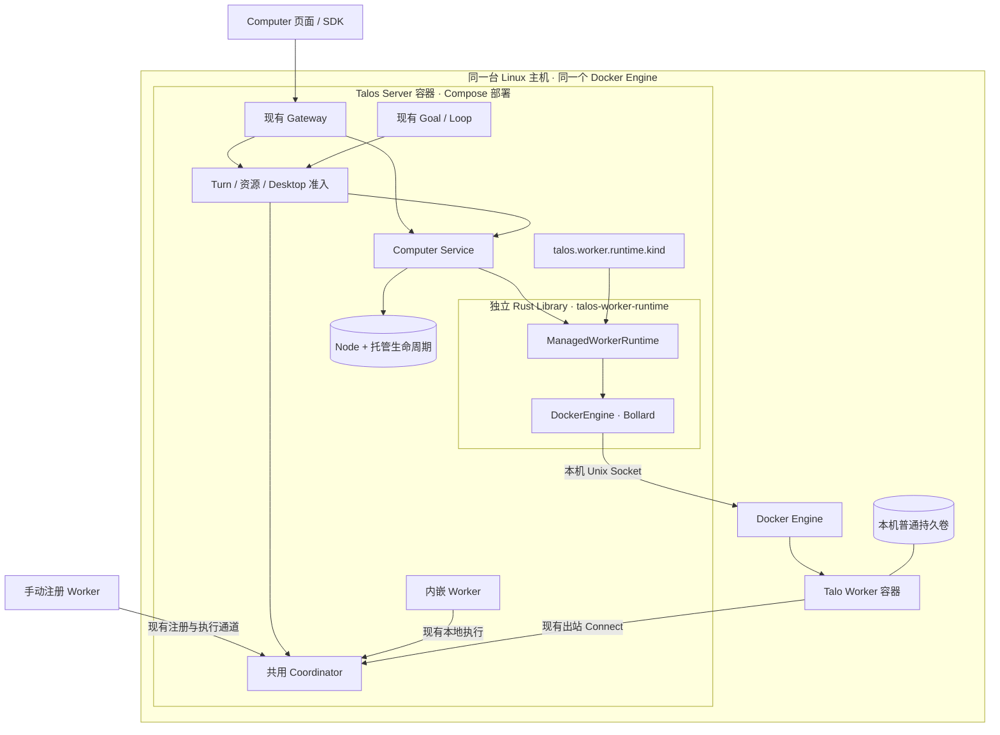
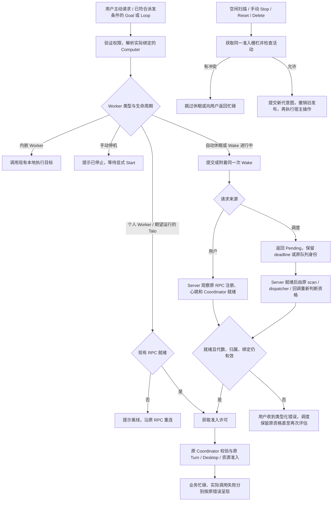
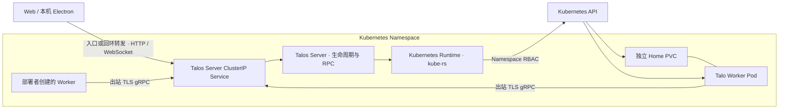
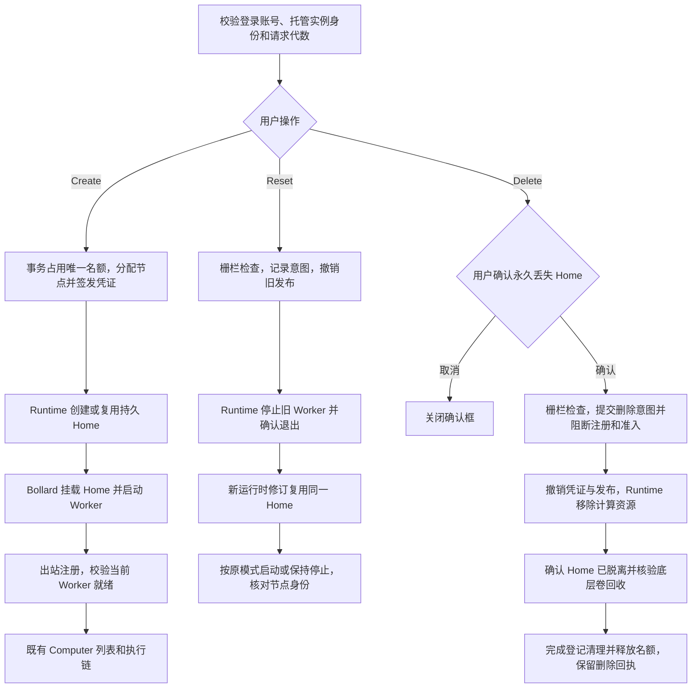

# Talo 托管 AI 助手

状态 `implemented` · 2026-11-09

代码基线 `5a688fcccf3d40fa06866950ad3f49bca358ccd7`

需求来源 [Issue #130](https://github.com/apilots/talos/issues/130)

## 1. 需求背景与一期边界

Talos 是产品名，Talo 是 Talos 提供的托管 AI 助手。未选电脑时，用户从右侧电脑选择页的「Talo」标签进入。已选个人电脑时，用户从中间侧栏的「Talo」进入同一初始化页面。就绪后沿用现有 Computer 身份和桌面流程。一个已认证账号最多拥有一台 Talo。固定计算规格为 4 核 CPU 和 8 GB 内存。Docker 提供普通持久 Home，就绪后在「连接桌面」下显示当前运行环境不支持限制磁盘配额。Kubernetes 请求 100 GB 持久卷，配额能力取决于部署选择并实测的 StorageClass。服务端负责准备持久 Home、初始化 Worker、登记 Computer 并绑定当前用户。计算停止后 Home 保留，重置更换运行容器，删除销毁 Home。

**每套部署只有一个管理 Server 和一个生效的托管 Runtime。** Docker 模式通过现有 Compose 部署，Server 与 Talo Worker 共用一台 Linux 主机的 Docker Engine。Kubernetes 模式通过独立清单部署，Server 使用 Kubernetes API 管理同一 Namespace 的 Talo 工作负载与 PVC。两个模式沿用相同的控制台、远程桌面和 AI Turn 执行权限链。

## 2. 当前行为与改动归属

| 当前机制 | Talo 接入 |
| --- | --- |
| `ComputerHomePage` 在未选择 Computer 时呈现在右侧，已有设备时复用 `ComputerPicker`。中间侧栏原先提供「你的电脑」。HTTP、App Server 和 SDK 共用 Computer Service。 | 在现有主内容区和侧栏增加两个 Talo 入口，复用同一个初始化页面和状态。列表、Session 绑定、控制台和桌面继续使用既有 `node_id`。[电脑首页](../../talos-app/web/src/pages/home/ComputerHomePage.tsx) · [侧栏入口](../../talos-app/web/src/app/layouts/AppLayout.tsx) · [HTTP 路由](../../talos-rs/crates/gateway/http/src/server/computers.rs) |
| 独立 Worker 使用已登记的 UUID、节点凭证和出站 Connect。Coordinator 检查归属、启用状态、租约、心跳与在线 Harness。 | 复用节点注册、凭证签发和 Coordinator 就绪判断；运行时启动仅表示容器已启动。[Worker 部署](../../deploy/docker/talos-worker/README.md) · [Coordinator](../../talos-rs/crates/orchestration/coordinator/src/agent_coordinator.rs) |
| Computer 删除撤销登记、凭证和在线发布，现有 Session/Project 仍保留原引用。 | 托管删除复用登记清理内部路径，并负责运行时资源和 Home 清理。原普通删除接口拒绝托管节点，避免留下失管资源。[登记删除实现](../../talos-rs/crates/orchestration/service/src/agent_node/deletion.rs) · [删除 Spec](../feat-046-computer-registration-deletion/design.md) |
| Server 负责 Session、Turn、消息队列和 Automation。独立 Worker 负责执行与资源操作；不持有管理 Session 数据库。 | 生命周期状态和唤醒决策由拥有节点和 Session 准入的管理 Server 持有。Worker 保持出站协议和既有执行职责。[Worker 镜像](../../build/worker/README.md) · [调度启动](../../talos-rs/crates/app/talos-base/src/application_automation.rs) |

所有执行目标继续使用同一个 Computer/Worker 模型和 Coordinator。内嵌、手动注册、托管是部署与管理归属的差别。托管 Worker 走现有远端注册路径，管理层用同一个 `node_id` 关联托管记录。应用装配按 `talos.worker.runtime.kind` 构造独立 Runtime Library，再注入 Computer Service。Turn、Automation、Desktop 继续走现有入口。同一 Server 上，已就绪且配置等价的自建 Docker Worker 与托管 Talo 共用任务、浏览器、文件、桌面查看与控制能力。Talo 额外接受 Server 的生命周期管理。自建 Docker Worker 的容器启停、替换及卷销毁由部署者负责。电脑页面的「移除注册」只撤销 Computer 登记和凭证，重新接入时由部署者显式注册并更新凭证。



## 3. 状态与并发

### 3.1 共用 Worker 状态与管理归属

`NodeInfo` 是现有 Computer 身份与状态合同，`mode` 表示 `embedded` 或 `remote`，`status` 表示节点启用状态，`health` 和 `available` 用于健康及在线判定。手动注册的独立 Worker 和 Talo 都是 `remote`，用同一套在线、忙碌、排队和错误语义。Talo 的托管身份来自 `node_id` 对应的 `managed_workers` 持久记录。`NodeInfo.managedWorkerPhase` 为客户端提供可空的托管状态投影。自建 Worker 的生命周期仍归其部署者，普通 Computer 删除只撤销登记和凭证。Docker 或 Kubernetes 是生命周期适配器的选择，不进入 `NodeMode`，也不改变 RPC 身份或执行语义。[NodeInfo](../../talos-rs/crates/common/types/src/node.rs) · [可用性投影](../../talos-rs/crates/orchestration/service/src/agent_node/service.rs)

只有受托管理计算资源的实例有明确的 Server 生命周期意图。托管的休眠和手动停机从该记录得出；手动注册的 Worker 失去连接时显示现有离线状态，Server 无法据此推断它的宿主机是关机还是网络中断。内嵌 Worker 的运行由 Server 进程持有，继续走现有本地路径。正常执行前按 §4.3 检查就绪，业务忙碌和调用失败沿同一条错误路径。

### 3.2 托管状态与权威记录

同一管理数据库新增 `ManagedWorkerRecord`。字段包括 `instance_id`、`owner_user_id`、唯一 `node_id`、在供给前分配的 `home_id`、当前镜像 digest、8 位容器短 ID、运行时修订号、`desired_mode`、操作代数 `generation`、当前操作及检查点、`last_activity_at` 和可安全展示的最近错误。持久业务状态记录 Server 的生命周期意图，在线性从现有 Worker RPC 观测，Docker 容器状态用于核验容器操作。页面合成这些信号，避免把期望运行显示为在线。凭证原文只写入 Worker Home，登记库仍存哈希与过期时间。

| 持久期望 | UI 状态 | 进入及退出规则 |
| --- | --- | --- |
| `Running` | 创建中 / 启动中 / 在线 / 离线或失败 | 创建、显式启动或从休眠唤醒写入。启动需确认 Docker 当前修订的容器在运行，以及原节点的新有效发布和可调用 Harness。Docker Engine 按容器重启策略恢复异常退出，RPC 掉线仍沿用原离线处理，显式 Start 可重试。 |
| `IdleSleep` | 休眠中 / 已休眠 | 自动空闲检查写入并由 Runtime 停止 Worker。合格请求可写入新一代 `Running`；手动 Stop 可直接切换为 `ManualStop`。 |
| `ManualStop` | 停止中 / 手动停止（离线） | Stop 获得准入栅栏后写入。只有显式 Start 可使其重新运行。Reset 在原模式完成后仍处于离线。 |
| `Deleting` | 删除中 / 删除待重试 | 经确认后提交。收敛前继续占用单实例名额。完成后保留最小删除回执，释放名额。 |

进行中操作用封闭的 `Create | Start | Wake | Sleep | Stop | Reset | Delete` 枚举及其步骤表示。错误属于该操作，期望状态单独持久化。启动遇到永久错误时保留 Home 和失败信息，用户可显式重试。自动 Wake 临时失败且确认容器未启动时，按 §4.2 恢复可唤醒状态。

### 3.3 串行化、恢复与失败

- 数据库以账号唯一约束和事务保留实例名额，以 `node_id` 关联现有节点。登记模块接受内部预分配 UUID，创建受管记录与初始节点登记同事务提交。事务同时保留 `home_id` 和容器短 ID；卷名由 `home_id` 派生。重试按已记录的名称和归属接管对应资源。首次 bootstrap 遇到“凭证已签发但文件未落盘”，且确认本代 Worker 从未启动时，通过既有轮换逻辑补发；启动后沿原到期和撤销规则处理。
- 每台实例由单个管理进程写入生命周期意图。数据库记录操作代数和检查点，先提交意图，再按实例串行执行并核验宿主副作用。Docker 适配器按资源 ID 执行与观测，恢复读取管理记录。管理层短时持有准入栅栏，长时间宿主调用在栅栏外执行；Read、附着 Wake 和记录新意图可以继续。发出冲突操作前先确认上一个操作结果，资源或归属不明时保留可重试检查点。
- 同一进行中操作的重复请求返回当前快照；并发 Create 命中同一账号名额。首次创建失败后，用户可对原实例显式 Start，按检查点继续供给 Home、初始化、准备运行时和启动，复用原实例与节点。变更携带 `instanceId` 和 `expectedGeneration`。匹配进行中操作的重试允许附着，其他过时代数返回 `Conflict`。Delete 回执仅对原拥有者与原实例有效。删除后重建使用新实例、节点和 Home ID。
- 用户与调度请求共享一次 Wake。手动 Stop、Reset、Delete 可阻止新的唤醒或准入；已发出的宿主操作先核验结果，再按新意图收敛。每个请求继续执行前重查代数、归属、实际绑定和在线发布。操作意图独立于 HTTP/JSON-RPC 连接，客户端断线不取消生命周期操作。
- 管理 Server 重启后先核对宿主、当前容器和原 Worker 租约/发布。对睡眠与手动停机只执行停止收敛。已提交的显式 Start/Create 和未完成 Wake 可完成其原操作，过期 Wake 结束原等待并保持 Home，后续依 §4.2 观察实际状态。失败保留检查点和名额，直至资源清理可证实。创建在 Worker 首次启动前可补偿失败资源；首次可能写入用户数据后保留 Home，交由重试或确认删除。
- 一期只部署一个启用托管 Worker 的管理进程，启动时复用 `talos_fs::FileLock` 对管理数据目录做进程级互斥，拒绝同一目录的第二个托管运行实例。首版 Talo 的 Session 和队列由同一个管理 Server 准入，Desktop 可作为该 Server 的客户端。来自其他嵌入式运行时的本地 Session 执行不能纳入该 Server 的空闲统计，首版对 Talo 拒绝该路由。管理关停和重启期间的身份或活动状态不确定时，空闲扫描保守延迟。

## 4. 空闲、唤醒与交互

**空闲判定。** 以 Computer 聚合绑定它的所有 Session。默认连续 900 秒无活动后，现有管理维护运行时每 15 秒扫描已运行实例。Worker 心跳、选中 Computer、读取历史、被动刷新、只看桌面画面、未来才到期的 Loop/Goal 及内置维护扫描不续期。以下情况阻止空闲停机或刷新最后活动时间：

| 信号 | 处理 |
| --- | --- |
| 已接受的远端 Turn 准入、Running / Cancelling Turn、等待审批或输入的活动 Turn | 活动期间阻止休眠。结算时刷新时间。恢复前按现有 canonical active Turn 和 Worker 执行状态核对。 |
| 已排队且符合原自动派发条件的消息、正在派发的队列项 | 保留至派发结算或明确移除。被取消边界阻止且需要手动派发的条目可随实例休眠，显式派发可唤醒。 |
| 授权的远端资源操作或桌面打开/控制取得 | 请求期间持有短期准入许可；完成时刷新时间。上传等流式写操作持有许可至结束。 |
| 远程桌面有效键鼠输入 | 在现有控制权和 input epoch 校验后按实例合并更新。持续挂着无输入的桌面可被休眠关闭；浏览器定时器、用户脱离 Talos 启动的后台进程、无输入的桌面画面均可随休眠结束。 |

生命周期与远端工作共享实例准入栅栏。请求在调用 Worker 前登记许可；Turn 准入把许可交接给已记录的 active Turn，结算再释放。空闲检查关闭新准入后，重新验证各 Session 活动、队列保留项、桌面输入时间与 Worker 空闲；竞态中若已有新活动就取消本轮休眠。持久时间戳用 Unix 秒，进程内超时用单调时钟。崩溃后若不能确认最后活动，重新获得在线发布后等待完整空闲窗口。

**唤醒入口。** 首次/继续发送、显式启动已排队消息、显式重试 Turn、用户打开远程桌面、需要 Worker 的主动文件访问，以及已符合原规则的 AI 自动派发，按授权后的实际目标请求 Wake。请求必须已通过原输入与权限检查。已有 Session 以已绑定的 Worker 为准；新 Session 使用已授权的选取结果。先解析当前生命周期意图。自动休眠先走 Wake，RPC 就绪后才执行远程副作用和新 Turn 准入。纯读取元数据、预取和轮询只展示状态。对同一资源读同时用于预取与交互的情况，SDK 默认仅读取；明确的用户操作携带类型化启动意图，服务端仅在声明支持的端点消费，且重新检查目标所有权。

- 首条/后续 Turn 接在 Service 的 Start 路径，将 `connect_selected_computer` 的路由解析与真正需要 Worker 的就绪检查分开。验证并解析实际目标后唤醒，再交给原幂等和准入。同一个命令幂等键优先返回已接受的结果。只有尚未接受的合格请求才会等待 Wake。显式重试 Turn 复用原目标与准入路径，在验证原消息可重试后接入同一 Wake。[Start 入口](../../talos-rs/crates/orchestration/service/src/service/facade.rs) · [队列入口](../../talos-rs/crates/orchestration/service/src/service/message_queue.rs)
- 远程桌面先在主动打开阶段唤醒，再读取新的浏览器控制状态和 generation，随后沿原 `open_desktop` 申请一次性 viewer grant。空闲停机关闭原桌面流，并保留用户已设置的浏览器暂停；正常休眠本身不产生新的手动暂停。旧票据、旧 input epoch 和旧页面 generation 不跨容器恢复；媒体重连和状态轮询只按既有流程处理。[桌面准入](../../talos-rs/crates/orchestration/service/src/service/desktop.rs)
- Computer 的 `available` 继续反映在线状态。Web/Desktop 对已休眠的 Talo 允许用户显式发送首条消息或点击打开桌面；桌面入口可先显示启动操作，等 Wake 完成后再读取 browser snapshot。冷刷新后的被动读取与预取保持只读。
- 单次等待上限拟为 45 秒，启动操作整体上限拟为 120 秒。客户端显示“正在启动 Talo”，等待超时返回类型化 `Timeout`，可重试同一业务请求。此时尚未准入的请求不入新队列，不创建 Turn。用户取消只结束自己的等待。手动停止、真实掉线和个人电脑继续使用现有离线行为。
- Stop / Reset / Delete 使用同一栅栏拒绝正在准入的远端请求、未结束 Turn（含等待输入）、正在进行的文件写入和有效桌面控制会话。用户先取消/结束工作或退出控制后重试。被动 viewer 可关闭，既有排队项在 Stop/Reset 时保留，并由原队列规则决定后续派发。显式 Reset 按原期望状态处理：`Running` 换容器后启动，`IdleSleep` 和 `ManualStop` 换容器后保持停止。即使原 Worker 离线，也沿同一规则。后台桌面应用会结束，UI 在操作前说明影响。

### 4.1 复用现有 Worker RPC、身份和在线判定

Docker Talo 复用独立 Worker 的 `node_id`、持久 Home 内的注册凭证和出站 Connect。Worker 通过已有 Agent RPC 向 Server 注册，按现有机制发心跳、续租和重连。当前源码每 10 秒发送心跳，每 30 秒尝试续租，租约最长 90 秒且不超过注册凭证到期时间；最近一次心跳必须小于 30 秒。传输断开会撤下旧发布；Worker 优先用仍有效的 lease 重连，租约失效后用原注册凭证重新注册。Coordinator 沿现有归属、启用状态、有效租约、新鲜心跳和可调用发布校验执行目标。[Worker Runner](../../talos-rs/crates/orchestration/agent-client/src/runner.rs) · [心跳判定](../../talos-rs/crates/orchestration/agent-protocol/src/node.rs) · [节点服务](../../talos-rs/crates/orchestration/service/src/agent_node/service.rs) · [Connect 发布](../../talos-rs/crates/app/talos-base/src/agent_node_connect.rs)

续租与注册凭证到期是两个层次。Reset 复用原 UUID 和 Home 中有效的凭证；现有续租不会延长该注册凭证的到期时间。注册凭证到期时，由拥有者显式启动触发原节点凭证的内部轮换。Server 撤销旧发布、确认容器退出，再替换原 Home 中的凭证文件并恢复启动。该路径保留同一节点 ID 和 Worker 配置。自动 Wake 和心跳沿用现有租约机制。Talo 的 RPC 身份沿用当前节点和有效租约。Docker 修订由 Engine 核验，RPC 发布由节点服务核验；这两个观测不提供容器级证明。已有协议按节点凭证认证持有者。Stop/Reset/删除先关闭节点准入、撤销旧发布和旧租约，再执行容器动作。替换时确认旧容器已经退出，启动前恢复该节点的注册资格，再等待新的有效租约和发布。此处使用现有注册与状态机制。

### 4.2 Server 唤醒与派发等待

Worker Manager 指 Computer Service 的托管生命周期模块。Server 聚合空闲信号，超过配置阈值后写入 `IdleSleep` 并调用 Engine Stop。Wake 的正常路径先检查所选实例的期望状态和现有 Coordinator 就绪性，自动休眠触发或附着共享 Start。Engine 返回启动成功后，Server 等待该节点完成出站注册、发布并通过现有就绪校验。相同实例的并发请求共享一次启动和就绪等待。

| Server 看到的状态 | 行为 |
| --- | --- |
| 就绪 | 复用现有 Session 路由和 Turn 准入，发给已绑定的 Worker。 |
| `IdleSleep` 或自动 Wake 中 | 按当前操作代数发起或附着启动。在 Server 内按实例观察现有发布变化并复核 Coordinator；有界等待，状态变化唤醒等待方。就绪后重查 Session 资格，再创建 Session 或投递 Turn。 |
| 容器运行中但失去心跳或 RPC 发布 | 按普通离线处理，优先让原 Worker Runner 重连或重注册；心跳过期本身不触发自动 Stop、Start 或 Reset。用户仍可显式 Reset。 |
| 手动停机 | 只有显式 Start 重新开放运行。用户请求和调度沿既有离线处理。 |
| Wake 整体超时 | Server 结束本次等待并记录未就绪，观察 Engine 的实际结果。容器已启动则保持运行，沿原 RPC 重连；新请求重查就绪。已超时请求不会因迟到的发布而派发。Engine 结果不确定时先核验状态。 |
| 自动 Wake 暂时失败且 Engine 确认容器未启动 | 若该操作未被 Stop、Reset 或 Delete 取代，保留 Home 和错误，将意图恢复为 `IdleSleep`。冷却后，仍有资格的新请求或原调度可发起一次新的 Wake。 |

Server 只保留原请求等待和原队列项，调度遇到 Wake pending 时保留原 deadline 或队列身份。就绪通知是重新检查的信号。最终派发仍通过原授权、节点就绪、去重和准入，避免通知到达后发生 Stop 或绑定变更时错误投递。Watch 仅用于 Server 进程内按实例共享等待。先订阅再读取当前就绪性，并在发布变化或有界复核时重新校验，避免错过启动完成信号。已有调度扫描和 RPC 负责其原职责；待派发项使用原请求和原队列。

### 4.3 操作前检查与错误展示

生命周期回答「这台 Talo 应该运行、自动休眠，还是手动停止」。连接就绪回答「当前 Worker 能否接收命令」。心跳和租约负责后者；只有 Server 的业务记录能区分自动休眠和手动停机。容器进程已启动、RPC 未就绪时，界面显示启动中或离线；`Running` 作为期望状态保留。

| 执行目标 | 操作前检查 |
| --- | --- |
| Server 内嵌 Worker | 通过 Coordinator 取得本地已注册的执行目标，直接沿现有调用。内嵌生命周期由 Server 持有，无需 Docker 状态或远程心跳。 |
| 个人独立 Worker | 走现有 Coordinator 在线检查和远程调用。 |
| 托管 Docker Worker | 先按 §4.2 判断休眠或停机，再用现有在线检查取得可调用目标。 |

现有租约、心跳和已发布的执行通道足以作为派发前检查，正常路径无需为每次命令额外发送探测 RPC。派发使用真实 RPC 结果，处理检查通过到调用之间的竞态：

| 结果 | 服务端行为与提示 |
| --- | --- |
| 调用前已确认失联 | 返回既有不可用错误，提示 Worker 离线或连接中断。期望状态保持原值，等待原 Runner 重连。 |
| 检查通过，但实际调用断开或超时 | 用现有 `ServiceUnavailable` / `Timeout` 提示本次连接失败或超时；重新核验在线状态。提交结果不确定时，按原请求幂等键或 Turn 恢复查询确认，避免重复投递。 |
| Worker 在线，当前 Session 或队列忙 | 复用现有排队、`ActiveTurnRunning`、`MessageQueueBusy` 或队列满提示。忙碌归属本次请求或 Session，Worker 仍在线，生命周期保持原值。 |
| Worker 在线，操作发生业务错误 | 保留原鉴权、验证或执行错误，按现有提示路径呈现。 |

## 5. 调度契约

用户显式把 `/goal` 或 `/loop` 加入队列时，现有规范化步骤会先访问 Worker 的 Skill。输入与归属校验通过后，在查 Skill 前走同一 Wake；等待失败沿用原入队失败语义。普通消息仍由原队列派发入口处理。

现有调度由 Server 每秒扫描 Loop 和符合首轮条件的 Goal。Worker System Skill Resolver 只访问 Session 绑定的 Worker。调度唤醒以现有“可执行”的判定为前提，接入调度调用方，避免所有 Skill 或 Coordinator 读操作隐式启动容器。[扫描入口](../../talos-rs/crates/orchestration/service/src/automation/goal_loop/facade.rs) · [Skill Resolver](../../talos-rs/crates/app/talos-base/src/application_automation_control.rs)

| 路径 | 当前源码行为 | 自动休眠接入 |
| --- | --- | --- |
| 到期 Loop，尚未 claim | `enqueue_loop` 先解析 Worker Skill，成功后 CAS 清除 `next_due_at` 再入队。解析失败时到期记录可留给之后的 scan。 | 在原资格检查后、查 Skill / claim 前请求 Wake。未就绪时只跳过本次扫描该候选，不推进到期时间。 |
| 已入队，准备或准入失败 | 释放队列 reservation。Loop 的错误若非 `Conflict` / `ActiveTurnRunning`，可经 `failed_loop_admission` 停为 `ExecutionFailed`。User 队列走原保留逻辑。 | 确认候选可派发后，在准备前检查 Wake。未就绪时释放 reservation，保留原队列项和已有 occurrence ID；Wake 就绪后为受影响的 Session 调用一次原 dispatcher。只对托管自动休眠的类型化等待分支延期。 |
| Goal 首轮、续跑 | 首轮有原延时。后续主要来自正常结算或已知空闲的重连；原许可、队列与预算条件仍生效。进入提交后，解析或提交失败可暂停为 `ExecutionFailed`。 | 在原资格和预算检查通过后、查 Skill 前请求 Wake。首轮由原 scan 继续。其他本来有资格的续跑在 Wake 完成后通过原续跑入口重查预算、revision 和空闲状态。Timeline 订阅或恢复保留现有在线协调逻辑，自动休眠时不会从该入口发起 Wake。重启不枚举并续跑所有 Goal。 |
| 已手动停机、普通掉线、失去租约 | 到期 Loop、已入队 Loop 和 Goal 的路径各自处理，取决于失败阶段。 | 手动停机保留旧可用性错误及各路径的失败状态。之后显式 Start 只恢复在线，交给既有 scan、重连和队列规则。 |
| Server 重启、内置维护 Job | 定义持久化，纯内存消息队列不会重建。内置 Job 执行属于所在运行时的维护回调。 | 保留原恢复规则和 Job 所属地。维护 Job 不唤醒 Talo。 |

源码位置 [Loop 入队及失败](../../talos-rs/crates/orchestration/service/src/automation/goal_loop.rs) · [队列派发](../../talos-rs/crates/orchestration/service/src/turn/service/message_queue.rs) · [Goal 续跑](../../talos-rs/crates/orchestration/service/src/automation/goal_loop/turn.rs) · [现有 Automation 契约](../feat-053-session-goal-loop/design.md)。

调度扫描提交或附着 Wake 后立即返回该候选的 `Pending`，不等待宿主操作或心跳，也不影响同一轮的其他 Session。就绪后重新判定原条件，沿原 CAS、reservation 和 Turn 准入执行。对等待 Wake 的已入队消息和已符合资格的续跑，在本进程按 Session 合并一次完成回调，在启动操作的时限内等待就绪，并重用原 dispatcher 或续跑入口。45 秒前台等待上限只适用于交互请求。仅含 User 消息的 Session 也能获得一次原派发机会。重启只恢复生命周期操作和原本可恢复的调度定义。只有确认容器未启动并已恢复 `IdleSleep` 的临时失败进入自动启动冷却，默认 60 秒。之后由仍符合原规则的请求或调度触发；永久错误待显式 Start 修复。冷却控制容器启动频率，调度器仍使用现有发生次数、取消边界、队列和 deadline，不产生新的补跑或重放记录。Worker 已就绪后的真实 Skill/准入错误照旧结算。

### 唤醒与停机流程



## 6. 托管 Worker 与部署适配器

**托管 Worker（Managed Worker）** 是已有 Worker 的一种部署所有权。Talo 是首个面向用户的产品入口，实例在 Computer 列表仍使用原 Computer 标识。生命周期对象命名为 `ManagedWorker`，其 Store 记录为 `ManagedWorkerRecord`，部署口命名为 `ManagedWorkerRuntime`。Computer Service 拥有实例归属、期望状态、唤醒与撤销，部署口只接受已授权的宿主操作。

### 6.1 独立 Runtime Library 与持久 Home

新增独立 Rust Library crate `talos-worker-runtime`，放在基础设施层，提供 `ManagedWorkerRuntime` 接口、资源描述、实际状态观测与结构化运行时错误。DockerEngine 实现和 Bollard 依赖留在 Library；Kubernetes 适配器用 kube-rs 复用同一接口。Server 装配选择后端，业务代码调用接口管理容器、网络与 Home。Library 的输入是实例标识、运行时修订、计算规格和资源标识，依赖方向从 Server 指向 Library。Library 独立于 Computer、Session、Turn、用户授权和 Worker RPC。

Server 组合两类独立信号。Runtime Library 负责报告容器是否存在、运行或退出以及卷是否挂载；Worker RPC 和 Coordinator 提供身份、租约和在线就绪；Session/Turn 继续处理忙碌、排队和调用结果。Server 结合这两类信号及自己的休眠或停机意图决定是否启动、等待、派发或报错。Docker 状态留在 Library 的观测模型，Worker RPC 状态继续沿用既有业务模型。

| 接口 | 一期完成条件 |
| --- | --- |
| `ensure_home` | 创建或复用归属已核验的 Home，保持同一 `home_id`。Docker 适配器使用本机 named volume。Library 应用受信调用方提供的初始化文件；显式凭证恢复时按指定文件替换，保留其他数据。 |
| `ensure_runtime` | 创建或复用指定修订的 Worker 容器，接入 Runtime 网络并挂载原 Home。替换时确认旧容器已退出。 |
| `set_running` | 用 Bollard 启动或停止指定容器，并观测到目标状态。 |
| `inspect` | 核验容器状态、归属、运行时修订与 Home 挂载。区分缺失、Engine 不可达和归属冲突。 |
| `remove_runtime` | 移除实例容器，保留 Home 和 Engine 的共享 Worker 网络。 |
| `remove_home` | 确认计算已移除后，删除该实例名下的 Docker 卷并核验结果。 |

Docker 创建使用 `HomeCapacity::Unrestricted`，普通持久卷报告磁盘配额 `unsupported`。Kubernetes 使用 `HomeCapacity::LimitedBytes(100_000_000_000)` 申请 PVC。部署验证 StorageClass 的容量强制执行后才配置 `home_quota_enforced`，API 随之报告 `enforced`。PVC 申请值和实际文件系统硬限制分别验收。

### Talo 专属对话

Server 在 `managed_workers.conversation_session_id` 中为每个实例预留唯一 ID，通过现有托管 Worker 读取接口返回给前端。进入页面只读 Session 和历史。首次发送使用现有 Turn API，由 Service 校验账号、目标 Worker 和空的 Project 绑定，再通过现有 Session 创建流程物化会话。后续发送查询并复用同一个 Session。并发首次发送以 Session 主键收敛到同一个会话，执行仍使用现有 Turn 准入。Stop、Wake 和 Reset 保留绑定。删除 Talo 不级联删除历史，重新初始化分配新 ID。

Talo 页复用 Session 详情的消息历史和底部输入框。右侧桌面沿用 Server 中转，启停、Reset 和删除放在对应 Talo 桌面 Tab 的菜单内。

### 6.2 单机 Docker 接入

Talos Server 的 Compose 服务把宿主的 `/var/run/docker.sock` 绑定到 Server 容器内同一路径。现有镜像以非 root 的 `talos` 用户运行；按宿主 Socket 的数字 GID 配置 Compose 补充组，启动时用 Bollard 检查访问权限。Bollard 通过 Unix Socket 调用同一个 Engine 的容器、网络和卷 API。Server 与动态 Worker 是该 Engine 上的容器；动态 Worker 沿用现有出站 Agent RPC 与 Server 通信，Server 将部署指定的 HTTPS 注册地址和必要的 CA 写入现有 Worker runner 配置。该地址须从 Worker 网络可达，证书名称须匹配；Server 当前发布在宿主 loopback 的端口不能直接作为 Worker 的地址。一期复用部署已有的 Agent ingress，不新增代理。Compose 管理 Server 的部署，Talo 生命周期由 Computer Service 管理。[Server Compose](../../deploy/docker/talos-server/compose.production.yml) · [Worker 部署](../../deploy/docker/talos-worker/README.md) · [Bollard API](https://docs.rs/bollard/latest/bollard/struct.Docker.html)

**信任边界。** Socket 只挂给 Talos Server，Server 后台与宿主运维属于同一可信边界。镜像包含供运维用 `docker exec -it talos-server talos` 启动的 CLI/TUI；该入口已要求宿主 Docker 权限。一期在 Talos 公开入口控制权限，Server 容器内部沿用部署的可信后台假设。

**对外入口。** 公开 API 只接受鉴权后的 Talo 生命周期动作和已授权实例 ID；镜像、挂载、网络和资源规格由服务端构造。Worker 容器只挂自身 Home。现有 Server 内嵌桌面和工具也可能从 Web/SDK 触发执行；挂载 Socket 的部署应只向与宿主运维同等可信的账号开放这些 Server 内嵌执行入口。普通 Talo 用户的命令在自己的 Worker 容器执行。启用 Talo 要求开启 Server 认证，并按现有管理员角色对 Server 内嵌桌面和执行实施服务端授权；该部署把管理员视为受信运维。在现有共享访问服务中，对实际解析出的节点执行授权，覆盖缺省路由、显式目标、已有 Session、资源和桌面入口，后台派发也沿原用户授权。HTTP、JSON-RPC 与 SDK 复用该边界。这样既保留运维 TUI，又避免公开入口间接成为宿主命令入口。[Docker 权限](https://docs.docker.com/engine/security/) · [Server 内嵌桌面与 TUI](../../deploy/docker/talos-server/README.md#embedded-browser-and-terminal-management)

- 每台 Worker 挂载独占 named volume 到 `/home/talos/.talos`，将 `HOME` 与 `TALOS_HOME` 指向该目录。首次供给时按现有 Worker 配置模板初始化，保证 UID/GID 10001 可写、凭证文件权限为 0600。Reset 保留原卷、节点身份和用户文件。[Worker 镜像](../../build/worker/README.md)
- 模型由每台 Worker 自己的持久配置管理，复用现有 Provider 适配器以及模型服务地址、模型和 API key 配置。Talos 提供 Provider 接入能力；一期没有公共模型网关或凭证签发服务。Talo 初始化准备 Computer 和 Home，模型配置沿现有 Worker 配置入口管理。端到端 AI 验收在可销毁实例中配置可用的 Worker 本地 Provider 和测试凭证。[独立 Worker 配置](../../deploy/docker/talos-worker/README.md)
- 复用 Worker 镜像、Chromium seccomp、私有 shm、`no-new-privileges` 和现有桌面 relay。现有 Chromium seccomp JSON 随 Server 发布资源提供，Docker 适配器通过 Bollard 的容器安全选项应用该 profile。容器的 CPU 与 RAM 硬限制为 4 vCPU 和 8 GB。Engine 使用 `unless-stopped` 恢复异常退出，Server 的主动 Stop 与 Sleep 保持容器停止。托管 Worker 共用 Engine 上的一个 bridge，配置禁用容器间直连，保留出站注册和 Provider 访问。部署要求 Linux Docker Engine 执行 bridge 防火墙规则。各 Worker 保有独立网络命名空间，且不发布宿主机端口。

**容器命名。** Docker Worker 名称为 `talos-worker-talo-<short_id>`，例如 `talos-worker-talo-k7m2p4x9`。短 ID 使用 8 位小写字母或数字，由 Server 在实例创建时随机生成并持久化。重试和 Reset 沿用同名，先删除旧容器再创建新容器。Library 以完整实例 ID 的标签核验归属；同名但归属不同的容器返回冲突，原容器保留。

### 6.3 Kubernetes 接入

Server 复用现有 OCI 镜像和单管理进程，部署在目标 Namespace。Kubernetes 适配器通过 kube-rs 创建每个 Talo 的单副本 StatefulSet、独立 PVC 和短期初始化资源。动态对象由 Rust 类型构造，部署清单提供镜像、Namespace、StorageClass、Service 地址、证书和权限。`deploy/kubernetes` 管理 Server、Service、RBAC、专用存储配置及自建 Worker 示例。用户从 Talo 页面发起初始化。



休眠和 Stop 将工作负载缩到零副本并等待 Pod 退出。Start 扩回一副本，复用原 PVC 和 Computer。Reset 删除旧计算修订并保留 PVC，再按期望状态建立新修订。确认 Delete 删除本实例计算和 PVC。StorageClass 使用 `Delete` 回收策略，由部署预检和实际删除验收确认底层卷回收。Server 运行身份使用 Namespace 权限，StorageClass 和 provisioner 由部署者准备。Worker Pods 使用同一个 Server Service 的 TLS Agent 入口，桌面和文件不需要 Worker Service 或宿主端口。

### 6.4 创建、重置、删除



删除确认必须展示实例名称与「持久数据将永久丢失，无法恢复」，客户端取消不发送删除调用。服务端在匹配当前实例与代数的请求中要求明确确认字段。先持久化删除意图，关闭该节点注册与新准入，撤销凭证和 relay；清理宿主资源并证实 Home 删除后完成原登记清理/保留 tombstone，最后释放名额。中途失败显示具体步骤并允许同一实例重试。部分完成的删除不可重新启用。确认范围包括 Home 上的文件、配置、登录数据；管理侧既有 Session、Project、历史及已有 Sync 副本按原删除合同保留，旧引用继续显示登记已移除。UI 在删除确认时说明这两个数据范围。个人 Computer 与其卷不参与清理。

## 7. API、配置与客户端

- 在现有 Gateway/SDK Computer 命名空间增加 `computer/readManagedWorker`、`computer/createManagedWorker`、`computer/startManagedWorker`、`computer/stopManagedWorker`、`computer/resetManagedWorker`、`computer/deleteManagedWorker`。HTTP 对应 `GET/POST /v1/computers/managed-worker` 与 `POST /v1/computers/managed-worker/{instanceId}/{start|stop|reset|delete}`，固定子路径需覆盖现有 `:node_id` 路由匹配的测试。读取与变更统一返回 `ManagedWorkerResponse { enabled, instance }`。实例尚未创建或已删除时，读取返回 `instance: null`。Create 无客户提供的 owner、镜像或容量参数；动作包含 `expectedGeneration`，Delete 额外要求 `confirmDataLoss: true`。成功响应给出已提交的操作和状态，UI 用同一 Read 有界轮询，终态后刷新现有 Computer 列表。调用人始终由服务器认证身份确定。
- `ManagedWorkerInfo` 只包含 `instanceId`、`nodeId`、`generation`、期望状态/进度、计算规格、磁盘配额状态及可展示的 `ApiError`。磁盘配额状态由生效的 Runtime 和已验证的存储能力决定；就绪界面的提示按该字段显示，见 §7.2。Computer 列表项新增兼容的托管标记或窄状态投影以区分睡眠、启动和离线，桌面和模型状态保持各自原契约。HTTP、JSON-RPC、Rust SDK/embedded 与 Web/Desktop SDK 共用 DTO。维护当前协议 schema 和生成产物。客户端根据类型化状态与 `ApiError` 渲染；忙碌复用 `ActiveTurnRunning` 或 `Conflict`，关闭功能和不可用沿 `ServiceUnavailable`，非 owner 返回资源不可见，超时使用 `Timeout`。普通删除、状态变更、凭证导出/轮换在节点服务的权威入口拒绝托管资源，覆盖 HTTP、App Server 和 Node Management RPC。托管生命周期使用同一节点服务的受控内部调用。所有注册和资源入口继续核对实际 owner。
- Web/Desktop 复用现有电脑首页、电脑选取组件和工作区导航，按 §7.2 接入同一个 Talo 页面。用户从当前实例状态看到创建、显式启动、停止、重置和删除。Computer 列表继续提供同一节点选择；休眠可选，手动停机沿用离线限制。过渡状态由现有请求层有界轮询，面板打开时按 Computer 列表相同的五秒间隔刷新稳定状态。被动刷新可显示离线、休眠和重新就绪，读取本身不唤醒 Worker。复用现有 Tab 键盘规则和窄屏侧栏。SDK、协议与 UI 规则分别沿用仓库契约。[API](../../docs/development/API.md) · [错误](../../docs/architecture/ERROR_MODEL.md) · [UI](../../docs/architecture/CLIENT_ARCHITECTURE.md#ui-implementation)

### 7.1 Runtime 配置

在 `talos.yaml` 使用以下配置层级。因为 `runtime` 下还有后端参数，`talos.worker.runtime.kind` 是选择器，`talos.server.runtime` 放 Server 管理策略。以下为一期示例：

```yaml
talos:
  worker:
    runtime:
      kind: DockerEngine
      image: "ghcr.io/apilots/talos-worker@sha256:<digest>"
      control_plane_endpoint: "https://agent.example.com"
      docker_engine:
        socket_path: /var/run/docker.sock
  server:
    runtime:
      idle_timeout_seconds: 900
```

- 每套 Server 部署使用一个 Worker Runtime。缺省不开启托管 Worker。Server 装配读取 `talos.worker.runtime`，验证后把所选 Library 实现交给业务层。DockerEngine 使用本机 Unix Socket，默认 `/var/run/docker.sock`。Worker 使用 `control_plane_endpoint` 与系统信任或运维配置的 `trusted_ca_file`；服务端将 CA 随受控配置供给。
Kubernetes 模式的 `talos.worker.runtime` 配置示例：

```yaml
kind: Kubernetes
image: "ghcr.io/apilots/talos-worker@sha256:<digest>"
control_plane_endpoint: "https://talos-server.talos.svc:9443"
trusted_ca_file: /run/talos-tls/ca.crt
kubernetes:
  namespace: talos
  storage_class: talos-xfs-quota
  seccomp_profile: talos/chromium-seccomp.json
  kubeconfig_source: InCluster
  home_quota_enforced: true
```

上述 `home_quota_enforced` 表示部署者已经验证所选存储配置。对于部署挂载的凭证，设置 `kubeconfig_source: Mounted`、`kubeconfig_path` 和可选的 `kubeconfig_context`。粘贴模式的私有文件引用由 Server 生成。

- `Kubernetes` 使用 `kubernetes.namespace`、`storage_class`、`seccomp_profile` 及认证设置。集群内优先使用 Namespace 专用 ServiceAccount。运维可以提供只读 Secret 挂载的 kubeconfig。管理员也可以在 Settings → Runtime 粘贴自包含 kubeconfig 和 context，验证后通过现有安全文件存储保存到持久 Server Home。读取接口仅返回安全配置和凭证状态。
- Settings → Runtime 由已认证管理员访问，普通用户的 Talo 和 Worker 模型设置沿用原授权。Docker Socket 路径在页面只读。设置保存后受控重启生效。若还有托管资源，切换后端、集群、Namespace 或 StorageClass 会被拒绝。已保存且等待重启的变更会阻止新建 Talo。
- `talos.server.runtime` 持有管理策略，例如默认 900 秒的空闲阈值，重启后生效；它不选择第二个 Worker 后端。内嵌和手动注册 Worker 沿用现有配置与 RPC。

### 7.2 Talo 初始化交互

1. **未选择电脑。** 复用 `ComputerHomePage` 的右侧主内容区，内联展示「个人电脑」和「Talo」两个 Tab，默认打开「个人电脑」。列表为空时，在此页显示通过 Talos Desktop 登录同一账号的连接指引；已有个人电脑但尚未选择时，复用 `ComputerPicker` 展示个人电脑列表，点击一项进入该电脑的工作区。点击「Talo」Tab 在同一区域显示助手页面。
2. **已选个人电脑。** 中间侧栏现有「你的电脑」行位置改为助手入口「Talo」，点击后在右侧显示同一个助手页面。左侧保留当前个人电脑选择，已有会话继续绑定原节点。个人电脑的桌面操作仍可从现有电脑管理页的设备详情进入。[设备详情](../../talos-app/web/src/features/computers/topology/ComputerInspector.tsx)

原生 Electron 可通过 `TALOS_DESKTOP_SERVER_URL` 打开受信 Server 的产品页面。此模式使用隔离的 Electron 渲染视图和 Server 同源的 HTTP、桌面 WebSocket。Worker 继续通过出站 RPC 注册，桌面媒体经 Server 中转。独立 Desktop 继续使用本地 App Server。部署端点使用 HTTPS，本机夹具可使用回环 HTTP。

Talo 页面按当前账号读取托管实例。两个入口都显示同一实例的状态。尚未初始化时提供「初始化 Talo」，该流程省略硬件规格。

提交后按 Server 的当前进度显示「初始化 Talo」「启动 Talo」「等待 Worker 注册」。切换 Tab、离开页面或刷新后，由同一个 Read 恢复当前进度。Coordinator 确认就绪后提供「连接桌面」。点击时通过既有 Computer 选取和桌面入口，以该 Talo 的节点身份连接。Docker Engine 在该按钮下方显示「当前运行环境不支持限制磁盘配额」。已验证强制限额的 Kubernetes 配置省略该提示。初始化失败显示现有类型化错误；已有实例时重试启动原实例。模型连接沿用 Worker 配置。

## 8. 验收设计

| 验收面 | 首版验收 |
| --- | --- |
| Computer 和权限 | 验证内嵌、手动注册及托管 Worker 共用 Computer 状态和错误语义；托管操作只作用于受管实例。保留个人电脑连接；Create 并发和重试只登记一个实例；验证 owner 和非 owner、旧代数、普通管理路由绕过，以及通过原 Console、桌面和 AI Turn 的正常使用。 |
| Web/Desktop 入口 | 验证未选电脑时在右侧主区切换「个人电脑」和「Talo」，覆盖个人电脑空态、已有列表和列表选取。验证已选个人电脑时从中间「Talo」导航打开相同 Talo 页面，查看和初始化期间保留原电脑选中状态。切换入口和刷新继续展示同一实例与进度。覆盖键盘、窄屏、失败重试和就绪后明确连接桌面。 |
| Idle 与 Wake | 用可控时间验证默认 900 秒及管理员改值、多 Session、Turn、队列、输入与被动 viewer。覆盖 Wake 与 Stop/Reset/Delete 竞态、同代并发只启动一次、重连和服务重启。验证 Engine 已启动但 RPC 未就绪时不投递；Wake 超时后容器保持原运行结果，迟到就绪只服务后续请求；容器确认未启动时，验证冷却后可重新 Wake 且手动停机优先；心跳过期后按原 RPC 重连，单纯失联不会触发容器启停；worker-ready 前尚无 Turn/occurrence 副作用。 |
| 调用就绪与错误 | 验证内嵌 Worker 走本地调用，独立 Worker 沿现有在线检查。Talo 手动停机、自动休眠和心跳失效显示各自状态。注入就绪检查后断连或超时，显示对应错误并验证幂等恢复；Session 忙时保留原排队或忙碌提示，Worker 保持在线。 |
| Docker 首次可用与唤醒入口 | 从空卷自动初始化后，通过现有桌面和 AI Turn 验收；首次创建中断后对原实例执行 Start，可按检查点恢复且不登记第二个节点。对已休眠的 Talo，冷刷新后可直接发送新会话首条消息或点击打开桌面。验证休眠时显式重试 Turn 与入队 `/goal`、`/loop` 可唤醒，且被动刷新、预取和 Timeline 订阅不会唤醒。 |
| Automation | 对普通 Worker 先表征到期 Loop、队列准备/准入失败、Goal 首轮/续跑和重启/重连；对 Talo 的手动停机断言相同业务结果。自动休眠分别覆盖用户、Loop 与合格 Goal 的唤醒，以及仅有 User 消息的 Session 在 Wake 后获得一次派发机会。断言 deadline、原 occurrence、取消边界和已有队列恢复规则。 |
| Docker 资源与数据 | 在可销毁 Docker 环境验证普通卷创建成功，API 报告磁盘配额不支持且可启动，提示仅出现在就绪后「连接桌面」下方，初始化流程不展示硬件规格。验证 4 vCPU、8 GB RAM 限制和跨租户卷隔离。对比 Reset 前后容器 ID、Computer ID、Home ID、工作文件、凭证配置及 Chromium 登录状态。验证删除取消、分步失败重试、卷删除和个人电脑不受影响。注入卷创建或删除已完成但检查点未提交的崩溃，验证使用原卷身份收敛。覆盖掉线的 `Running` 实例被显式 Reset 后重新启动，及已停止实例 Reset 后保持停止。 |
| Runtime Library 与配置 | 独立验证 Library 对指定容器和卷的生命周期；验证 `DockerEngine` 注入本机适配器，`Kubernetes` 注入 kube-rs 适配器。验证容器名为 `talos-worker-talo-<8 位短 ID>`，重试和 Reset 保持原名，归属冲突时保留其他资源。 |
| 单机接入、安全与故障 | 在同一 Linux 主机、同一个 Engine 上用 Compose 启动 Server，验证 Bollard 通过挂载的 Socket 管理 Worker。以发布镜像的非 root 用户验证 Socket 可用。覆盖缺省/显式 embedded 目标、已有 Session 与桌面授权，验证普通账号无法借公开入口进入 Server 内嵌执行。验证托管 Worker 从自身网络完成 TLS 注册，且只挂自己的 Home，过时操作和旧桌面票据失效，重启继续部分操作，凭证/环境变量/宿主诊断不进入外部 DTO 和日志。凭证到期后以拥有者的显式启动触发内部轮换，恢复同一节点并保留其文件。旧租约不满足启动就绪。 |

实现阶段使用现有 Computer、Worker、Automation 和 Desktop 夹具，运行 `just test -p talos-service`、`just test -p talos-store` 及实际改动包的检查；协议变更运行 `just gen-app-protocol`，配置走所属 schema 生成器。GitHub PR 门禁复用 [容器 Worker/桌面](../../talos-e2e/scenarios/23_browser_container/README.md)、[Automation](../../talos-e2e/scenarios/24_automation/requirements.json) 的设施，增加受支持 Runner 可执行的代表场景。使用可销毁实例开展验收。完整 Docker 与 Kubernetes 故障矩阵使用独立的本地 `25_managed_talo` 组。Kubernetes 额外验证 Namespace RBAC、Service DNS/TLS、专用 StorageClass 实际拒绝超额写入、PVC 留存与回收，以及管理员 Runtime 设置和凭证持久化。

## 9. 评审决策

1. **部署授权。** 按 §6.2 验证 Talo API 和 Server 内嵌执行入口。AI 验收沿用 Worker 自己的 Provider 配置。
2. **空闲与打断。** 确认只看桌面可休眠、活动 Turn 和桌面控制阻止手动破坏性操作、主动请求范围及 45 秒前台等待。未由原 Automation 合同支持的补跑规则如需变更，单独评审。
3. **数据留存。** 确认删除范围为持久 Home 和运行资源，继续保留现有 Session、Project、历史和 Sync 副本规则。
4. **异常处理默认值。** 评审一期建议的运维触发凭证轮换、显式 Reset 按期望状态恢复，以及 Wake 超时后让已启动容器沿原 RPC 重连。
