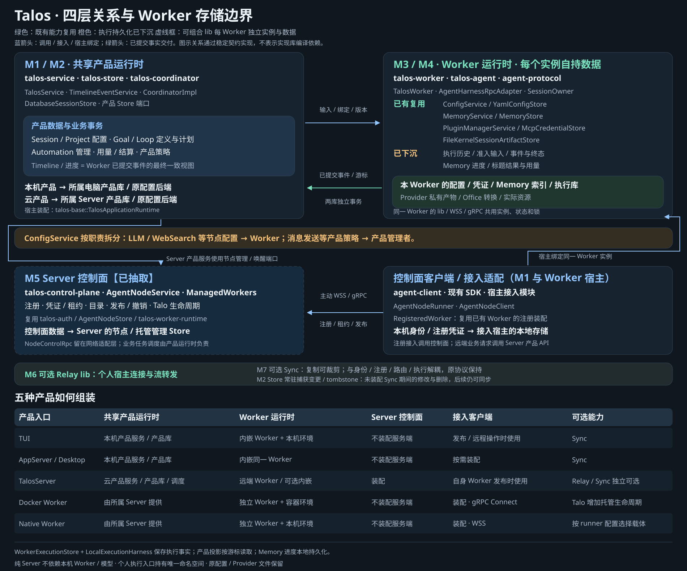
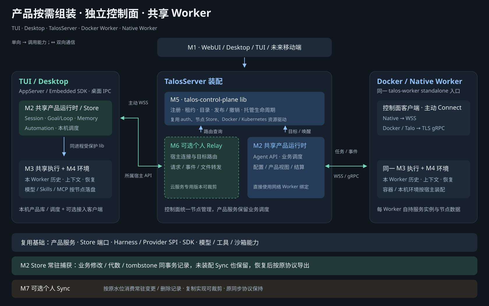
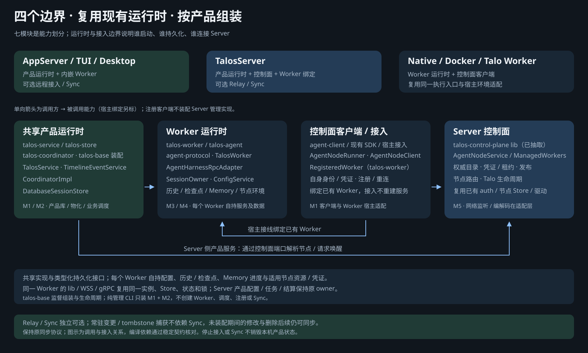
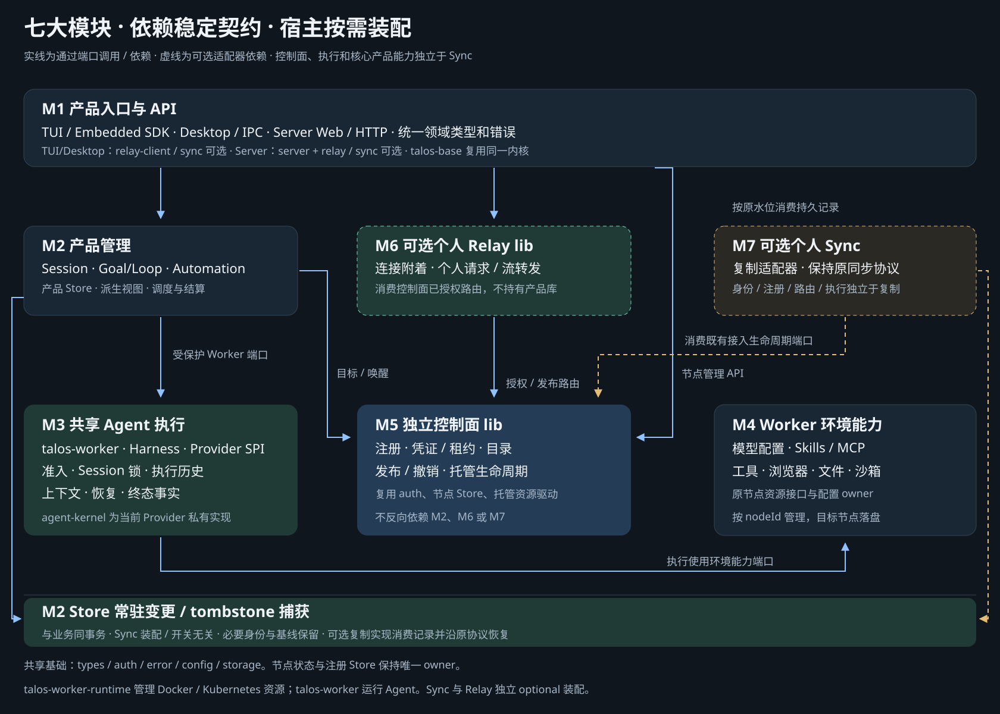
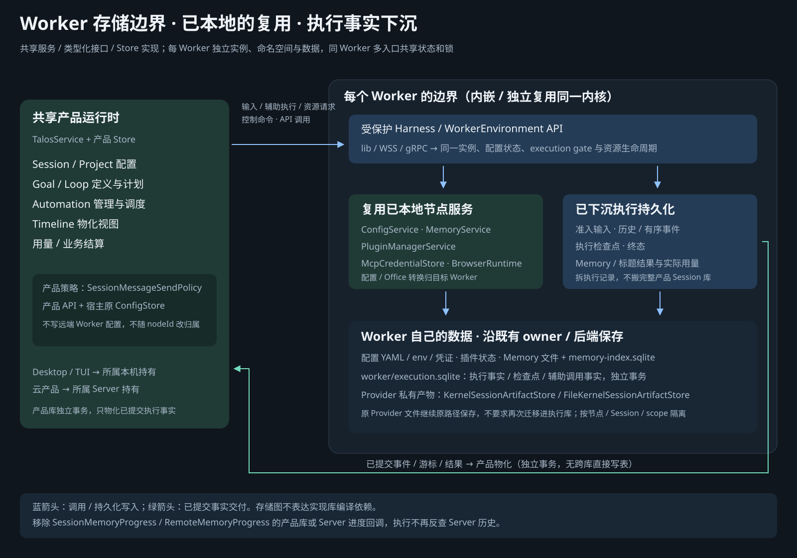
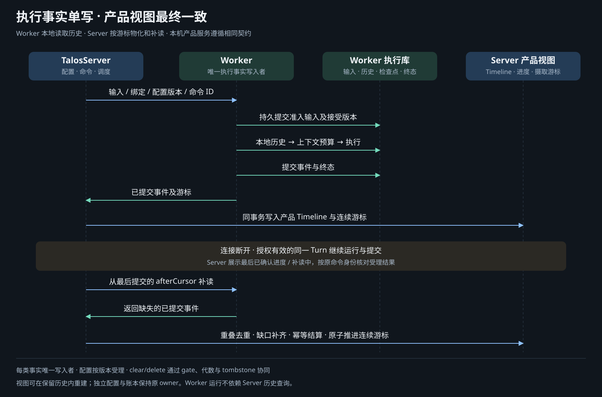

# Talos 产品架构、数据归属与模块拆分

本方案已进入实现与最终验收阶段，聚焦 Talos 的产品职责、数据归属、模块拆分和产品组装。

## 方案结构

本文件是业务要求、产品架构、数据 ownership、架构决策和技术决策的唯一决策源。

| 文档 | 落地范围 |
| --- | --- |
| [执行与产品数据落地](execution-ownership.md) | Worker 执行持久化、产品数据物化、上下文、任务管理、断连补读、结算与切换 |
| [模块拆分与产品组装](worker-entrypoints.md) | 现有模块迁移、依赖方向、可选 Relay lib、产品入口和传输装配、生命周期 |

合成总图汇总已确认的四边界、七模块、五产品和存储归属，不新增独立运行时或平行服务。
产品架构与数据归属图从 Review 材料归档到本目录，另附七模块依赖图及执行一致性时序图。
各图均包含完整样式，可独立打开。
图中 Sync 标示可选组装及接入边界，本次解耦 Talos 侧依赖，保持原同步协议。
架构调用图的单向箭头统一表示调用者指向被调用能力/端口，双向箭头表示双向通信。
时序图和存储边界图按标签区分请求、调用及已提交事实的交付方向，不将数据流解释为编译依赖。

## 本次范围

- 把完整本机产品、Server 管理产品、共享 Worker 内核的职责落到现有模块和接口。
- 把个人电脑远程转发抽为可裁剪的 Talos relay-server lib。
- 基于现有模块抽取控制面 lib，归拢节点注册、目录、租约、发布和托管生命周期。
- Sync 保留为可选模块，拆除它与账号接入、注册、路由和执行的依赖耦合。
- 统一同账号 WebUI、Desktop/TUI 和未来移动端的产品 API 与授权目标选路。
- 下沉执行历史、上下文和 Memory 形成，消除日常执行对 Server 全量历史回调的依赖。
- 落实共享准入、Session 锁、资源校验、持久化、游标补读、结算和旧路径清理。

Sync 独立服务、协议、Loro 合并、加密、密钥管理及数据迁移不在本次范围。
本次调整 Talos 侧集成、宿主职责和 Cargo 依赖，使 Sync 可选装配并保留现有开关及同步语义。
具体 Noise 套件、设备密码学协议、推送、QUIC/P2P、跨机器 Session 迁移和跨 Agent Goal 拆分另行设计。
现有传输认证和加密继续适用，Relay 的端点载荷处理与传输边界为后续安全能力保留明确接口。

## 业务要求

| 编号 | 要求 |
| --- | --- |
| B1 | Desktop/TUI 是完整本机产品，自己管理 Session、Goal、Loop、Memory、Automation 和数据；本机工作可在云端和 Sync 不可用时继续。 |
| B2 | Talo、独立 Docker Worker、独立 Native Worker 都由 TalosServer 提供产品 API、管理、调度和产品数据存储。Native Worker 部署在个人电脑上也遵循此模型。 |
| B3 | 完整 TalosServer 的同账号用户可通过 WebUI 操作所有已授权个人电脑和云电脑。Desktop/TUI 远端访问及未来移动端复用同一套产品 API 和领域语义。 |
| B4 | 个人 Desktop/TUI 的远程请求经 Server 转发到所属电脑，在所属电脑处理和持久化；云端 Agent 请求直接进入 Server 产品服务。 |
| B5 | 个人端和 Native Worker 可主动通过双向 WSS 接入，云 Docker/Talo 使用已有 TLS gRPC Connect，配置决定传输载体。 |
| B6 | Desktop/TUI 在本机完整管理和触发任务；Server 管理产品的任务由 Server 触发、Worker 执行，并支持已有托管休眠唤醒。 |
| B7 | 已准入且授权仍有效的 Turn 在交付连接断开后继续执行；重连后按游标获取增量。切换管理者必须等待 Session 空闲。 |
| B8 | 原有历史留在已有副本的电脑上本地只读。新执行统一进入新架构，并删除旧执行兼容路径及仅服务于它的代码。 |

## 产品架构

Desktop/TUI 在本机装配产品服务、产品库、调度器和内嵌 Worker。
TalosServer 装配产品 API、账号认证、Computer 目录、Worker 注册、云产品服务和调度器。
完整版本还装配 Relay lib，为个人终端提供连接和转发；云服务专用版本可裁剪该能力。

云产品服务直接调用其 Worker 绑定，个人 Relay 调用目标宿主的产品 API。
同账号统一访问保留现有权限校验、个人 Computer 选择器与独立 Talo 入口。
访问目标的物理位置、客户端缓存或 WSS/gRPC 配置不会改变产品归属。

## 基于实际代码的七大模块

原设计以 main 的 b0c77b34 为核对基线，实施分支已合入 a953843f。下表表达职责边界，现有代码基础和目标迁移分别列出。
产品装配层依赖这些模块，按部署注入 Store、执行端口和宿主能力。

| 编号 | 大模块 | 现有代码基础 | 目标边界 |
| --- | --- | --- | --- |
| M1 | 产品入口与 API | apps/tui、sdk-embedded、gateway/core、gateway/http、gateway/app-server、客户端 SDK | 终端、桌面 IPC、Web/HTTP 和 SDK 的同领域类型适配与能力发现。 |
| M2 | 产品管理 | talos-service、talos-store、talos-coordinator、talos-router | Session/Project、Goal/Loop、Automation、Memory 管理、派生 Timeline、业务结算和 Agent 绑定/派发；Store 始终持久捕获可同步产品事实及 tombstone。 |
| M3 | 共享 Agent 执行 | talos-worker、talos-agent、agent-protocol、Provider SPI | Harness、准入、Session 锁、执行历史、上下文、恢复与终态事实。agent-kernel 是当前 Kernel Provider 的实现，其他 Provider 接入同一 Harness。 |
| M4 | Worker 环境能力 | config、skills、mcp、browser、tools、sandbox，以及 Worker 中已有节点配置/资源服务 | 模型配置、Skills/MCP、工具、浏览器、沙箱和宿主文件资源；按执行节点授权和持久化。 |
| M5 | Server 控制面 | AgentNodeService、agent_node/managed_worker、talos-base 注册与目录/托管装配 | 抽为 talos-control-plane lib，统一节点注册、凭证/租约、目录、发布、节点可用性与托管资源生命周期。 |
| M6 | 可选个人 Relay | gateway、talos-base 的个人中转及连接处理 | talos-relay-server lib，消费控制面权限和路由契约，处理个人宿主附着与有界流转发。 |
| M7 | 可选个人 Sync | talos-sync、sync-parser、StoreSyncAdapter、独立 Sync SDK/服务 | 可选导出、传输、合并与物化，消费 Store 的持久变更；把宿主接入解耦，保持原同步协议和数据语义。 |

talos-base 和各 binary 是装配层，负责实例化和生命周期，业务规则归对应模块。
通用 auth、types、error、config、storage 等基础库按现有分层复用。
talos-worker-runtime 是 Docker/Kubernetes 托管资源驱动，归控制面调用；它与 Agent 执行运行时 talos-worker 职责不同。

## 四个运行时与接入边界

七模块按能力划分，以下四边界说明谁装配、谁持久化和谁作为 Server 客户端，二者是同一架构的不同视角。

| 边界 | 落地模块与关键类型 | 职责及七模块对应 |
| --- | --- | --- |
| 共享产品运行时 | talos-base 装配现有 Service/Store，TalosApplicationRuntime、TalosService、TimelineEventService、CoordinatorImpl、DatabaseSessionStore、Automation | AppServer/TUI/TalosServer 复用产品管理、Session/Project、派生 Timeline、Goal/Loop 管理、Automation 调度与产品生命周期；本机也持有产品库和常驻捕获。对应 M1/M2 与宿主装配。 |
| Worker 运行时 | talos-worker，TalosWorker、AgentHarnessRpcAdapter、SessionOwner、AgentHarness/AgentProvider、ConfigService | 所有内嵌与独立 Worker 复用执行库、历史/上下文、Memory 形成/恢复、模型配置、Skills/MCP、工具和浏览器。对应 M3/M4。 |
| Server 控制面 | talos-control-plane lib，持有 AgentNodeService、ManagedWorkers；复用 auth、Store、ManagedWorkerRuntime | Server 侧多节点权威目录、注册凭证/租约、发布/撤销、节点路由和 Talo 生命周期。产品业务调度保留在共享产品运行时。对应 M5。 |
| 控制面客户端 | 复用 agent-client、现有 SDK 和 talos-base 宿主接入；AgentNodeClient、AgentNodeRunner、RegisteredWorker、WorkerEnrollment、DesktopCloud | 用户端登录/接入、自身身份和凭证保存、主动注册/连接及重连；AppServer/TUI 通过 Server 产品 API 操作远端。属于 M1 的客户端/宿主适配和 Worker 接入，不装配 M5 Server 管理实现。 |

控制面客户端消费现有协议与 Server API；注册角色和凭证来自原接入流程。
独立 Worker 使用原节点凭证登记，沿用原凭证文件和续租策略；用户端保留原交互登录和账号授权。
客户端不持有多节点权威目录或托管管理状态，也不为离线本机运行启动 Server 控制面。
共享产品运行时继续使用已有 talos-base 和产品服务，客户端继续使用已有 SDK/agent-client，不新增平行产品运行时或注册协议。
四边界不要求新增四套 runtime/crate；调用关系通过稳定契约实现，不能据图直接引入实现库的编译依赖。
EmbeddedServerClient 属于 talos-sdk-embedded，适配本机产品运行时；RegisteredWorker 属于 talos-worker，负责复用已有 Worker 的注册宿主接线。
NodeControlRpc 留在 talos-base 网络适配层，调用控制面 lib，监听与编解码不进入领域控制面。

**Worker 实例与持久化**：内嵌和独立 Worker 共享服务实现与类型化持久化接口，每个 Worker 持有自身服务实例和节点数据。
范围包括节点配置、执行历史/检查点、Memory 形成进度，以及适用的节点资源与凭证；各实例独立命名空间，复用同类 Store 实现。ConfigService 当前位于 talos-service，职责按配置目标划分，不能据 crate 名将节点能力归入云产品管理。
同一 Worker 的 lib、WSS、gRPC 入口复用同一实例、状态、Store 与锁；clone/环境包装器只引用原共享状态，注册和重连不重建执行或持久化服务。
Server 产品库中的产品配置、任务/计划、派生视图和结算仍由产品服务管理。独立 Worker 不装配完整云产品管理服务，也不恢复向 Server 读取执行历史的依赖。

产品宿主统一装配并监督各运行时和适配器。TUI/AppServer 常驻期间管理本机产品库、调度与内嵌 Worker；
Server 宿主管理其产品运行时、控制面及可选 Relay/Sync；独立 Worker 宿主管理执行与注册客户端。
关闭 Sync 只停止复制，登出/撤销按账号和节点作用域处理，宿主终止按既有准入与 drain 策略关闭其组件。

## 五种产品的组装

| 产品形态 | 入口与产品管理 | 执行与环境 | 控制面和可选组件 |
| --- | --- | --- | --- |
| TUI | 终端 UI、EmbeddedServerClient、共享产品运行时的本机服务与产品库 | 内嵌 M3 + M4，同进程受保护 lib | 不装配 M5 服务端；可选客户端发布本机/访问远端，M7 可选。 |
| Desktop | 桌面 UI、AppServer/IPC、共享产品运行时的本机服务与产品库 | 同一内嵌 M3 + M4 | 不装配 M5 服务端；AppServer 按需装配接入客户端，M7 可选。 |
| TalosServer | Web/API、云 M2 产品服务与产品库 | 网络 Worker 端口或自己的内嵌 M3 + M4 | 装配 M5；完整版本含 M6，云服务专用版本可裁剪 M6；M7 独立可选；自身 Worker 发布按需使用客户端。 |
| Docker Worker | 同一 talos-worker binary，产品 API 与调度由 Server 提供 | M3 + 容器 M4，主动 TLS gRPC Connect | 控制面客户端；Talo 在相同 Worker 上增加 Server 所有的托管生命周期。 |
| Native Worker | 同一 talos-worker standalone 入口，产品 API 与调度由 Server 提供 | M3 + 本机 M4，主动 WSS | 控制面客户端，按节点配置选择载体。 |

控制面客户端不装配 Server 控制面服务或 Sync。关闭 Relay 或 Sync 不改变云产品 API 和 Worker Connect。
这里的客户端不包含 Sync 实现，产品宿主仍可另外装配可选 M7。
AppServer/TUI = 共享产品运行时 + 内嵌 Worker + 可选接入/Sync；
TalosServer = 共享产品运行时 + Server 控制面 + 可选 Relay/Sync + 内嵌或远端 Worker 绑定；
独立 Worker = Worker 运行时 + 控制面客户端。

## 控制面 Library 与模块依赖

抽取 orchestration 层的 talos-control-plane lib，迁移现有实现，沿用账号与注册存储的唯一 owner。
归拢注册、凭证轮换、租约/心跳、Computer 目录、可调用发布与撤销，以及 Talo 创建、停止、休眠、唤醒、重置和删除。
身份验证使用现有 talos-auth，存储使用现有 AgentNodeStore/托管记录端口，托管动作调用 talos-worker-runtime。

产品服务通过控制面端口解析目标、校验节点可用性并请求托管唤醒，仍由产品服务负责业务排队、任务资格和结算。
Relay 消费已授权的个人目标路由。WSS/gRPC 监听、编码与连接 I/O 留在适配器，向控制面提交已验证连接与发布事件。
控制面不依赖 Session 产品服务、Relay 或 Sync；产品资格和节点活动保护通过受限端口协作，避免反向引用产品 Store/SessionRecord。

Sync 可选适配器消费现有身份、产品提交和注册生命周期接口。稳定宿主/管理者身份归接入宿主所有，Sync 引用同一身份，
注册和路由不再调用 TalosSync.peer_id() 才能工作。迁移保留已有持久身份值及账号绑定，避免产生第二套身份或注册表。
库依赖中检查 talos-base、talos-service、talos-store 的传递 Sync 依赖，使未装配 M7 的构建也能运行产品、控制面及 Relay。

### 独立持久变更捕获与 Sync 恢复

变更及 tombstone 捕获属于 M2 现有 Store 的事务能力，始终装配，不受 M7 feature、同步开关、网络或账号登录状态控制。
复用并解耦已有 resource_revisions 和事务捕获机制，按本机产品事实及原资源范围记录；
Sync 可选化只裁剪导出转换、复制网络及导入适配器，不裁剪事实记录。
该记录用于个人产品复制，与 Worker 交付 outbox 无关，不增加另一套队列或同步协议。

| 编号 | 恢复要求 |
| --- | --- |
| S1 | 产品修改和变更事实同事务提交或回滚。覆盖现有可同步 Session/Project/File 元数据、clear/delete、代数及相关账号/注册退役对原同步范围的影响。 |
| S2 | 删除前保存必要的原身份、owner、资源/执行节点、代数及删除事实；实体移除后仍可定位并导出 tombstone。未装配期间的新建、更新、删除和同身份新代均保持可恢复顺序。 |
| S3 | 不装配 Sync 或关闭网络复制时仍记录事实。未被安全消费的记录不得因 feature 切换、重启、登出或停用而丢失；原绑定、checkpoint、ACK 与账号偏好保留。 |
| S4 | 恢复装配并获得授权绑定后，已有适配器按资源和原水位消费这段记录，转成原 Sync 契约并沿原 outbox/ACK 路径发送。相关本地缺口处理完成前，既有导入栅栏阻止远端旧事实覆盖。 |
| S5 | 既有资源不能仅靠 bootstrap 重扫恢复，修改前后差异和删除必须来自持久记录。导入不产生回声捕获，重复导出/导入及结算沿原幂等规则。 |
| S6 | 捕获本机事实不授予上传资格。匿名历史、未认领数据和跨账号内容仍须原显式认领与账号/Computer 权限校验；不重新引入已退役的 Computer 同步上传。 |

字段及本地 schema 由既有 Store owner 内的 capture 模块管理，复用 resource_revisions；协议消息、合并、ACK 和独立 Sync 服务端不变。
记录保留遵循原安全消费与回收机制；未消费事实不得静默截断。捕获失败须使对应业务事务失败并报告原错误。

## 产品数据归属

| 数据或职责 | Desktop/TUI 产品 | Talo / Docker / 独立 Native 产品 |
| --- | --- | --- |
| 产品 API、Session / Project 身份与配置 | 所属电脑的本机产品服务 | 所属 TalosServer 产品服务 |
| 执行事件的完整产品 Timeline、历史与结果展示 | 所属电脑产品库中的物化视图 | Server 产品库中的物化视图 |
| 产品用量结算与后续调度状态 | 本机对应业务服务及 Store | Server 对应业务服务及 Store |
| 可同步产品事实的变更及 tombstone 记录 | 本机 Store 常驻捕获，Sync 未装配也保留 | 适用现有同步范围的 Store 同样保留；记录不改变云产品/个人产品隔离 |
| Goal / Loop 定义、预算、版本、时间策略和调度状态 | 本机产品服务和调度器 | Server 产品服务和调度器 |
| Memory 管理记录、维护计划、可见结果 | 本机产品服务和产品库 | Server 产品服务和产品库 |
| 执行历史、已准入输入、检查点、上下文摘要、Memory 形成进度 | 内嵌 Worker 的执行库 | 注册 Worker 的执行库 |
| Provider 原生续跑状态和私有产物 | 对应 Worker / Provider | 对应 Worker / Provider |
| 模型配置、Skills/MCP 配置与节点凭证资源 | 实际 Worker 的既有配置和凭证 owner | 实际 Worker 的既有配置和凭证 owner，页面经 Server 按 nodeId 管理 |
| 工作目录、源码、文件与本地工具资源 | 实际所属电脑，按资源权限访问 | 实际执行或资源宿主，按资源 API 访问 |
| 账号授权、Computer 身份、注册凭证/租约、发布和路由信息 | Server 控制面持有接入管理数据，本机保留自身身份 | Server 控制面 lib 与既有 auth/Store |
| 个人远程请求和结果的交付 | Server 有界转发，产品内容在所属电脑持久化 | 多客户端直接访问 Server 持有的云产品数据 |
| 可选设备间复制 | 现有独立 Sync 集成 | 使用 Server 产品 API 实现多端访问，沿用现有产品隔离 |

产品数据的写入者由产品归属决定。Worker 是执行事实的唯一写入者。
产品库和执行库分别持有 schema、连接和事务；同机部署也明确区分数据库。
两侧通过受保护 Worker API 和已提交事件交换数据，产品 Timeline 是执行事件的产品视图。
Server 统一存储 Native 产品数据不代表把 Native 宿主任意文件上传云端。

个人 Relay 只持有接入、路由和有界交付状态，日志、持久队列、缓存和数据库不得保存个人会话正文及文件内容。
已有 Sync 本地副本仍受原权限约束，读取副本不授予原 Session 的执行和调度权限。

### Worker 存储边界与复用现状

配置、Memory 内容/索引、插件/MCP 及 Provider 私有产物已在 Worker 本地，沿用原实现、scope、路径与后端。
本次下沉完整执行事实及 Memory 形成进度，拆开现有 AgentExecutionStore 的执行记录与产品 Timeline/通知，移除 SessionMemoryProgress/RemoteMemoryProgress 对产品 SessionStore/Server 的日常回调。
Provider 私有文件继续由 Provider 保存，逻辑下沉不等于把这些文件再次迁入执行库；详见[七类服务与物理存储清单](execution-ownership.md#worker-服务与物理存储边界)。

ConfigService 按字段拆分能力：LLM/WebSearch 属于目标 Worker，SessionMessageSendPolicy 属于所属产品。
产品策略通过产品 API 及原 ConfigStore 保存，节点配置按 nodeId 通过 WorkerEnvironment 管理；复用原实现与类型化窄端口，见[配置拆分](worker-entrypoints.md#configservice-的字段接口与持久化拆分)。

## 数据一致性决策

Worker 是执行事实的唯一写入者。Server 管理产品中的 Timeline 是 Worker 已提交事件的物化查询视图，
允许暂时落后，并在 Worker 保留的授权历史代数内补读和重建。
产品配置、管理命令、调度与业务结算各自由原产品 owner 写入。
本机 Desktop/TUI 使用相同契约，只是产品服务与 Worker 同进程部署。

| 数据类别 | 唯一写入者 | 另一侧的使用方式 |
| --- | --- | --- |
| Session/Project 配置，Goal/Loop 定义、预算、计划和暂停状态 | 对应产品服务；云产品为 Server，本机产品为所属宿主 | 派发携带本次所需输入、版本和稳定命令身份，Worker 提交其已接受版本。 |
| 已准入输入、消息、工具事件、执行状态和终态 | Worker | 产品服务只将已提交事件物化为 Timeline 和执行结果视图。 |
| 检查点、上下文摘要、Provider 续跑状态、Memory 形成进度和生成结果 | Worker / Provider | 产品服务物化管理展示所需结果，Memory 管理配置仍由产品服务持有。 |
| 用量结算、下一次调度时间、产品管理状态 | 对应产品业务服务 | 幂等消费原 Turn/occurrence 和版本对应的已提交事实。 |

| 编号 | 一致性要求 |
| --- | --- |
| C1 | 每类事实只有一个权威写入者。产品库与执行库各自事务一致，两侧的事件物化采用最终一致性。 |
| C2 | Worker 先持久提交准入输入，再启动 Provider；先提交事件与终态，再交付产品服务。Server 待处理请求不等同于已准入执行事实。 |
| C3 | 产品服务原子写入物化事件与连续游标，重叠去重、缺口补读；终态副作用由已有业务 owner 幂等处理。 |
| C4 | Server 视图落后时展示最后已确认进度或补读状态，不能仅凭断线、空页或旧视图判定失败、重发新 Turn 或触发下一 occurrence。 |
| C5 | 准入响应丢失时使用原命令身份核对和重试，Worker 返回原受理结果或当前状态，避免重复执行。 |
| C6 | 配置和 Goal/Loop 变更按版本提交并由 Worker 明确接受。更新不覆写活动 Turn 的检查点；影响当前执行须走原有控制/中断命令及其结果。 |
| C7 | clear/delete 按授权操作、Session gate、历史代数及 tombstone 协同执行。晚到旧代事件不得恢复已删除内容。 |
| C8 | Worker 启动、续跑、压缩和 Memory 形成只读取自身执行状态，不向 Server 获取历史 Session；Server 重建的是执行派生视图，不覆盖其独立配置或业务账本。 |

补读和重建限于 Worker 已保留的历史及权限。数据已清理或游标过代时返回现有类型化错误，
按明确的生命周期处理，不以空历史继续执行。此契约不增加逐事件 ACK、投递 outbox 或跨库事务协调器。

## 架构决策

| 编号 | 决策 |
| --- | --- |
| A1 | 区分产品管理与 Agent 执行，Desktop/TUI 与 Server 复用产品服务 lib，所有 Worker 复用同一执行内核。 |
| A2 | 产品入口负责装配，复用现有服务、Store 和领域模型；共享层不依赖具体 Server/客户端宿主。 |
| A3 | 抽取可选 talos-relay-server lib，负责个人终端连接、路由和流式转发。云产品服务与 Worker 接入独立于该依赖。 |
| A4 | Relay 在编译组装时可裁剪。裁剪后保留云产品 API、Worker 注册与调度，个人转发能力通过已有能力契约明确表示不可用。 |
| A5 | 产品历史为展示、管理和结果服务；执行历史、上下文预算、压缩、Memory 形成与恢复由 Worker 承担。 |
| A6 | 每个 Session 和任务只有一个产品管理者及调度者，查看端和设备副本不接管业务写入权。 |
| A7 | Sync 复制实现保留为独立可选模块；Store 变更和 tombstone 捕获始终装配，保证未装配期间的事实后续可同步，保持原授权范围、协议与数据语义。 |
| A8 | 执行事实单写在 Worker，Server 产品 Timeline 为可补读的最终一致物化视图；产品配置、管理与结算仍由各自业务 owner 持有。 |
| A9 | 抽取独立 talos-control-plane lib 归拢节点与托管管理，产品业务调度、Worker 执行和 Relay 转发各有其 owner。 |
| A10 | 共享产品运行时、Worker 运行时、Server 控制面和控制面客户端明确分层。AppServer/TUI 复用产品持久化和业务调度，接入客户端与 Server 管理实现分开。 |

## 技术决策

| 编号 | 决策 |
| --- | --- |
| T1 | 复用 talos-agent、talos-worker、talos-base、产品 Service/Store、EmbeddedServerClient 和协议适配器。控制面及 Relay 分别抽为 lib，迁移已有逻辑并清除重复实现。 |
| T2 | 本机 TUI、Desktop/AppServer、TalosServer 内嵌 Worker 同进程直调受保护 lib；日常执行不依赖 loopback Worker/resource RPC。 |
| T3 | 注册 Worker 主动建立 Connect，outbound 为 WSS，direct 为 TLS gRPC Connect；Server 提供网络入口，注册 Worker 不监听执行端口。 |
| T4 | lib、WSS、gRPC 共享准入许可、SessionOwner、Session gate、适用的 OS 锁、资源生命周期和终态提交。 |
| T5 | Worker 本地查询与投影执行历史，先限制数据读取，再应用 prompt 字符/token 预算；移除日常完整历史反向回调。 |
| T6 | Worker 提交输入、事件和结算事实；产品服务按稳定事件身份物化 Timeline，并在同事务记录连续游标。重连按游标补读，业务结算幂等。 |
| T7 | 无逐事件 ACK、Worker 投递 outbox 或 Relay 持久重放队列。Sync ACK 不参与执行准入。 |
| T8 | 复用同一组产品 DTO、错误和流语义，SDK 封装本机、个人转发和云产品路径。个人端与独立 Native 的角色在注册契约中明确。 |
| T9 | 宿主负责组件启动、关闭和装配；Relay 管连接，产品服务管调度，Worker 管已准入执行。大文件与交互流采用有界队列、背压和适用的分通道处理。 |
| T10 | 按 C1–C8 实现写入权、版本受理、命令重试、视图落后、游标补读及代数删除；产品视图不作为 Worker 执行历史来源。 |
| T11 | Store 通用持久捕获独立于 Sync 实现依赖；复制通过可选适配器接入。核对传递依赖，身份、注册、路由、准入与补读不依赖 Sync 初始化或在线状态。 |
| T12 | 控制面使用既有 auth、节点 Store 和托管资源驱动，稳定契约供产品服务与 Relay 使用；不创建第二套账号、目录、节点锁或注册状态。 |
| T13 | 模型配置沿已有 WorkerEnvironment/ConfigService 按 nodeId 读写，在目标 Worker 持久化并按原 reload/gate 规则生效，Server 提供授权入口与选路。 |
| T14 | 按 S1–S6 保持本地变更、删除、代数与授权恢复；先处理本地待导出缺口，再允许相关远端事实覆盖，沿用原 outbox/ACK 和导入无回声语义。 |
| T15 | 复用 TalosApplicationRuntime 和现有产品服务，复用 AgentNodeClient/AgentNodeRunner/RegisteredWorker 等客户端类型；从 ApplicationSyncHost/WorkerEnrollment 迁出宿主身份与接入职责，客户端不依赖控制面服务实现。 |
| T16 | 内嵌/独立 Worker 共享服务、类型化接口及 Store 实现；每 Worker 自持实例、命名空间和数据，同 Worker 多入口共享状态/锁。已本地保存的节点能力及 Provider 私有产物沿用原后端，仅解除执行事实与进度的产品/远端依赖。 |
| T17 | ConfigService 按字段与能力拆分窄端口：Llm/WebSearch 归节点，SessionMessageSendPolicy 归所属产品。复用原类型与配置 Store，产品策略不写入远端 Worker，也不引入平行配置系统。 |

## 落地顺序与完成条件

1. 对齐已有基础，确定 owner、窄端口和持久捕获契约。
2. 先使 Store 变更/tombstone 捕获独立于 Sync，再下沉 Worker 历史、上下文和持久事件。
3. 抽取控制面 lib，组装本机/Server 产品服务、产品库及业务调度。
4. 抽取可选 Relay，完成 Sync 复制可选化与恢复，验证五产品及独立装配。
5. 统一切换新执行，落实旧历史只读、旧路径清理及全部故障边界验收。

根目录 PLAN 与两个子 Spec 均采用上述实施依赖顺序。具体端口设计可在第 1 阶段先行，控制面实现抽取在第 3 阶段。

验收包括控制面依赖方向、Relay/Sync 独立裁剪构建和产品正常入口；同步协议改造、密码学协议实现和外部服务部署均不作为本次交付条件。
子 Spec 列明已落地的存储布局、事件页限制、类型映射和装配端口；实际验收结果保留在根目录忽略的 output 报告，不以设计文档代替验收。

已有基础来自 [PR 209 的内嵌 lib](https://github.com/apilots/talos/pull/209) 和
[PR 208 的出站连接](https://github.com/apilots/talos/pull/208)。
本方案替代此前“所有远程产品归云端持久化”及“个人数据在 Server 建立完整副本”的草案口径，包括 [PR 205](https://github.com/apilots/talos/pull/205) 中冲突的提议。
