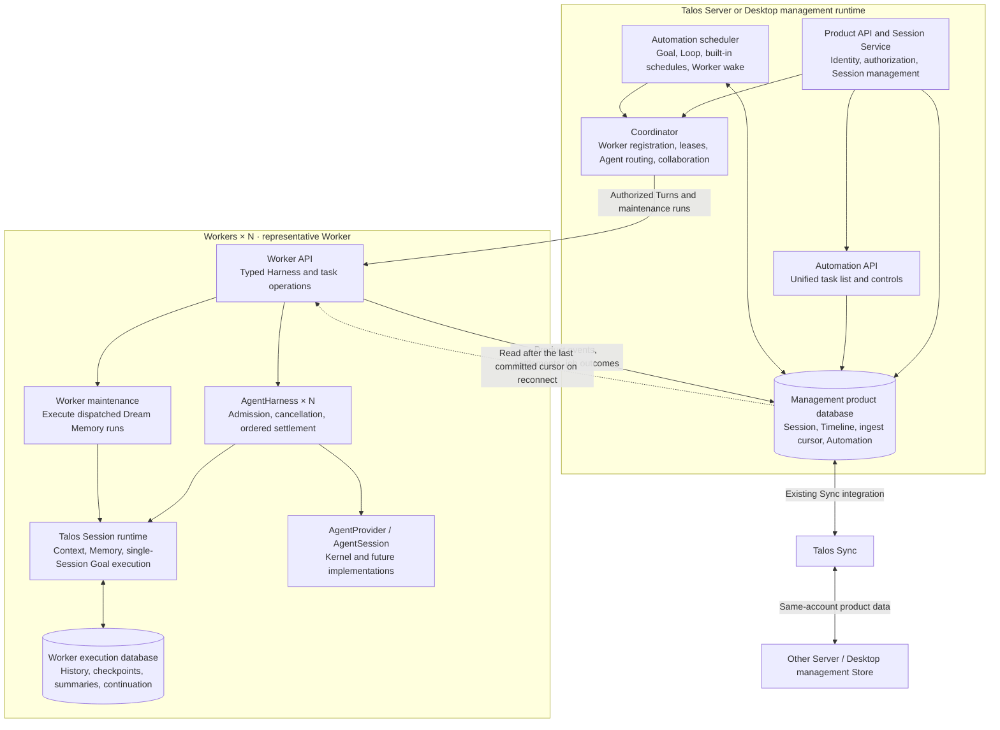

# Worker execution ownership and management

[Spec overview](design.md)

## Background

Talos already hosts `AgentHarness` and its configured `AgentProvider` on the Worker.
The current Coordinator admits a Turn and persists its product Timeline.
When preparing a new Turn, the Worker calls the current management runtime's
`ReadSessionHistory` to get the history it needs. The embedded configuration
makes this call over loopback. The history service packages complete Turns into
one response, and the Worker filters them for prompt use after receipt.

A Desktop incident exposed the cost of that dependency. A 4,558,084-byte
history response exceeded the 4 MiB gRPC receive limit during prompt preparation.
The selected history had to cross the RPC boundary before prompt budgets could
take effect. The same dependency exists when the Coordinator and Worker run on
different machines.

The current ownership and routing contracts are described in
[Session ownership](../feat-057-session-ownership/design.md),
[Worker coordination](../feat-044-talos-sync/worker-coordination.md), and
[RPC routing](../feat-044-talos-sync/rpc-routing.md).
The current [history client](../../talos-rs/crates/orchestration/agent-client/src/resources.rs)
and [prompt context source](../../talos-rs/crates/orchestration/agent-provider-kernel/src/history.rs)
show the read and filter order.

## Goals

- Let a bound Worker execute and continue a Session from durable local execution
  state. Keep history selection and prompt budgeting on the Worker.
- Preserve management-side Session records, the complete product Timeline, and
  existing same-account synchronization across Talos Server and Desktop.
- Recover an interrupted management event feed with a cursor-based pull from the
  Worker through the Agent API. Let admitted Turns continue when the management
  execution connection is lost.
- Allow an authorized management runtime to take the next Turn when the bound
  Worker confirms the Session is idle.
- Keep one Server-side management and dispatch path for Goal, Loop, and
  Worker-backed maintenance. Wake a managed Worker in automatic sleep for
  eligible Dream Memory runs. Keep these tasks visible in Automation.
- Keep the common Harness and Provider contracts as the Agent execution boundary.
  Keep Goal attached to one AgentHarness and one Session.

## Non-goals

- Cross-Agent Goal decomposition, delegation, or evaluation.
- Automatic relocation or failover of a Session to another Worker.
- Per-event application acknowledgements, a Worker delivery queue, or a second
  Sync client or replication protocol.
- New Agent Provider implementations, public API redesign, or Sync schema
  expansion for private execution state.
- Migration of pre-cutover execution state, Goals, Loops, or Memory progress
  into the Worker store.

## Architecture

### Ownership

| Owner | Durable state and responsibilities |
| --- | --- |
| Management runtime | Owns product Session identity, account access, Project and Worker/Agent bindings, user-facing metadata, and the existing product Timeline. Owns Automation definitions, controls, and dispatch. Retains routing, Worker leases, command authorization, product idempotency, and Sync export/import through the existing owners. |
| Worker Session runtime | Owns ordered execution history, admitted inputs, Turn state and settlement, checkpoints, summaries, Session Memory progress, and the execution state of an admitted Goal. Persists public Agent events alongside the state required to resume execution. Owns the committed cursor used by Agent API reads. |
| AgentHarness | Uses the existing Worker Session gate and ownership lock for admission, input, cancellation, recovery, and settlement. Acquires the configured Provider's AgentSession. |
| AgentProvider / AgentSession | Implements Agent-specific Turn execution and native continuation. Owns Provider-private artifacts. Uses shared Worker execution capabilities through the existing typed boundaries. |
| Talos Sync | Replicates management-side product facts between authorized peers. The current account namespace, parser, Store materialization, outbox, and durable Sync acknowledgements continue to apply. |

A Session remains pinned to its account, Worker, Agent binding, and Workspace.
The bound Worker is the single execution writer, including when multiple
management runtimes are authorized to address it. Opening or reading a Session
does not acquire execution ownership. Public product events have a durable
copy on the Worker and in management Stores. Only the Worker writes execution events.
Management-owned settings, notices, and lifecycle commands retain their
existing product owners.

The Coordinator routes through `AgentHarness`. For TUI and Desktop remote
Computer operations, the cloud TalosServer is the Coordinator and product
owner. The local management runtime handles operations on its own embedded
Worker. The Worker resolves the configured `AgentProvider` behind the Harness.
Cross-Agent collaboration remains a Coordinator capability. Provider
configuration, native state, and capability checks stay behind the Worker
boundary. Both modes use the same execution contract described in
[Worker API entry points](worker-entrypoints.md).

### Persistent storage

The Worker execution database and the management product database have
separate owners and transaction boundaries in every deployment. The Worker
opens its execution database and owns its schema and write lifecycle. The
management runtime opens its product database and owns its Session metadata,
Timeline, ingest cursor, Automation records, and Sync outbox. Each side commits
its own state. Ingest exchanges typed events and cursors through the Worker
API, including in the same process. Neither side accesses the other's
database or depends on a cross-database transaction. The Worker has no Talos
Sync connection.

Co-location can use separate database files in the same deployment. The
storage engine and layout remain implementation decisions.

### Turn execution and context

1. Session Service authorizes the caller and routes the command to the bound
   Worker and Agent. The command carries the current input, trusted Session
   binding, and invocation policy. New attachment inputs use the authorized
   attachment path and become available to the Worker for the admitted Turn.
2. The Worker uses the existing Session gate and admission handshake. The
   management runtime retains authorization and command idempotency. The
   Worker commits the admitted input and execution state before starting the
   Provider. The Worker owns the admitted Turn's lifetime after that commit.
   Resume loads the exact saved checkpoint or Provider continuation. Restart
   recovery follows the existing Worker ownership and cleanup rules.
3. The Worker prepares prompt context from local history, summaries, and local
   execution resources. The history query selects the requested window with
   bounds on data read and content projected. Existing character and token
   budgets remain at prompt assembly. Compaction can read earlier history in
   bounded batches and changes context without rewriting product Timeline facts.
4. The Worker commits ordered public events and the corresponding execution
   state before reporting them as committed. Terminal settlement follows the
   durable outcome. The management runtime persists the public events through
   its existing Timeline path and exposes them through the existing product APIs.

Routine Turn starts, continuations, compaction, and Session-derived memory
formation use the Worker store. External resources explicitly
owned by product services, such as a newly supplied attachment, keep their
existing authorized interfaces. Bound history growth at the Worker query
and projection boundaries.

### Connection loss and Coordinator handoff

Losing the management execution connection after admission detaches delivery
from the existing Turn. The Harness keeps running the Turn and committing
events under its existing Worker ownership and lifetime controls. A disconnected
delivery stream cannot block durable progress. Reconnection does not start a
second Turn. A reservation lost before admission is released
through the existing path. Explicit interrupt, authorization revocation, and
lease expiry keep their existing cancellation behavior.

Switching TUI or Desktop clients on the same cloud Server retains that
Server as Coordinator. A handoff between authorized management runtimes
allows the next Turn on the same Worker only when the Worker confirms the
Session is idle. The existing Worker gate atomically checks the Session
binding and idle state during admission. An outstanding reservation,
running Turn, Turn waiting for input, or unconfirmed cleanup keeps the
Session unavailable for handoff. Management handoff does not grant clients a
dispatch route. TUI and Desktop still use the cloud product API for remote
Computers.

This check replaces the Shared-history admission barrier. Sync
acknowledgements still confirm product replication.
Admission to an idle Session does not wait for an acknowledgement
from the source management runtime or Sync. A management runtime with a stale
Timeline can read the missing product history from the Worker using the same
cursor read. Reuse accepted command identity to recognize retries without
running the same admitted Turn again.

## Product Timeline and cursor reads

Keep the current product Timeline coverage, including input, message blocks,
tool events, waiting state, usage, and terminal success or failure. Provider
transcripts, native continuation, checkpoints, and Workspace contents stay in
their Worker-owned stores. The management runtime can serve the materialized
Timeline while the Worker is unavailable. Execution availability still depends
on the bound Worker.

The Agent API needs a read of committed Session product events. The logical
operation is `ReadSessionEvents` on the existing authenticated Worker API. The
name describes the contract for this draft:

| Contract | Semantics |
| --- | --- |
| Input | Authorized Session and Agent binding, exclusive `afterCursor`, and a bounded page size. With no cursor, read from the start of the current retained generation. |
| Output | Ordered canonical Agent events and any associated settlement facts, with stable identities, the cursor of the last returned event, and whether more committed data is available. An empty page leaves the caller's position unchanged. |
| Cursor | Worker-issued, Session-scoped, and bound to the history generation. It expresses a position in the committed Worker stream. Management database row sequences and Sync feed positions stay local to their respective owners. |
| Bounds | Bound each response by event count and serialized bytes. Preserve canonical payloads. A single supported large event must fit via a bounded representation supported by the transport. Resolve the exact limits and oversized-record handling before implementation. |
| Authorization and errors | Reuse account, Worker, Session, and Agent binding authorization. The read works for an idle Session. Reject cross-Session or stale-generation cursors with the existing typed error contract. Use the existing clear/reset lifecycle to establish a new generation. |

### Reconnect

1. During normal execution, the current management runtime consumes the existing
   live Agent event stream. Published events carry their committed Worker
   positions in the same cursor space as the read operation. The management
   runtime applies events idempotently by stable event identity and stores the
   cursor for the contiguous committed prefix in the same transaction as the
   corresponding Timeline writes.
2. After reconnect, the management runtime reads after its last committed
   cursor. It persists each page before continuing. Apply the same ingest path
   to live and pulled events. Overlap is deduplicated, and a gap is read before
   advancing the cursor past it. If the detached Turn is still active, use
   successive cursor reads to follow later commits. An empty page is not a
   terminal signal. Continue until the relevant committed outcome has been
   read. If the Worker is unavailable, retain the current cursor and retry on
   a later reconnect.
3. The management runtime captures committed product facts through its existing
   Sync path. Sync import retains its current side-effect rules. A duplicate
   Worker event or a Sync import must not repeat billing, reflection, tool
   execution, or Automation dispatch.

The pull reads from the Worker execution log. Its scope is the current
management runtime's missing product events. Worker storage is independent of
management ingest progress. The existing Sync acknowledgements cover the
management-to-Sync link. Talos Server and Desktop management runtimes own
the Sync connection and materialize imported events in their local product
Stores.

### Settlement received through a cursor read

The Worker stores the typed facts needed by existing management settlement with
the committed outcome. These include the Turn and original dispatch identities,
usage, and any accepted Goal completion declaration or dynamic Loop decision.
Match each result to its dispatched Turn or occurrence and definition version.
Keep management settlement inputs separate from the public Timeline payload
and its Sync contract. Return them only to the authorized management owner of
the original dispatch.

A cursor read can be the first delivery of a settlement. The original
management-side billing and scheduling owners apply it through the existing
idempotent paths keyed by Turn or Loop occurrence. Before advancing its cursor
past the settlement, that management runtime either applies it durably or
records it in the corresponding existing durable settlement state. Other
management runtimes can ingest the Timeline without taking over those effects.

## Memory, Automation, and Goal

The cloud TalosServer owns dispatch for remote Computer tasks. The local
management runtime can own dispatch for its embedded Worker under its
existing host policy. The responsible runtime owns the task definition,
trigger policy, controls, due time where applicable, and reported outcome.
Only that owner dispatches a scheduled run. Reading an Automation list or
importing product facts through Sync does not authorize dispatch.

| Task | Server management and trigger | Execution |
| --- | --- | --- |
| Session Goal | Own the objective, revision, budget, and managed status. Dispatch the first eligible Turn and later Turns after a committed settlement or another existing eligibility signal. Check pause, budget, user queue, and Session idle rules before dispatch. | The bound Worker and Harness advance the Goal in one Session. Persist the admitted revision, progress, checkpoints, and completion evidence. Report the outcome and any completion declaration. |
| Session Loop | Own the definition, interval policy, due time, and stop state. Dispatch one eligible occurrence through the existing Session queue. Calculate the next due time from normal settlement and apply a matching dynamic decision. | The bound Worker runs the admitted Turn. A model-controlled Loop can commit a typed continue-with-delay or stop decision for the admitted occurrence and revision. |
| Dream Memory Maintenance | Own the cron schedule, pause and resume state, and run-once entry point. Wake an eligible managed Worker in `IdleSleep` for a due or explicitly requested run, then dispatch through the Worker API. | The Worker processes eligible local Sessions in bounded batches, generates Dream Memory, and updates its local memory store, index, and formation progress. Report the result to the Server. |
| Profile Usage Retention | Trigger on Server startup, on its configured schedule, or on an authorized run-once request. | The Server's Profile Store removes expired finalized usage rows from its own database as platform maintenance. |
| `session-loop-scan` | Run the existing internal Server scan to find eligible Goal and Loop work. | The scan is part of dispatch. Only the selected work goes to the Worker. |

Goal remains a capability of one Harness bound to one Session. The Server owns
the managed Goal record and applies Worker outcomes once against the dispatched
revision. The Worker holds the admitted goal inputs and execution state. It
does not independently dispatch the next Goal Turn. Goal and Loop retain their
existing mutual-exclusion, user-queue, and cancellation rules. The inner
model/tool loop and on-demand prompt compaction are execution operations within
a Turn. Session Memory reads, summaries, and prompt injection use Worker-local
state. Shared User and Workspace memory retain their authorization policies.

### Wake and dispatch

For a due Goal, Loop, or Dream Memory run, the Server checks the task definition
and authorized Worker binding before requesting work. A managed Worker in
`IdleSleep` uses the existing Server Wake operation. Concurrent eligible work
can join the same wake. The Server waits for the Worker to become ready within
the existing bounds, then rechecks task eligibility and dispatches at most one
run for that occurrence. Manual stop and ordinary unavailability keep their
existing lifecycle rules. This extends the managed Talo maintenance policy
specifically to Worker-backed Dream Memory runs.

Dream Memory uses the same wake path for an authorized run-once request. A
paused job suppresses scheduled runs and may still accept an explicit run-once
request under its existing controls. Resume schedules the next eligible run.
The managed activity permit covers the admitted maintenance run through
completion so the Worker cannot idle-sleep during it. Use the same dispatch
identity when checking or retrying a request with an unknown outcome. The
Worker uses the existing idle Session maintenance boundary when selecting local
history. Dream Memory maintenance does not create a chat Session or enqueue a
Goal or Loop Turn.

### Automation page

The existing Automation page remains the place to list, inspect, and control
Session tasks and built-in jobs. The Server serves Goal and Loop records and
the configured built-in jobs for the authorized Computer, including Worker
Dream Memory. Reuse the existing `builtinJob/list`, `builtinJob/control`,
and `BuiltinJobInfo` contracts and their execution scope. The Server reports
the schedule, pause state, and last observed outcome. Show a run as active only
after the execution owner accepts it. Listing or refreshing the page does not
wake a Worker. Pause, resume, and run once use the same Server-side management
path regardless of where the job executes.

References: [Memory architecture](../../docs/architecture/MEMORY_ARCHITECTURE.md),
[Session Goal and Loop](../feat-053-session-goal-loop/design.md), and
[managed Worker lifecycle](../feat-054-managed-talo/design.md).
See the existing [built-in job management service](../../talos-rs/crates/orchestration/service/src/automation/native_jobs.rs)
and [Automation page](../../talos-app/web/src/pages/automation/AutomationPage.tsx).

## Rollout and historical data

All executable Sessions use the Worker-owned path after cutover. Drain active
work before switching a deployment. A pre-cutover Session cannot admit a Turn,
resume a waiting invocation, or dispatch a Goal, Loop, or Memory job. A user
starts new work in a new Worker-owned Session. Remove the management-owned
execution path, its history callback and Shared-history admission barrier, and
the handlers, configuration, and state used exclusively by that path. A
deployment switches the participating management and Worker components
together without enabling parallel execution modes.

Pre-cutover history already on a Computer remains available through authorized,
local read-only history access on that Computer. This applies to copies
already stored locally. It has no cloud product API, remote recovery or
backfill, or new Sync export or import. The local reader uses existing history
access and does not participate in admission or prompt context. Leave the
on-disk historical records in place. Apply this boundary to pending
pre-cutover Sync records as well as newly requested reads.

Product clients use the existing Session, History, Timeline, and Automation
API shapes for Worker-owned Sessions. Authorized clear and delete commands
coordinate with the existing Session gate, generation, and tombstone rules so
delayed events cannot restore removed history.

## Impacted areas

- `talos-worker`, `talos-agent`, and the existing Worker persistence owner for
  execution state, admission, and local context reads.
- `agent-protocol`, `agent-pb`, and `agent-client` for typed event positions
  and the Worker read operation across the
  [supported Worker API entry points](worker-entrypoints.md).
- `talos-service`, `talos-store`, and `talos-base` for routing, Timeline ingest,
  reconnect reads, management-side Sync capture, and Automation dispatch.
- Existing history, memory, model-context, and automation owners for their
  adjusted storage bindings. The independent `talos-sync` service and SDK retain
  the existing product Sync contract.

## Verification strategy

- **Local and remote execution.** Continue a long Session, compact it, and
  generate Session-derived memory using only Worker execution history.
  Verify a pre-filter history larger than 4 MiB can produce bounded context.
- **Storage ownership.** Verify that an embedded Worker commits execution in
  its own database and that management materializes the Timeline and cursor
  in its product database. With management ingest unavailable, confirm the
  admitted Turn continues and the Timeline catches up by cursor on reconnect.
- **Disconnect and replay.** Drop the management execution stream after
  admission while keeping the lease valid. Verify the same Turn keeps running.
  Reconnect from the last committed cursor, including an empty page before a
  later commit. Verify event order, overlap deduplication, and that usage and a
  dynamic Loop decision settle once when the terminal result first arrives by
  cursor read. Cover interrupted paging, stale generation, and lease revocation.
- **Multiple management peers.** Sync a complete product Timeline between
  Server and Desktop without a Worker Sync connection. Verify that switching
  remote product clients keeps the cloud Server as Coordinator. For a
  management-runtime handoff, delay source Sync acknowledgement and reject a
  second management runtime while the Session has an unresolved Turn or
  cleanup, then admit its next Turn once the Worker confirms idle. Verify
  authorization, atomic admission, and no repeated side effects on Sync imports.
- **Goal and Loop.** Verify the Server manages Goal configuration, pause,
  budget, and revision across Worker restarts and dispatches every eligible
  occurrence. Verify single-Session progress and completion evidence,
  Goal/Loop exclusion, and correct settlement of a dynamic Loop decision.
- **Built-in maintenance.** Verify a scheduled Dream Memory run and a supported
  run-once request wake an automatically sleeping managed Worker and dispatch
  only once after readiness. Cover pause during wake, shared wake with other
  work, manual stop, and protection from idle sleep until the run completes.
  Verify Server-local usage retention and passive Automation page reads do not
  wake Workers.
- **Automation page.** Verify the selected Computer's permitted tasks, schedule,
  pause controls, run-once actions, and reported outcomes remain available
  through the existing product API. Cover a sleeping Worker and preserve
  execution-instance authorization.
- **Cutover.** Verify every executable Session uses the Worker-owned path and
  that pre-cutover Sessions cannot execute. Open existing history locally with
  the Server unavailable. Verify it cannot be fetched through the cloud or
  newly replicated through Sync. Verify a retained Worker-owned product
  Timeline remains readable when its Worker is unavailable.
- Cover deterministic ownership and cursor behavior in gated integration tests.
  Run the representative automation and reconnect scenarios in hosted CI where
  feasible. Verify the real multi-management-peer and independent Sync topology
  as local acceptance using the existing computer Sync scenarios.

## Review items

- Choose the Worker store layout by extending the
  existing Worker persistence owner. Set page byte/count bounds and define how
  existing large canonical events fit through the Agent API before encoding
  the wire shape.
- Map the existing typed settlement and Automation status contracts onto the
  Worker API for embedded and standalone Worker deployments.
