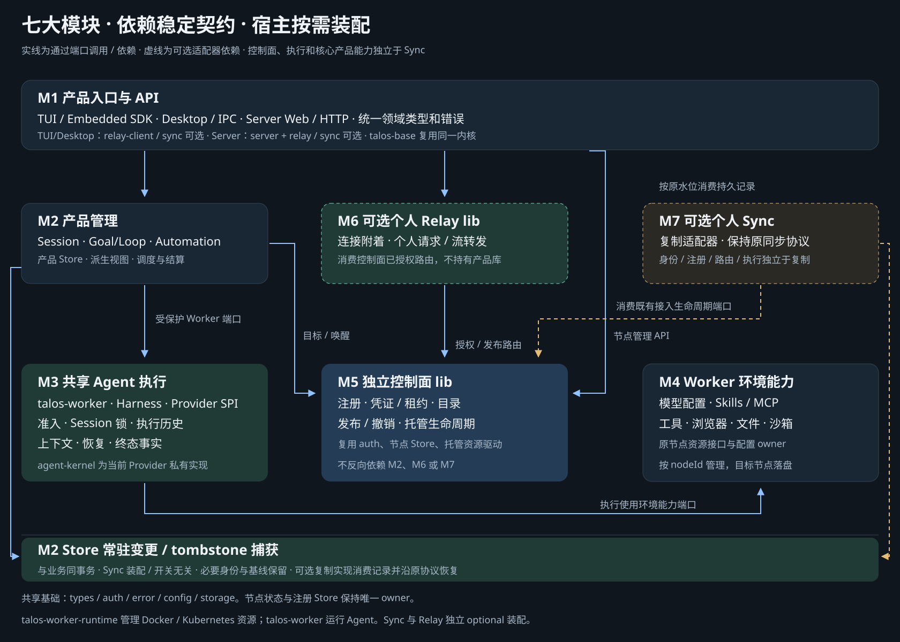

# 模块拆分与产品组装

[主 Spec](design.md) · [执行与产品数据落地](execution-ownership.md)

[四层与产品存储合成总图](assets/architecture-overview.svg)汇总本方案边界，详细契约以主 Spec 和本子 Spec 为准。

## 目标与已有基础

本子 Spec 落实主 Spec 的[架构决策](design.md#架构决策)与[技术决策](design.md#技术决策)，细化模块归属、依赖、组装、入口及迁移步骤。
产品业务和数据归属以主 Spec 为准。

[PR 209](https://github.com/apilots/talos/pull/209) 已实现受保护内嵌 Worker 的 lib 直调，
[PR 208](https://github.com/apilots/talos/pull/208) 已实现主动 WSS 和 TLS gRPC Connect。
本次对照 main 的 b0c77b34 核对现有模块和耦合点。在这些基础上拆分 owner，保持原有产品契约与传输生命周期；实施时对齐已合并基础。

## 模块归属与迁移

| 现有位置或模块 | 迁移后的职责 | 迁移与清理 |
| --- | --- | --- |
| talos-agent 中 RPC 适配器及其执行逻辑 | 共享受保护执行边界，持有 Session gate、SessionOwner、准入和终态生命周期 | 延续 lib 与网络适配器共用的执行状态；把仅限编码的逻辑留在适配层。 |
| talos-worker | 组合 Harness、Provider、环境、资源及执行持久化 | 承接执行历史、上下文、压缩和 Memory 形成；组合相同实例的本机与网络句柄。 |
| 产品侧旧执行写入与续跑绑定 | 执行准入、状态迁移、Provider continuation/checkpoint 和执行结算统一归 Worker | 产品服务只提交领域命令并摄取已提交事实；删除已被替代的执行直写接口，移除从产品库读取 Provider 引用再传回 Worker 的依赖。 |
| runtime.rs 引用的 ConfigService、MemoryService、PluginManagerService 等节点服务 | M4 节点能力与类型化端口 | 按 config/memory/plugin 等既有能力 owner 迁移或暴露窄端口，Worker 不通过整套产品 Session 服务获取节点能力。 |
| 产品 Service/Store | Session/Project、Timeline、Goal/Loop、Memory 管理、Automation 和计费 | 将依赖具体 Server 宿主的逻辑改为现有类型化端口，供本机与 Server 复用。 |
| Store 中 resource_revisions 与事务捕获 | 独立于可选 Sync 的常驻变更/tombstone 捕获 | 保留原范围、身份、前后差异与代数；移除 bindings 为空或 feature 未装配时跳过记录的分支。 |
| talos-base | 产品装配、宿主生命周期与资源绑定 | 注入 Store、Worker 和控制面/Relay/Sync 绑定；移出混合业务管理逻辑。 |
| AgentNodeService、managed_worker、注册/目录/发布装配 | 独立 talos-control-plane lib | 迁移节点管理和托管策略，复用原节点 Store、auth 和资源驱动。 |
| 现有 gateway 与 talos-base 个人中转逻辑 | 独立可组合的 talos-relay-server lib | 抽取连接附着、鉴权后路由、关联、有界流转发、背压和撤销；移除原位置重复实现。 |
| agent-client、协议与网络适配器 | Worker 主动 Connect 和类型化投影 | 保持 WSS/gRPC 共用执行契约；端点载荷处理与转发包络有明确边界。 |
| EmbeddedServerClient 与现有客户端 SDK | 统一产品能力与类型化结果 | TUI/CLI 沿用 run_embedded_app_server，SDK 屏蔽本机、个人转发、云服务路径。 |
| ApplicationSyncHost、现有 Sync 集成 | 可选 Sync 适配器与独立宿主接入生命周期 | 将身份、注册、目录和远程连接移出 Sync owner；保持协议、绑定和物化语义。 |

参考已有 [执行边界](../../talos-rs/crates/orchestration/agent/src/rpc.rs)、
[Worker 装配](../../talos-rs/crates/app/talos-worker/src/lib.rs)、
[应用装配](../../talos-rs/crates/app/talos-base/src/application_runtime.rs)、
[EmbeddedServerClient](../../talos-rs/apps/sdk-embedded/src/lib.rs)、
[资源绑定](../../talos-rs/crates/app/talos-worker/src/resource_binding.rs)与
[资源授权](../../talos-rs/crates/app/talos-base/src/agent_resource_authorization.rs)。

新增边界包括 orchestration 层的 talos-control-plane lib 和 gateway 层的 talos-relay-server lib。
两者都链接进 Server 装配，本次不增加独立部署进程。其余七模块职责在既有库与端口内整理，避免平行框架。

## 控制面 Library 的抽取

当前管理职责分散于下列实际代码。迁移须复用原有实现、锁与持久记录。

| 当前落点 | 目标 owner 与迁移方式 |
| --- | --- |
| AgentNodeService 的节点 Store、凭证、注册、租约和 current publication | 控制面 lib 负责目录、节点身份与有效性、发布/撤销。底层 schema 与 AgentNodeStore 保持原 owner。 |
| agent_node/managed_worker 中的托管意图、访问策略、reconcile 和派发保护 | 控制面 lib 负责实例生命周期及节点级就绪/活动保护；任务资格、Session 队列和结算仍由产品服务处理。 |
| application_managed_worker.rs 中驱动选择和宿主锁 | 装配层选择并注入已有 ManagedWorkerRuntime，控制面调用 Docker/Kubernetes 驱动；进程锁仍由宿主持有。 |
| NodeControlRpc / agent_node_connect.rs 的监听、WSS/gRPC 编解码与连接接收 | 网络适配器保留 I/O，调用控制面认证、注册与发布契约；控制面不依赖 axum/tonic handler 或具体 Server。 |
| desktop_worker.rs 中借用 ApplicationSyncHost 的 WorkerEnrollment | 客户端接入组件负责自身身份与注册，调用 Server 控制面 API；本机正常运行不要求装配 Server 控制面服务或 Sync。 |
| ApplicationSyncHost 中的账号接入、目录、connect_computer 和注册生命周期 | 身份归宿主接入，目录/注册策略归控制面，个人连接归 Relay，Sync owner 只处理可选复制。 |
| AgentNodeService.account_sync / ManagementSync 回调 | 改为可选适配器从已有生命周期端口接入，移除控制面持有 Sync 类型或实现的反向依赖。 |

实际代码参考 [AgentNodeService](https://github.com/apilots/talos/blob/b0c77b34/talos-rs/crates/orchestration/service/src/agent_node/service.rs)、
[托管装配](https://github.com/apilots/talos/blob/b0c77b34/talos-rs/crates/app/talos-base/src/application_managed_worker.rs)和
[ApplicationSyncHost](https://github.com/apilots/talos/blob/b0c77b34/talos-rs/crates/app/talos-base/src/application_sync.rs)。

控制面通过既有 talos-auth 验证身份，不复制账号/Profile 服务。
托管资源驱动复用 talos-worker-runtime，该库管理容器/Pod/Home，区别于 talos-worker 的 Agent 执行。
现有代码引用 Actor、SessionRecord、NodeAdmissionGates 和产品回调的位置须逐项核对。
共享身份沿用已有稳定类型；产品资格与活动统计改为有限的类型化查询/许可端口，由宿主注入，禁止控制面依赖整个 talos-service。
调用顺序、锁顺序、权限与撤销栅栏保持原行为，迁移后只保留一套节点状态。

共享产品服务通过 ProductNodeAccess 消费既有节点能力。个人 Full/纯管理 CLI 只持有本机元数据及原 ComputerManagement 客户端，本机节点元数据仍复用原 Store，但不创建 Server 的 AgentNodeService、凭证/租约权威或托管管理状态；Server 分支才构造唯一控制面实现。NodeAdmissionGates 的唯一实现位于 agent-protocol，Server 控制面和产品服务共享同一个 Arc，本机产品复用同类 gate 与 Worker 的原执行保护。talos-base 保留同一组装库，Server 生命周期、监听、注册权威和托管驱动只在显式 server feature 下编译；个人入口的生产依赖图不引入控制面、托管 runtime 或 Server Relay。
本机资源绑定直接使用原对象和本机授权构造，不通过构造 Server 控制面获取资源能力。退役的公开 loopback 客户端构造器删除；仅边界测试需要的本地通道限定在 crate 测试范围。

## 四边界的实际类型与组装

主 Spec 的[四个边界](design.md#四个运行时与接入边界)约束 Server 管理实现与客户端适配的依赖。

| 边界 | 当前类或接口 | 目标调整 |
| --- | --- | --- |
| 共享产品运行时 | TalosApplicationRuntime、TalosService、TimelineEventService、CoordinatorImpl、DatabaseSessionStore、Automation | 在 talos-base 中保留共同装配，本机和 Server 注入各自产品数据与受保护 Worker 绑定；从必备字段/启动中分离 Server 控制面和可选接入。 |
| Worker 运行时 | TalosWorker、TalosWorkerResources、AgentHarnessRpcAdapter、SessionOwner、AgentHarness/AgentProvider、ConfigService | 管理执行、节点服务和资源，lib/网络入口共享受保护适配器及状态；WorkerRpcHost 仅在需要 RPC 监听的部署装配，内嵌直调不调用 bind。 |
| Server 管理 | AgentNodeService、其内部 ManagedWorkers、NodeControlRpc/Connect 投影、ManagedWorkerRuntime | 管理实现迁至控制面 lib，NodeControlRpc 保持在 talos-base 网络适配层、Connect I/O 留在现有接入适配器，托管驱动仍为已有基础能力。 |
| 控制面客户端 | AgentNodeClient、AgentNodeRunner、RegisteredWorker、WorkerEnrollment；用户端 DesktopCloud/SDK | 保留客户端网络/重连/凭证生命周期；从 ApplicationSyncHost 解耦身份和连接，不引入控制面服务依赖或重复注册表。 |

参考已有 [TalosApplicationRuntime](https://github.com/apilots/talos/blob/b0c77b34/talos-rs/crates/app/talos-base/src/lib.rs)、
[AgentNodeClient](https://github.com/apilots/talos/blob/b0c77b34/talos-rs/crates/orchestration/agent-client/src/node.rs)、
[RegisteredWorker](https://github.com/apilots/talos/blob/b0c77b34/talos-rs/crates/app/talos-worker/src/registration.rs)和
[WorkerEnrollment](https://github.com/apilots/talos/blob/b0c77b34/talos-rs/crates/app/talos-base/src/desktop_worker.rs)。
ManagedWorkers 是现有内部实现，是否保留其内部类型名在迁移时决定；不作为新增公共 API。

AppServer/TUI 装配共享产品服务、本机持久化、内嵌 Worker 和可选接入客户端；对外就绪前完成受保护资源绑定。
TalosServer 在同一产品运行时之上装配控制面及可选 Relay/Sync；使用远端 Worker 时注入网络句柄。
独立 Worker 不装配完整产品运行时，只组合 Worker 与注册客户端。
Server 自己的内嵌执行保持受保护 lib 直调；如需发布同一 Worker，发布句柄复用相同实例。
Server 的 `agent_node.embedded_worker` 只控制其本机 Worker 装配，默认保留原内嵌行为。显式关闭时只构造原产品／控制面／网络注册路径，不构造本机 Worker、Agent、模型客户端或执行数据库；本机节点接口明确不可用，不回落任意远端。默认 Agent 逻辑路由仍由原产品配置声明并匹配 Worker 发布的 Agent ID；读取定义仅组装路由，不实例化被禁用的本机 Agent，也不据远端首个部署猜测路由。TUI/Desktop 始终装配完整本机 Worker。关闭本机 Worker 不关闭原产品 Goal/Loop 扫描、任务调度或维护任务。
纯 Server 的内置实例维护任务沿原 builtin-job API 管理，已认证管理员可用原 `embedded` 当前宿主别名发现，再按返回的稳定宿主／execution instance 身份控制；普通 Worker owner 无此权限。这不是本机 Worker 或 Computer 注册，不向 SyncStatus／目录伪造 Computer 身份。产品发送策略等整实例配置同样沿产品 owner 的管理员授权，不依赖本机 Worker 可达；个人端仍保留原本机所有权校验。
宿主统一管理启动、就绪发布、停止准入和 drain，接入断线不能销毁本机产品库或无关执行。
EmbeddedServerClient 在 talos-sdk-embedded；RegisteredWorker 在 talos-worker 内通过 agent-client::AgentNodeRunner/AgentNodeClient 接线。
RegisteredWorker::attach 使用已存在的 Worker/适配器，独立宿主创建一次 Worker；接入适配器不为每种传输重新创建配置、历史或凭证服务。

### 原有 Worker 端口的四类职责

按职责整理现有 AgentHarness 与 WorkerEnvironment，不因此新增四个 crate、SDK、服务或注册表。

| 类别 | 原能力端口与职责 | 产品侧保留 |
| --- | --- | --- |
| Agent 执行 | AgentHarness 的准入、输入、事件、取消、续跑与压缩；同一 Worker 原 SessionOwner／执行 gate／Store。 | 绑定、调度、观察与幂等结算。 |
| Session 辅助执行 | 原 AgentHarness 的 Dream、标题等语义操作；目标 Worker 本地历史、动态模型配置、结果和实际用量。 | 计划／触发、标题展示持久化、Profile 归账；不接收 prompt 后自行调用模型。 |
| 节点环境管理 | WorkerEnvironment 的 ConfigService、模型、插件、Skills/MCP；nodeId 决定实际配置文件 owner。 | 请求授权、节点选择与管理界面；不复制远端配置文件。 |
| 节点资源操作 | WorkerEnvironment 的文件、Git、预览、浏览器、桌面；文件读取／转换进程／临时产物在选定节点。 | 原件若属产品 File 仍由产品鉴权存储，预览票据与展示属产品；SessionPath 固定原 Session Worker。 |

四类入口均沿现有受保护边界，校验身份、目标、资源作用域与执行代数，复用同一实例、锁和关闭生命周期。辅助模型操作按实际调用保留可重读结果／用量，产品按稳定调用身份幂等消费；不新增 ACK／出站恢复队列。Office 文件沿既有预览 handle 与有界分块交付，不能整文件塞进单个 RPC。

### Worker 服务实例与持久化复用

共享的是代码、领域类型与类型化接口，每个 Worker 持有自身服务实例和节点数据，内嵌/独立采用相同装配规则。

能力现状及七类服务清单统一见[执行与物理存储边界](execution-ownership.md#worker-服务与物理存储边界)。
其中配置、Memory 内容/索引、插件/MCP 和 Provider 私有文件已在 Worker 装配，继续复用原存储；执行事实与 Memory 形成进度才需要解除产品库/远端回调依赖。

ConfigService 现定义在 talos-service，talos-worker::config 已为它组合节点 ConfigStore、共享执行 gate 和 reload_hook。
迁移依据字段的职责整理窄端口，复用现有实现，不为独立 Worker 引入完整 TalosService/Session 产品管理；产品发送策略等产品配置仍走产品 owner。
talos-service 的 product feature 仅装配产品管理服务，可在没有 control-plane feature 时独立编译；control-plane feature 显式接入原 Server 节点和托管实现。现有节点配置、环境、Memory、插件与文件能力保持原实现，可不装配 product 单独复用。
独立 Worker 关闭该 feature，编译依赖中也不引入控制面、托管 Worker 驱动或 Sync；产品入口显式启用 product。
同一 Worker 的 lib、WSS、gRPC 共享 TalosWorker 的节点服务、Store、AgentHarnessRpcAdapter/SessionOwner、资源绑定和适用 OS 锁。
Arc/clone 或 WorkerEnvironment 包装器仅共享原状态；不同 Worker 使用各自身份/存储绑定，冲突目录沿用原进程锁和资源校验拒绝，不引入第二套锁。
节点服务在对外就绪前绑定，停止网络连接只分离传输；宿主按原停止准入与 drain 策略关闭服务，重连不重建实例，重启从本 Worker 数据恢复。
服务具体位置和接口细化沿用既有能力 owner，不新增一套 Worker 服务框架，也不恢复 RemoteMemoryProgress/Server 历史回调作为日常执行依赖。

实际基础参见 [节点配置组合](../../talos-rs/crates/app/talos-worker/src/config.rs)、
[ConfigService](../../talos-rs/crates/orchestration/service/src/config/service.rs)、
[Worker 环境与服务](../../talos-rs/crates/app/talos-worker/src/runtime.rs)和
[WorkerRpcHost](../../talos-rs/crates/app/talos-worker/src/rpc_host.rs)。

## 依赖方向

图例沿用主 Spec：单向箭头为调用/端口依赖，调用者指向被调用能力；双向箭头为通信；虚线表示可选消费者。

- M1 产品 API 调用 M2 产品服务；请求按目标归属进入 M6 个人 Relay 或云产品路径。
- M2 依赖受保护 Worker 端口与 Store 端口，调用 M5 控制面契约解析目标、检查就绪和请求托管唤醒。
- M3 共享执行通过 Provider SPI 与 M4 环境能力工作；执行层不依赖产品 Session 服务、Relay 或 Sync。
- M5 消费既有 auth、节点/托管 Store 端口和 talos-worker-runtime 驱动；不反向依赖产品服务、Relay 或 Sync。
- M6 消费 M5 的鉴权后目标与发布契约，处理个人连接和转发；不持有产品库或任务调度器。
- M7 可选适配器消费宿主身份、产品提交与注册生命周期端口。核心模块不导入 M7 实现，适配器不掌握执行准入或节点可达性。
- M2 Store 的持久捕获始终可用；M7 消费其已提交记录，捕获实现不依赖 Sync SDK、Loro 或账号传输任务。
- 应用装配层持有具体 Service/Store、网络适配器和生命周期，接口及实现的绑定在该层完成。
- 控制面客户端只依赖既有 SDK/agent-client、稳定协议与宿主凭证接口，不依赖 talos-control-plane 的 Server 管理实现。

产品服务中的 Agent 路由、Session 队列和多 Agent 协作保留现有 Coordinator/Router owner。
控制面提供节点路由与发布资格，Worker 保留最终 Session 排他；三个边界各自只有原有一套锁和状态。

## 五种产品装配

前台执行入口持有本机 Worker 的唯一执行命名空间。并发 Goal/Loop 状态查询、暂停、停止和编辑，以及 Session 列表/详情/模型选择、Models、Status 等纯管理 CLI，只组合已有产品 Store、Service、Gateway 与认证上下文，不创建第二个 Worker，不恢复执行、不启动调度、注册或 Sync，也不引入 loopback RPC。
纯管理命令通过 talos-base::build_product_runtime 组合，在同一产品数据库提交定义，原前台执行者继续按既有扫描和结算规则观察状态；start、resume 和 exec 等执行命令仍使用完整 Worker 装配。节点配置和工作区校验复用已有窄环境能力，未装配的执行操作明确拒绝。产品上传恢复也不得在纯管理装配中运行；完整装配在取得唯一 Worker 命名空间锁后执行恢复。

| 产品形态 | 入口和产品管理 | 执行及环境 | 管理/可选组件 |
| --- | --- | --- | --- |
| TUI | apps/tui + EmbeddedServerClient + 本机产品服务/Store | 内嵌同一 Worker + 本机环境 | Server 接入客户端；Sync 可选。 |
| Desktop | 桌面 UI + AppServer/IPC + 本机产品服务/Store | 内嵌同一 Worker + Desktop 资源宿主 | 个人远程接入客户端；Sync 可选。 |
| TalosServer | Web/HTTP + 云产品服务/Store + 调度器 | 网络 Worker 端口，或自己的内嵌 Worker | 控制面 lib；Relay、Sync 分别可选。 |
| Docker Worker | 同一 talos-worker binary，云产品服务由 Server 提供 | 共享执行 + 容器能力 + 主动 TLS gRPC Connect | 控制面客户端；Talo 增加 Server 托管生命周期。 |
| Native Worker | 同一 standalone 入口，云产品服务由 Server 提供 | 共享执行 + 本机能力 + 主动 WSS | 控制面客户端；显式载体配置优先。 |

Docker/Native 共用入口与执行内核，配置和宿主能力区分部署。
共享边界是 Harness 与 Provider SPI，agent-kernel 只是当前 Kernel Provider 的私有实现。

完整 Server 装配 Relay；云服务专用 Server 可不装配 Relay。二者均独立选择是否装配 Sync。
Relay 与 Sync 使用独立 optional dependency/feature，关闭其中一个不关闭另一个。

### 产品入口的编译装配

| 入口 | 明确装配的 feature | 关闭可选组件后的能力 |
| --- | --- | --- |
| TUI、EmbeddedServerClient、AppServer/Desktop | 默认 sync、relay-client；入口向现有 talos-base 转发各自 feature，依赖关闭隐式默认 feature。 | --no-default-features 保留完整本机产品与 Worker，既不编译 Server 控制面，也不强制装入 Sync 或个人产品发布通道。 |
| TalosServer | binary 始终装配 Base 的 server；默认 relay、sync 分别转发，二者独立可选。 | --no-default-features 仍有原控制面、云产品服务和 Worker 注册，移除 Server Relay 与 Sync。 |
| Docker/Native Worker | 现有 Worker binary 与客户端；不装配 Base 或 Server 管理库。 | 保留原独立执行、注册、租约及重连；Server 相关集成测试才显式选择 Base server。 |

Base 的 server 只装入现有 control-plane、worker-runtime、渠道和 TLS 监听适配器，并启用 Service 的 control-plane；relay 依赖 server 并装入现有 relay-server。relay-client 只装入原个人宿主的出站产品发布适配器，不依赖 Server Relay 或控制面库，也不替代原节点注册/目录客户端。sync 仍只控制原复制适配器，常驻捕获及 tombstone 不变。

Server 代码在 Base 内部私有文件中按现有职责归拢，不新建 crate、SDK、管理器、注册表、协议或替代授权路径。本机与网络入口保留原资源鉴权、共享实例、准入锁和关闭保护。现有 relay 能力字段按产品归属报告：个人产品表示 relay-client 是否装配，云产品表示 Server Relay 是否装配；不因同一编译中包含另一种入口而误报，不新增 wire 字段。

Cargo 同一调用会合并依赖 feature，因此产品发行物必须逐入口单独构建并立即归档，不能用一次包含 Server/TUI/AppServer 的联合构建生成个人产品包。现有 build.sh 和 Desktop 打包沿用各自入口；CI 发行物构建同样按产品隔离。workspace 联合检查可用于质量门禁，但不能作为个人编译依赖裁剪的证据。deps-check 校验每个个人入口及最小 Server 的独立 normal/build 依赖图；CI 另跑个人无可选组件、最小 Server 与完整 Server 的真实测试，不能复用默认 feature 的测试归档来冒充裁剪验收。

不装配 Relay 时，云产品 API、Worker 注册、Node.Connect、调度与云产品读取完整可用，个人转发能力明确不可用。
同账号目标目录与领域契约统一，保留个人 Computer 选择器与独立 Talo 入口。
本次覆盖现有 Web/SDK，未来移动端复用 API。

## Sync 可选化与接入解耦

本次只调整 Talos 侧模块、依赖和宿主接线，保留原有同步协议、持久数据和合并/确认语义。

| 耦合点 | 处理方式 |
| --- | --- |
| application_runtime 无条件打开 TalosSync、运行时必须持有 sync/sync_host | 按装配能力创建可选 Sync 适配器；本机产品、Server 控制面和执行先于且独立于 Sync 可用。 |
| ApplicationSyncHost 持有目录、账号凭证、连接、Worker 注册和 Coordinator | 拆出宿主接入与控制面客户端接线；个人连接迁到 Relay owner；Sync 只订阅需要的生命周期。 |
| sync.peer_id() / sync_peer_id() 用于管理连接和调用身份 | 稳定宿主/管理者身份归接入宿主，迁移保留原持久值，Sync 引用该身份；不要求先启动同步，也不重新创建账号绑定。 |
| talos-base、talos-service、talos-store 强依赖 talos-sync/SDK | 将通用事务捕获留在常驻 Store，把导出转换、复制及导入物化放入可选适配器；核对传递依赖，核心捕获不依赖同步实现。 |
| 节点管理触发账户 Sync、执行等待共享历史 | 可选适配器消费原有提交和注册生命周期；节点授权、发布、Session 准入及游标补读不读取 Sync 就绪或 ACK。 |
| 关闭 Sync、登出与宿主关闭混合清理连接 | 关闭 Sync 仅停止复制；登出按账号范围撤销相关接入；宿主关闭分别 drain 其拥有组件，保持各自撤销规则。 |

上述依赖拆分须先把 Store 事务捕获从 Sync 实现中抽出。常驻部分负责业务变更、代数和 tombstone，
可选部分负责导出转换、网络复制及导入物化。主 Spec 的 [S1–S6](design.md#独立持久变更捕获与-sync-恢复) 是恢复契约。

已装配但关闭开关、编译未装配、未连接或重启时，产品写入都执行同一常驻捕获。
修改/删除须与记录同事务提交；保留既有身份、账号范围、必要前后差异与代数。
不能只保存旧 outbox/checkpoint/ACK 或只在重新装配后 bootstrap 重扫。
恢复装配时按原水位将本地缺口转为原 Sync 事实，再允许相应资源的远端导入，复用既有冲突检查与导入栅栏。
相关绑定及账号偏好保持，未消费记录与删除前的必要身份在安全导出前保持可读。

基线 main 的 source.rs 曾在 bindings 为空时跳过捕获，metadata capture 依赖已安装适配器，
catalog bootstrap 排除已有同步文档。常驻 Store capture 已取代这些捕获前置条件，保留现有 wire/merge/ACK 契约。
不增加新的同步服务、投递队列或事件总线，不把登录/网络传输作为事务捕获的前置条件。
脱钩不引入第二套 peer identity、事件总线、同步队列或注册表。

## 正常入口与选路

本机操作进入本机产品服务，通过 lib 调用内嵌 Worker。
远程操作统一进入 TalosServer 产品 API。Server 按已验证的产品归属选择目标宿主 Relay，或自身云产品服务。
云端 Agent 请求直接进入产品服务和 Worker 绑定，不经过个人 Relay。

新操作以已授权的选中 Computer 为目标，已有 Session/Project 以持久绑定为准。
只有当前宿主的 embedded alias 或已核验自身注册身份可选择本机路径。
Server 对账号和目标目录重新校验。缓存、客户端切换和 Sync 副本不改变权威绑定。
个人 Desktop/TUI 与独立 Native 的角色在已有注册领域模型中明确，传输载体不决定产品归属。

查看端不在本地登记一个远端 Worker Coordinator，也不持久维护远端运行与调度状态。
产品缓存和既有副本只提供授权视图，不提供远端执行资格。

## 个人宿主 Relay

所属 Desktop/TUI 通过主动认证连接发布其产品能力。
复用现有连接、关联、有界分块、文件与媒体资源机制，补齐已有产品操作的类型化转发投影。
转发范围包含 Session 创建/列表/历史、Turn/input/interrupt、Automation、Memory、文件及已支持媒体。

Server 验证客户端账号与目标设备路由，目标宿主验证自身持久 Session/资源绑定和产品权限，再调用本机产品服务。
同账号不同客户端凭据可以访问同一宿主。Server 通过已认证 TLS/WSS 连接委托最小账号身份，
宿主将其与当前注册租约的所属账号比对；身份仅进入内部类型化请求上下文，不包含访问令牌或 auth-disabled 标记，不能由普通 HTTP 头伪造。
不同账号即使具备 Server 管理员权限也不能借个人 Relay 读取他人产品数据。此处信任已配置的 Talos Server 认证委托，不宣称新增端到端加密。
端点载荷处理与 Relay 转发包络分层，密码学算法与密钥协议不在本次实现中重新定义。
个人数据只在所属宿主持久化，Relay 保留有界关联、取消、超时、背压和暂存缓冲。
日志、业务库、持久缓存和投递队列不得保存个人正文与文件内容。

为控制、交互事件、文件和媒体提供独立有界队列及流控；根据已有传输能力分通道，避免大文件阻塞交互。
保持现有 WSS 出站接入和 TLS，协议和库复用已有网络 owner。

个人宿主离线时返回明确不可用。重连通过宿主产品 API 补读已提交事件，Relay 不建立持久重放队列。
把原 Coordinator.Connect 中“调用端持有业务准入、落库和资源回调”的 Worker 原始转发替换为所属宿主的产品 API 转发。
保留仍使用的权限化文件和媒体能力，移除旧执行 handler、路由、状态及仅供其使用的帮助代码。

## Server 管理 Worker 的网络绑定

Native、Docker 和 Talo 注册到其产品所属 TalosServer，Server 保留产品 API、数据与调度。
Worker 执行使用共享 Harness 边界和本地执行历史，新附件和 Server 所有资源通过已授权端口访问。
产品配置按版本派发，执行事实由 Worker 单写；Server 产品服务消费事件构建最终一致视图，
具体受理、补读和重建遵循[一致性契约](execution-ownership.md#一致性与命令受理)。
查看端不提供执行历史或反向资源回调。Worker 离线时已有 Server 产品历史仍可读，执行等待原目标恢复或既有托管唤醒。

沿用 AgentNodeRunner 和传输适配器；节点凭证、租约、心跳和发布管理归控制面 lib，协议投影保持现有契约。
注册成功不等于可执行，Connect 就绪后发布准确 Harness/environment 句柄。
重连栅栏隔离旧路由，撤销只移除受影响发布。保留 TLS 校验与显式传输配置。

outbound 使用 WSS，direct 使用 TLS gRPC Connect，二者都由 Worker 主动建立。
个人端与 Native 使用已有 outbound 默认，Docker/Talo 使用已有 packaged direct 默认；显式配置优先。
Server 提供入口，注册 Worker 不监听执行端口。
现有 HTTP/SSE 产品 API、Desktop IPC 和本机 Gateway 继续由各自入口装配。

## Worker 环境与模型配置

M4 复用现有 Worker 配置、Skills/MCP、工具、浏览器和沙箱能力，不因七模块划分再建一套管理框架。
模型页面按 nodeId 使用既有 WorkerEnvironment/ConfigService，目标 Worker 持久化配置并按原 reload/gate 规则生效。
Server 提供授权入口和选路，模型凭证沿实际节点的配置/凭证 owner 保存。
同一接口用于 Talo、Docker、Native 和本机 Worker，节点之间的配置各自隔离。

### ConfigService 的字段、接口与持久化拆分

当前 ConfigService 混合节点配置与产品发送策略，服务所在 crate 不能决定所有字段的归属。
复用现有 ConfigPath/ConfigValue/ConfigResponse、ConfigStore 与 YamlConfigStore 实现，以类型化窄端口区分两类能力，不新增配置协议、配置注册表或平行服务系统。

| 能力与字段 | 服务/API owner | 持久化与生效 |
| --- | --- | --- |
| ConfigPath::Llm / ConfigValue::Llm、WebSearch | Worker 节点配置端口，由 WorkerEnvironment 暴露；本机直调，页面经 Server 授权后按 nodeId 访问。 | 目标 Worker 的既有 YamlConfigStore 和 env 文件；复用敏感字段读出规则、execution gate、校验、reload_hook 与原子发布。产品服务不另存一份可独立写的节点配置。 |
| ConfigPath::SessionMessageSendPolicy / ConfigValue::SessionMessageSendPolicy | 所属产品的配置服务/API 管理默认发送策略，复用现有 queue/steer 领域类型与原调用语义。 | 由本机产品宿主或所属 Server 的既有 ConfigStore 持久化 agent.message_queue.default_send_policy；按原产品策略读取/生效，不写远端 Worker 节点 YAML，不作为节点模型 reload。 |

现有统一产品配置入口按类型化字段分派到产品配置或目标 Worker 窄端口，SDK 保持一套领域模型。
整理 WorkerEnvironment 配置能力时移除产品发送策略的可调用分支，契约及消费者同步调整；不能因 nodeId 选择而把产品策略错误写入某个 Worker。
独立 Worker 可复用 ConfigService 的节点实现与必要窄端口，不实例化产品配置/Session 管理服务。
内嵌宿主若沿用同一配置文件后端，仍保持字段 owner 分离、现有文件锁和保留无关 YAML 字段的写入规则；逻辑拆分不要求另建文件或复制全量配置。
产品库与执行库仍分离；节点/产品配置沿既有配置后端保存，本次不把它们强制迁入 SQLite。

## 共享准入与资源生命周期

- 产品服务创建受信调用上下文；网络适配器校验节点凭证和租约，本机路径从已授权宿主获得上下文。两者同样校验账号、Computer、Workspace、Session 和 Agent。
- 使用同一 Session gate、reservation、两阶段准入、AgentAdmissionPermit 和 SessionOwner 表。适用时使用既有 OS Session 锁处理跨进程共享目录。
- reload、clear 和 deletion 使用原有独占 gate 和所有权规则。Workspace 从受信配置解析，资源句柄在消费准入前完成绑定，guard 持有到结算和清理结束。
- 本机资源直接调用所属对象，网络资源携带已验证的 invocation scope；复用相同执行状态提交、事件顺序、中断和一次终态提交。
- Server 与本机产品服务只发起命令并消费执行副本；续跑引用、检查点、状态迁移和执行结算留在同一 Worker 边界，产品用量归账及后续调度分别消费这些事实。同进程装配不授予产品服务直接写执行事实的能力。
- 保留 RPC 适配器已有 preflight Status 与操作 Failure 的错误边界。原始 AgentHarness 默认实现不得绕过保护。
- 已准入调用的重连与补读复用已有 invocation 和稳定事件身份，禁止因重建传输流重复准入。
- 同一 Turn 的新 continuation 与旧命令重放必须区分：只有执行 owner 按代数和完整命令确认已有准入，才允许纯重放；不能用 start 探测重放。纯查询不创建 Provider、Browser 或资源生命周期，也不新增网络协议或索引。WorkerHarness 沿原上下文标准化转发到既有本地 journal；新 continuation 查无原命令后重新经过原准入、Session 锁、资源绑定及租约监督，载荷冲突直接报错。

## 宿主生命周期

内嵌产品构造受保护 Worker，不绑定私有 Worker/resource RPC listener。
本机访问和远程发布指向同一实例。保留 PR 209 的 listener 独立监督与 PR 208 的主动注册基础。

宿主分别监督控制面、Worker、媒体、注册/传输、可选 Relay 和 Sync 任务，关闭时停止新准入并按已有策略 drain 或取消。
关闭顺序复用同一生命周期实现：停止产品调度与新准入；仅对宿主拥有的本机 Harness 调用 stop_execution，完成活跃执行与本地日志提交；保持来源注册和读取授权，排空本机产品交付，完成业务结算或保留其已有待消费持久状态；最后由原 Coordinator 唯一执行 Provider、会话和资源的正式关闭。独立 Worker 的原关闭入口也先等待执行日志完成，不能在日志记录器之前关闭 Provider。stop_execution 是同进程宿主端口，不新增 RPC 方法或关闭管理器。

管理端退出时，独立远端 Worker 已准入的 Turn 继续执行。产品层只在观察等待边界结束远端观察，不发送 interrupt、不伪造终态，保留最后已提交游标、原命令身份和待消费回执。已开始的准入、输入提交及产品原子事务完成既有交接后才退出；关闭期间完成的回执仍记账，但不能再派发下一条队列或 Goal/Loop Turn。

保留前台 TUI 与常驻 Desktop 的原宿主规则。常驻管理者负责后续计划，关闭云端查看客户端不停止 Server 调度。
交付断开、撤销、租约到期与宿主终止按[执行子 Spec](execution-ownership.md#断连与结算)分别处理。

远程注册撤销只影响对应远端作用域，不取消无关本机工作。
媒体沿用其已有鉴权和传输路径；本次不新增容器桌面直连通道，也不要求所有资源共用一条物理 TCP 连接。

## 迁移顺序

1. 复用已合并 lib/Connect 基础，对齐装配层，核对现有共享 gate、生命周期和资源端口。
2. 先把 Store 变更/tombstone 捕获独立出来，再迁移 Worker 历史、上下文和 Memory 形成，实现持久事件、游标与结算接口。
3. 抽取控制面 lib，并在原产品 Service/Store 内消除具体 Server 宿主依赖，装配本机/Server 产品管理与调度。
4. 抽取 Relay lib，迁移宿主身份和接入 owner、裁剪 Sync 复制部分，验证记录恢复、独立装配与同账号目标选路。
5. 清理迁移后未使用的旧实现、loopback 配置、调用端 Coordinator 登记和兼容分支，完成正常入口与历史只读验收。

各步是实现依赖顺序，最终可执行路径统一切换到主 Spec 的新契约。
与根目录 PLAN 的阶段 1–5 一一对应；控制面端口设计在阶段 1 完成，实际抽取在阶段 3，不能先裁剪捕获再补恢复。

## 验收

- 验证 Server 的 Relay 开/关 × Sync 装配/不装配四种构建，检查 Cargo 传递依赖和能力发现；云产品与注册执行始终可用，个人转发只依赖 Relay。
- 不装配 Sync 时完成 Desktop/TUI 启动、登录、身份恢复、Worker 注册/租约、目录、个人 Relay、云端执行和游标补读；身份值与已有账号绑定稳定。
- 对已装配 Sync 单独关闭开关，验证复制停止但连接/路由/执行继续；重新启用保持原 outbox、checkpoint 与 ACK 行为。登出/撤销与关闭 Sync 的作用域分别验证。
- 先同步新架构资源，再切换无 Sync 构建，执行创建、修改、clear/delete、同身份新代及账号/注册退役，重启后恢复 Sync；验证全部授权变更传播，删除不复活且旧导入不能覆盖本地缺口。
- 覆盖业务事务回滚、捕获写入失败、未消费记录保留、恢复导出中断与重复导入，验证无丢失、无回声且原 wire/merge/ACK 保持。
- 检查七模块依赖，确认控制面无产品服务/Relay/Sync 反向依赖，Relay 无产品库和调度器依赖，执行内核无具体 Server 依赖，云请求不经过个人 Relay。
- 分别验证四个边界：AppServer/TUI 有产品库与本机调度，独立 Worker 只含执行与注册客户端；客户端无控制面服务实现依赖。
- 覆盖用户端登录、自身凭证持久化与恢复、独立 Worker 原凭证登记/续租及重连；验证停止接入、停止 Sync、登出与宿主关闭作用域分离。
- 覆盖迁移前后的凭证、租约、发布、撤销与托管生命周期，验证节点 Store、进程锁、活动保护、权限和 Session 排他未产生重复 owner。
- 从本机与页面对不同 nodeId 读写模型配置，验证落盘、重启、生效及节点隔离。
- 分别修改 Llm/WebSearch 与 SessionMessageSendPolicy，验证前者只写目标 Worker 配置/env 并遵守 reload gate，后者只写所属产品配置；切换 nodeId 不改变产品策略 owner，WorkerEnvironment 无产品策略旧分支。
- 验证同文件后端的字段更新不覆盖无关 YAML，凭证读取仍脱敏；不同 Worker 命名空间不串写，产品配置不会复制到每个 Worker。
- 在同一 Worker 同时启用 lib/WSS/gRPC，通过一个入口修改配置、读取历史/Memory，再从其他入口观察同一已提交状态；并发同 Session 验证同一准入、锁和结算。
- 对两个 Worker 分别修改配置、历史/检查点和 Memory 进度，验证服务实例及数据隔离；重连不重建，重启从各自存储恢复，凭证/节点资源不串用。
- 验证独立 Worker 通过窄端口复用配置/持久化实现，未装配完整云产品管理服务且执行历史不回查 Server；Server 产品配置、任务和结算保持原 owner。
- 验证 lib/WSS/gRPC 入口的等待输入和续跑均从 Worker 本地状态恢复，产品 API 不要求 Provider 私有引用；产品视图重建不改变 Worker 执行权威，旧执行直写接口已清除。
- 从同账号 Web 与现有 SDK 操作授权个人和云目标，覆盖能力缺失、账号隔离、离线目标、过时缓存及原产品错误语义。
- 验证 Desktop/TUI、内嵌 AppServer/Server 从正常产品入口直调 lib，完全无私有执行/资源 listener。
- 验证 Native WSS 和 Docker/Talo gRPC Connect、显式配置、注册就绪、重连、撤销及无 Worker 执行 listener。
- 在 Sync 关闭时远程操作个人宿主，确认产品写入归属和无 Relay 内容落盘；从无本地副本客户端操作云产品。
- 并发本机/Relay 调用及网络调用，验证同一 Session 锁、一次准入、SessionHeld、资源 guard、一次结算和空闲管理者切换。
- 覆盖断连前后、等待输入、游标首次交付终态、中断、租约过期及关闭，验证结果、错误与流顺序一致。
- 在本机 Turn 正在运行及准入交接尚未完成时关闭宿主，验证关闭会等待本地执行日志与产品交接，Provider 只正式关闭一次；管理端关闭远端静默长 Turn 的观察后，验证执行继续、无 interrupt、原游标与待消费回执保留。
- 覆盖大文件和媒体并发时的有界缓冲、背压与交互可用性，验证仍需的文件/媒体权限。
- 检查旧 handler、路由、缓存与重复实现已删除，Sync 副本不能产生额外调度者；Sync 协议和密钥改造不属于验收。

## 实现落点与传输约束

- Server 控制面库为 crates/orchestration/control-plane，Relay 库为 crates/gateway/relay-server；talos-base 通过 server、relay、relay-client、sync 按产品入口分别装配。talos-service 的 product feature 仅组合产品能力，control-plane feature 显式装入 Server 管理实现；独立 Worker 复用基础节点服务而不装入完整产品服务。
- NodeProductOwner 在既有注册契约中明确 Computer/Server 归属；权限与路由不从监听端口、载体或运行阶段推断。HostId 沿用原持久身份，Sync 只引用该值。
- Relay 复用产品 HTTP Router，不要求个人 Host 监听 HTTP。每流使用 64 KiB 分块、8 帧信用窗口、最多 64 并发流；控制/交互/文件/媒体分 lane，单流背压不得阻塞 socket 读取。SDK 文件方法仅可通过传输提示降级至 File lane，不能提升到 Control，提示不会进入产品授权。
- Relay socket 独立检测存活：15 秒 Ping，30 秒 Pong/写入超时；节点租约续期不替代产品 socket 活性。网络恢复复用现有租约及 Host 生命周期，不建立第二套注册或持久重放队列。
- 文件来源按认证账号与有效连接内的稳定 HostId 解析，重复活跃别名拒绝；Server 自身 HostId 直接进入本机产品文件 API，不要求装配 Relay。源文件范围读取复用现有 typed offset/limit 接口与上限，不修改 Sync wire。
- 个人预览复用原 capability：单层 r-{computer-base36}-{preview-base36} 子域名承载两个 UUID，保持一级 TLS wildcard 及 HTML 根路径资源归属。仅固定只读预览资源入口转发，Host 校验原 grant、过期与关闭状态，不建映射注册表或转发任意产品 API。
- 个人 MCP OAuth 的 REST 与 typed generic 入口使用同一回调归属，复用现有有界过期 oauth_routes 及 Host PKCE 校验；Server 不保存个人凭证或产品正文。普通 HTTP 不接受伪造委托身份，Relay 内部投影强制 RemoteProduct 来源并再次核对租约账号。
- 唯一领域模型、原 Store 捕获、Actor 与 Session 绑定继续归既有 owner。Sync 的存储、合并、ACK、Noise 套件及密钥协议不在本次改造范围。
