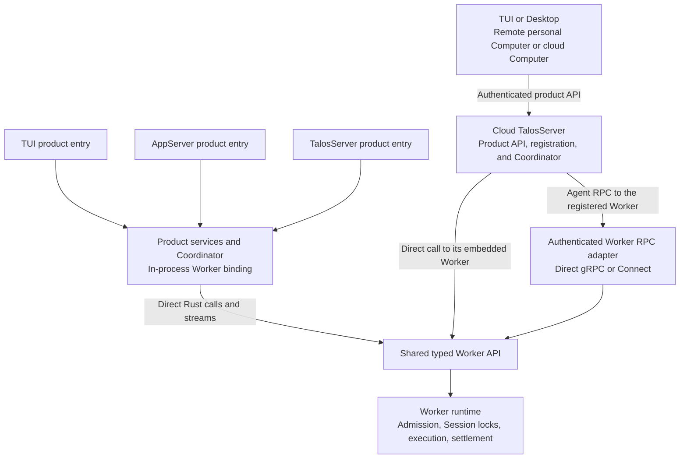

# Worker API entry points

[Spec overview](design.md) · [Execution ownership and management](execution-ownership.md)

## Decision

Use the existing `talos-worker` library as the shared Worker runtime. It
exposes a typed in-process execution API and the same execution operations
through the existing RPC adapter. Each product entry point composes the
Worker and the management services needed for that product. All entry points
enter the same Worker admission, Session ownership, execution, and settlement
paths.

| Entry point | Product entry and management | Management-to-Worker call |
| --- | --- | --- |
| Local TUI | Reuse the in-process product SDK and its Session, permissions, Timeline, and Automation services. | Call the embedded Worker API directly in the same process. |
| AppServer with an embedded Worker | Keep the existing AppServer product interface and management runtime. | Call the embedded Worker API directly in the same process. |
| TalosServer with an embedded Worker | Keep the Server's product interfaces, Coordinator, scheduling, and Sync integration. | Call the embedded Worker API directly in the same process. |
| Standalone Worker | The current management runtime retains product APIs and routing. The standalone binary composes the shared Worker library. | Use the existing authenticated Agent RPC over direct gRPC or outbound Connect. |

For the three embedded configurations, the local Worker call path uses Rust
calls and typed streams. It starts neither the loopback Worker RPC listener
nor a local resource callback listener for those calls. TUI and Desktop
use the cloud TalosServer product API when the selected Computer is remote.
The cloud Server selects its Worker binding and the corresponding transport.

## Cloud Server ownership of remote operations

TUI and Desktop send remote personal Computer and cloud Computer operations
to the cloud TalosServer's authenticated product API. This includes Computer
and deployment discovery, supported lifecycle actions, Session and Turn
commands, and access to files, workspace resources, and remote desktop
capabilities. Use the existing product request and response contracts and
extend the existing client transports where needed.

Cloud TalosServer owns authorization, operation admission and idempotency,
target selection, and routing. It resolves a Computer from its account-scoped
directory and verifies the Session or Project binding before dispatch. Its
Coordinator calls out-of-process Workers through authenticated direct gRPC
or outbound Connect and calls its own embedded Worker in process. It owns
the product result, Timeline ingest, Automation scheduling, and Sync
capture for the remote operation where applicable. Workers continue to
own durable Agent execution.

For an operation on an authorized remote Computer, TUI and Desktop are
product clients. They receive results and live delivery through the product
API. The cloud Server reaches connected Workers through the Worker-facing
transports and uses existing scoped resource operations where required.

### Client target selection and local state

Use the selected Computer for a new unbound operation. Use the saved
Session or Project binding for an existing bound operation. An operation
is local only when the target is the current host's embedded Computer
alias or its verified registration ID. Send all other Computer targets to
the cloud Server, which verifies the caller and resolves the binding again
from its authoritative directory. A stale local view cannot change the
route. When the Server is unavailable, remote commands fail through the
existing product error contract.

The cloud Server owns the remote Computer directory, live status,
registration, leases, and dispatch state. TUI and Desktop can display
in-memory observations from the cloud API and retain product facts from
the existing Sync integration, including Session and Project binding IDs
and product Timeline records. The local app does not maintain a durable
remote Computer registry or execution dispatch state. Synced product data
cannot authorize an operation or establish live availability.

### Registration and authority

| Participant | Cloud TalosServer responsibility |
| --- | --- |
| TUI and Desktop product client | Use existing authenticated device sign-in to identify the client. Authorize product calls under the signed-in account and scope. |
| Published personal Worker | Enroll the actual Worker as a Computer, including an embedded Worker's remote publication when enabled. Maintain its owner binding, Worker credentials, leases, heartbeat, published deployments, and registration revocation. |
| Managed cloud Worker | Use the same Worker registration and execution contract. Own authorized provisioning and lifecycle operations, including Wake while managed and in automatic sleep. |
| Management Sync peer | Use the existing Sync identity and account-scoped replication of product facts. The replica does not establish Worker availability or execution authority. |

Client registration and Worker registration are distinct. An authenticated
TUI or Desktop can operate an authorized remote Computer without becoming
an execution node. Device sign-in uses the existing product identity and
requires no separate registration store, Worker lease, or Sync enrollment.
Publishing a local Worker enrolls that same Worker through the existing
node contract. Keep user credentials and node credentials with their
respective owners.

An unavailable cloud Server prevents remote product operations. An
unavailable Worker leaves cloud-backed metadata and prior Timeline reads
available where retained. The local embedded Worker path remains available
under its local authorization policy. Manual stop and unreachable personal
Computers follow the existing lifecycle and error rules.

### Retire the old Coordinator relay

The prior [Coordinator relay](../feat-044-talos-sync/rpc-routing.md)
authenticated and forwarded ordinary remote Worker calls while the calling
management runtime admitted Turns and owned their product results.
[Managed Talo](../feat-054-managed-talo/design.md) already uses the owning
Server's product API. This design uses that product ownership boundary for
remote personal Computers as well.

Remove the `Coordinator.Connect` Worker command relay and its client-side
remote Coordinator dispatch, including the endpoints, handlers, routing
registrations, cached remote node state, and helpers used only by that path.
The cloud product API is the sole remote operation entry for TUI and Desktop.
The existing Worker-facing `Node.Connect` and direct gRPC carry authorized
cloud Server-to-Worker calls. Reuse scoped resource operations needed by
the Server-owned path. They do not accept client-originated Worker commands.
Pre-cutover history follows the [local-only history policy](execution-ownership.md#rollout-and-historical-data).

## Existing module ownership

| Existing owner | Responsibility |
| --- | --- |
| [`talos-agent`](../../talos-rs/crates/orchestration/agent/src/rpc.rs) | Owns the shared execution path. Move the Session gate, `SessionOwner`, active invocation tracking, resource guard lifetime, and settlement out of the listener-bound path into the existing Worker execution logic. The existing RPC adapter applies transport authorization and delegates to these same operations. |
| [`talos-worker`](../../talos-rs/crates/app/talos-worker/src/lib.rs) | Builds one Worker with its existing Harnesses, environment, and scoped resources. The in-process binding and any network adapters use the same shared execution state in that Worker instance. |
| [`talos-base`](../../talos-rs/crates/app/talos-base/src/application_runtime.rs) | Composes the product services and Worker in the existing application runtime. Registers the protected Worker binding with the existing Coordinator and supplies in-process access to management-owned resources. Owns product startup, shutdown, and listener lifetimes. |
| [`EmbeddedServerClient`](../../talos-rs/apps/sdk-embedded/src/lib.rs) | Remains the local TUI and CLI product SDK adapter over the existing in-process Gateway. The direct Worker binding sits below the Coordinator. |
| Existing Agent protocol and transport adapters | Reuse `AgentHarness`, `WorkerEnvironment`, `AgentAdmissionPermit`, and typed streams. Keep the existing Agent client, gRPC, and Connect as the network path. |

Implement this change within these existing modules, SDK, and services.
No separate embedded Worker module, new crate, parallel SDK, or service is
needed. [TUI and CLI](../../talos-rs/apps/tui/src/main.rs) continue to use
`run_embedded_app_server` and `EmbeddedServerClient`. AppServer and TalosServer
change the Worker binding in the same application composition.

Share the protected operations before replacing the embedded loopback
clients. The raw Provider-facing `AgentHarness` and raw Worker environment
do not constitute the protected entry point. In particular, implement
execution-state reads and commits against the shared Worker state instead
of relying on the lower-level Harness defaults.

## Shared execution contract

- **Authorization and binding.** Product services authenticate and authorize
  the actor, select the Worker, and provide a trusted invocation context.
  The RPC adapter verifies remote credentials and lease scope before creating
  that context. The local path receives it from the authorized product host.
  Both modes validate the account or workspace user namespace, Session, Agent,
  Workspace, and Computer against the stored binding. Resolve the effective
  Workspace from Worker configuration. A same-process context does not bypass
  these checks or substitute caller-supplied paths.
- **Admission and Session locks.** The shared Worker path owns reservation,
  atomic admission, and the existing `SessionOwner` and Session gate. Both
  modes consume the same admission permit before execution starts. Use one
  in-process owner table per Worker and the existing OS Session lock when
  production processes share its data directory. Preserve the TUI, CLI, and
  resident host ownership policies. Use the same exclusive gate for the
  [configuration operations that require it](../../talos-rs/crates/orchestration/agent/src/rpc_environment.rs),
  including reload and deletion. Local and remote calls see the same
  reservation, active Turn, and cleanup state.
- **Execution and settlement.** Both modes call the same Harness and Provider
  and share cancellation, cleanup, committed event order, and terminal
  settlement. The shared path commits the terminal state once and enforces
  ownership checks on event and cursor operations. The in-process entry
  returns the same typed results, errors, and streams that the remote adapter
  encodes in the protobuf contract.
- **Resources.** Wire the existing management-owned resource ports directly
  to their in-process owners for embedded operations, including authorized
  attachment access and product callbacks. Reuse the existing
  [Worker resource bindings](../../talos-rs/crates/app/talos-worker/src/resource_binding.rs)
  and [management scope checks](../../talos-rs/crates/app/talos-base/src/agent_resource_authorization.rs).
  Both entries bind an invocation's checked resource handles before permit
  consumption and retain the guard through settlement and cleanup. The network
  adapter supplies scoped remote resource clients where needed. Execution
  history and Memory follow the Session's storage ownership in the core Spec.

## Product lifecycle

The existing product composition owns startup and shutdown, product
authorization, Session metadata, Timeline, Automation, and Sync. Install the
in-process Worker binding in that composition. Keep the existing TUI and CLI
foreground policies, including TUI attachment and process-held commands.
Work scheduled after a foreground process exits still requires a resident
management runtime and an available or wakeable Worker.

### Listener lifecycle

Build the shared Worker and its protected in-process binding without binding
a local Worker or resource RPC socket. Remove the clients, listener setup,
and configuration used only by the embedded loopback path. Make the same
execution instance available to remote registration and public ingress. Decouple
adapter access in [`RegisteredWorker::attach`](../../talos-rs/crates/app/talos-worker/src/registration.rs)
and TalosServer ingress from an already-bound private `WorkerRpcHost`.
Outbound Connect uses the existing adapter without a private listener.
Direct gRPC uses a configured network listener when required by its route.
Desktop's dynamic publication of its local Worker attaches to this same
Worker.

The product host owns the Worker lifetime and the existing local
`DesktopRelay` shutdown signal. Move the relay signal off
`LocalResourceRpc` in the existing
[application composition](../../talos-rs/crates/app/talos-base/src/application_runtime.rs).
Host shutdown stops admission and drains Worker tasks, media, and configured
transports under their existing owners. Embedded host supervision observes
the Worker and owned tasks instead of waiting for a private listener to stop.
Remote registration revocation drains the affected remote invocations and
leaves local Worker access governed by the local host. Continue serving
Desktop-to-AppServer IPC and the Server's public product APIs through their
existing transports.

### Disconnect behavior

The Worker owns execution state for every executable Session through
either entry point. A transport change for the same Worker requires no
history transfer.

- **Before admission commits:** losing the caller releases its unconsumed
  reservation and permit through the shared Worker path.
- **After durable admission:** with authorization still
  valid, closing either a local observer or an RPC execution stream detaches
  delivery. The same Turn keeps running and commits events on the Worker.
  The management runtime resumes delivery with
  [cursor reads](execution-ownership.md#product-timeline-and-cursor-reads).

Explicit interruption, authorization revocation, lease expiry, and actual host
shutdown follow their existing cancellation or drain policies. Dropping an
observer in a live host and terminating the process have distinct effects.

## Verification strategy

- Start local TUI, CLI, AppServer, and TalosServer with embedded Workers. Verify
  direct Worker calls with neither private RPC listener. Exercise Turn
  execution, history, product Timeline, exposed Automation controls, and
  foreground Session ownership through the existing product entry points.
- Exercise the same operations on a standalone Worker over direct gRPC and
  outbound Connect. Check typed errors, event order, outcome, and durable
  cursor behavior against the in-process path.
- Race local and remote calls for the same Session on one Worker. Repeat for
  the same Session from independent processes that share the Worker data
  directory. Verify one admission, consistent `SessionHeld` or active-Turn
  behavior, one durable terminal settlement, and the same execution-state
  reads and commits through both entries.
- Verify configuration reload and deletion take the same exclusive gate on
  both entries. Reject mismatched account, Session, Agent, Workspace, and
  Computer bindings before resource access. Verify valid embedded attachment
  and product callbacks use their existing in-process owners.
- Verify Desktop dynamic registration, outbound Connect, and TalosServer
  ingress can publish the same embedded Worker without private listeners.
  Exercise registration revocation while local work is active and verify local
  media shutdown and Worker drain follow the product host lifecycle.
- Test disconnect before and after durable admission through both Worker
  entry points. Verify that a reservation is released or the admitted Turn
  continues, respectively. Cover cursor catch-up, explicit interrupt, lease
  expiry, and host shutdown.
- Verify existing public AppServer and TalosServer clients, Timeline
  materialization, and management-side Sync.
- Use authenticated TUI and Desktop clients to operate both a remote
  personal Computer and a managed cloud Computer. Verify the cloud Server
  authorizes, admits, and records the operation and resolves the Worker
  transport from a client with no local remote node registration. Cover
  stale display data, a Worker behind NAT, a sleeping managed Worker, and
  a mismatched account or Computer binding. Verify the selected Computer
  routes new work and the authorized saved binding routes existing work.
  Verify remote requests fail when the Server is unavailable and local
  execution remains available.
- Verify the old Coordinator relay cannot dispatch any Session or Turn
  operation and its unused paths are removed. Recheck Worker-facing Connect,
  direct gRPC, and authorized resource access through the Server path.
- Verify client login or registration and Worker enrollment separately.
  Confirm an authorized product client can operate a remote Computer
  without registering a local Worker. Verify Worker lease revocation
  withdraws the execution route.
